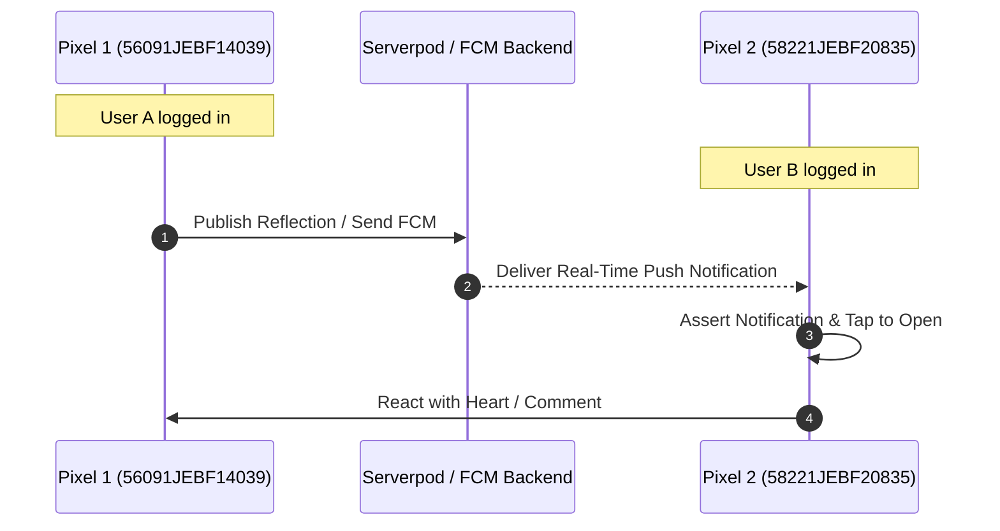

# Maestro MCP Server Device Automation & UI Verification Skill

This skill defines the complete operational guide, tool reference, and automation workflows for driving real physical Android devices (Google Pixels), Android emulators, Chromium web browsers, and Maestro Cloud via the **Maestro MCP Server** (`ServerName: 'maestro'`).

---

## 1. Complete Maestro MCP Tool Reference (10 Tools)

The Maestro MCP server provides 10 specialized tools across local device inspection/execution and cloud device testing:

### Local Automation Tools

| Tool Name | Parameters | Description |
| :--- | :--- | :--- |
| `list_devices` | *(none)* | Discovers all connected real hardware (Google Pixels), booted Android emulators, iOS simulators, and Chromium web targets. Returns device IDs, names, platforms, and connection states. |
| `inspect_screen` | `device_id` *(required)* | Dumps the active screen view hierarchy as compact JSON (`ui_schema` and `elements` tree with `b` bounds, `txt` text, `rid` resource ID, `a11y` accessibility label, `cls` class). Use before authoring flows to avoid hallucinated text strings. |
| `take_screenshot` | `device_id` *(required)* | Captures a high-resolution screenshot directly from the target hardware or emulator with **0 terminal approval prompts**. Returns image media URI. |
| `run` | `device_id` *(required)*, `yaml`, `files`, `dir`, `include_tags`, `exclude_tags`, `env` | Simulates user gestures, taps, text entry, scrolling, and assertions on the target device via declarative Maestro YAML. Exactly one of `yaml` (inline flow), `files` (file list), or `dir` (directory) must be provided. |
| `open_maestro_viewer` | *(none)* | Surfaces the live Maestro Viewer web URL (`http://127.0.0.1:9999/`) to view real-time screen mirroring, command traces, and interactive hierarchy trees. |
| `cheat_sheet` | *(none)* | Returns the comprehensive syntax manual for Maestro flow commands, selectors, conditional logic, JavaScript execution, and multi-screen flows. |

### Maestro Cloud Tools

| Tool Name | Parameters | Description |
| :--- | :--- | :--- |
| `list_cloud_devices` | *(none)* | Lists available real device models and OS versions on Maestro Cloud matrix (e.g. `android-34`, `iOS-17-5`). |
| `run_on_cloud` | `app_file` *(req)*, `flows` *(req)*, `device_model`, `device_os`, `name`, `project_id`, `env`, `include_tags`, `exclude_tags` | Submits app binary and flow files to Maestro Cloud for distributed execution. Returns `upload_id` and dashboard run URL. |
| `get_cloud_run_status` | `upload_id` *(req)*, `project_id` *(req)*, `include_flow_results` | Polls execution status (`SUCCESS`, `ERROR`, `CANCELED`, `RUNNING`) and per-flow results of a cloud upload. |
| `describe_cloud_run` | `run_id` *(req)*, `include_archive` | Retrieves metadata and signed download links for test artifacts (screen recordings, device logcat, and full zip archive including step-by-step screenshots and view hierarchies). |

---

## 2. Connected Device Hardware Matrix

Belong on the Spectrum development workstations feature active multi-device hardware:

1. **Pixel Hardware 1**: `56091JEBF14039` (Google Pixel real device, Android)
2. **Pixel Hardware 2**: `58221JEBF20835` (Google Pixel real device, Android)
3. **Android Emulator**: `emulator-5554` (Medium Phone API 37)
4. **Web Browser**: `chromium` (Chromium web automation target)

---

## 3. Local Execution Workflow

Always follow the standard 3-step loop:
`list_devices` -> `inspect_screen` / `take_screenshot` -> `run`

### Step 1: Discover Target Device
```json
call_mcp_tool(
  ServerName: "maestro",
  ToolName: "list_devices",
  Arguments: {}
)
```

### Step 2: Inspect Active Screen Hierarchy
```json
call_mcp_tool(
  ServerName: "maestro",
  ToolName: "inspect_screen",
  Arguments: {
    "device_id": "56091JEBF14039"
  }
)
```
> [!TIP]
> Always copy strings directly from `inspect_screen`'s `txt` or `a11y` attributes. Maestro regex matching is full-string; if text is `"Home Tab"`, matching `"Home"` will fail unless written as `"Home.*"`.

### Step 3: Run Flow on Target Hardware
```json
call_mcp_tool(
  ServerName: "maestro",
  ToolName: "run",
  Arguments: {
    "device_id": "56091JEBF14039",
    "yaml": "appId: com.belongonthespectrum.sanctuary\n---\n- assertVisible:\n    text: \".*\"\n- tapOn: \"Home\"\n"
  }
)
```

---

## 4. Multi-Device Synchronized Flows (Pixels 1 & 2)

When verifying multi-user flows (e.g. User A publishes a reflection or sends a direct message, and User B receives an FCM push notification and reacts):



1. Run publishing flow on `device_id: "56091JEBF14039"`.
2. Capture screenshot on Device 1 via `take_screenshot`.
3. Run reception and reaction flow on `device_id: "58221JEBF20835"`.
4. Capture screenshot on Device 2 via `take_screenshot`.

---

## 5. Live Maestro Viewer

Agents should surface the Maestro Viewer link so the user can watch execution in their browser:
- URL: **`http://127.0.0.1:9999/`**
- Tool: `call_mcp_tool(ServerName: "maestro", ToolName: "open_maestro_viewer", Arguments: {})`
