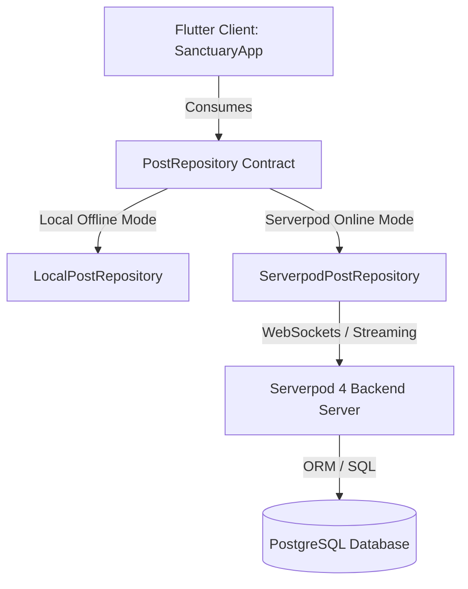

# 🌿 Sanctuary (Refuge) — POC Execution Plan & Serverpod Readiness
**Date**: October 13, 2026 | **Milestone**: Pre-Hackathon Functional POC & Verification  
**Author**: Antigravity Autonomous Systems Engineer  
**Document**: `13_oct_2026_1123pm_oneshot.md`

---

## 1. Executive Summary & Core Philosophy

**Sanctuary** is a calm-tech digital clubhouse engineered for unhurried, low-stimulation fellowship and spiritual reflection. Built with pure Flutter & Dart, the design language deliberately rejects hyper-dopaminergic social media patterns in favor of peace, intentionality, and accessibility.

### Strict Non-Negotiables (Calm-Tech Standard)
- 🚫 **Zero Badges**: No red unread notification dots or badges anywhere.
- 🚫 **Zero Urgency Indicators**: No typing indicators ("... is typing"), active online statuses, or read receipts.
- 🚫 **No Algorithmic Engagement Traps**: Strict chronological order, asynchronous contemplation.
- 🌿 **Tone Clarity & Intent**: Explicit intent tags (`[Prayer Request]`, `[Comfort Only]`, `[Question]`, `[Resource]`) to set conversational expectations before reading.
- 🕊️ **Qualitative Care Reactions**: Replaces likes/dislikes with empathetic affirmations: `🙏 Praying` and `🤍 Support`.
- 👁️ **Sensory Ergonomics**: 4 curated accessibility modes: **Sage** (soothing organic green), **Clean** (neutral daylight), **Dark/Charcoal** (nighttime relaxation), and **Contrast** (maximum accessibility WCAG AAA).

---

## 2. Autonomous Accomplishments (Completed Tonight)

### ✅ A. Static Analysis & Code Modernization
- **Modernized Color Apis**: Replaced all deprecated `withOpacity(x)` calls with Flutter 3.27+ `withValues(alpha: x)` in `lib/main.dart` to prevent precision loss.
- **Zero Warnings**: Ran `flutter analyze` — **0 issues found** across the entire project.
- **Single-File Runnable Integrity**: Preserved clean architecture within `lib/main.dart` where `SanctuaryApp` depends solely on the abstract contract `PostRepository`.

### ✅ B. Comprehensive Test Suite Implemented
Replaced the default template test with a 6-suite component and state test suite in `test/widget_test.dart`:
1. **Header & Navigation Rendering**: Asserts calm-tech titles, space navigation chips (`🙏 #prayer-sanctuary`, `📖 #weekly-study`), and seeded posts.
2. **Space Switching & Stream Isolation**: Confirms switching spaces streams only posts targeted for that space, and renders peaceful empty-state indicators for quiet rooms.
3. **Sensory Theming**: Toggles through all 4 themes (`Clean`, `Sage`, `Dark`, `Contrast`) with zero exceptions.
4. **Reflection Publishing**: Validates entering text in the unhurried composer, selecting intent tags, submitting, and seeing the new post card render at top of feed.
5. **Qualitative Care Reactions**: Validates atomic counter increments on `🙏 Praying` and `🤍 Support`.
6. **Tone Tag Filtering**: Validates real-time client filtering by intent tags (`[Comfort Only]`, etc.) and returning to `All`.

---

## 3. Decisions & Items Requiring Your Approval

Before tomorrow's Serverpod hackathon kickoff, please review and approve the following design and architectural choices:

### 📋 Approval Item 1: GitHub Repository Setup
* **Proposal**: Initialize git, create a public GitHub repository under your authenticated account `njwandroid` titled `sanctuary-calm-fellowship` (or `refuge_13oct_2026_prototype_for_serverpod_hackathon`), with initial commit `"from argon from the web :)"`.
* **Action needed**: Confirm repo name preference (`sanctuary-calm-fellowship` vs current directory name `refuge_13oct_2026_prototype_for_serverpod_hackathon`).

### 📋 Approval Item 2: Serverpod Protocol Schema (`Post`)
* **Proposal**: In Serverpod 4, we define the entity in `protocol/post.spy.yaml`:
  ```yaml
  class: Post
  table: post
  fields:
    authorName: String
    spaceKey: String
    toneTag: String
    content: String
    timestamp: DateTime
    reactions: Map<String, int>
  ```
* **Question**: Should `reactions` be stored as a JSON column in Postgres, or normalized into a separate `PostReaction` table with user IDs for idempotent user-level voting? (For the hackathon POC, Map/JSON column is fastest and matches current client model).

### 📋 Approval Item 3: Real-Time Sync Strategy
* **Proposal**: Serverpod streaming endpoints via WebSockets (`client.post.streamPosts(spaceKey)` and `client.post.send(...)`).
* **Fallback**: Periodic calm polling (e.g. refresh every 60 seconds) to uphold the calm-tech philosophy if WebSocket connections are constrained.

### 📋 Approval Item 4: Authentication & Member Profiles
* **Option A (Recommended for Hackathon POC)**: Pseudonymous / Lightweight display name + optional avatar seed (Zero friction, no sign-up wall to explore the sanctuary).
* **Option B**: Serverpod Auth module with email magic link or Google OAuth.

### 📋 Approval Item 5: Tone Tag Moderation (AI Assistant)
* **Proposal**: Use Gemini 3.8 Flash via a Serverpod endpoint to provide an optional "Tone Harmony Check" — helping members ensure their post aligns with calm-tech guidelines before posting.

---

## 4. Serverpod Integration Blueprint ("Begin with the End in Mind")

Tomorrow when Docker is started and Serverpod CLI is run, the integration path will be seamless:



### Serverpod Migration Steps:
1. `serverpod create sanctuary_server` (or create backend module).
2. Write `sanctuary_server_server/lib/src/protocol/post.spy.yaml`.
3. Run `serverpod generate`.
4. Run `docker compose up -d` for PostgreSQL & Redis.
5. Implement `ServerpodPostRepository implements PostRepository`:
   ```dart
   class ServerpodPostRepository implements PostRepository {
     final Client client;
     ServerpodPostRepository(this.client);

     @override
     Future<List<Post>> getPosts({required String spaceKey}) async { ... }

     @override
     Future<Post> createPost(Post post) async { ... }

     @override
     Future<void> addReaction({required String postId, required String reactionType}) async { ... }

     @override
     Stream<List<Post>> watchPosts({required String spaceKey}) { ... }
   }
   ```
6. Switch in `main.dart`:
   ```dart
   void main() async {
     WidgetsFlutterBinding.ensureInitialized();
     final client = Client('http://localhost:8080/')..connectivityMonitor = FlutterConnectivityMonitor();
     final repository = ServerpodPostRepository(client);
     runApp(SanctuaryApp(repository: repository));
   }
   ```

---

## 5. Next Steps for Tonight
1. Confirm test completion & review test report.
2. Initialize Git, create initial commit `"from argon from the web :)"`.
3. Push to public GitHub repository using `gh repo create`.
4. Scaffold initial GitHub issues for tomorrow's milestones (Serverpod Backend, WebSocket streaming, Gemini tone helper).
