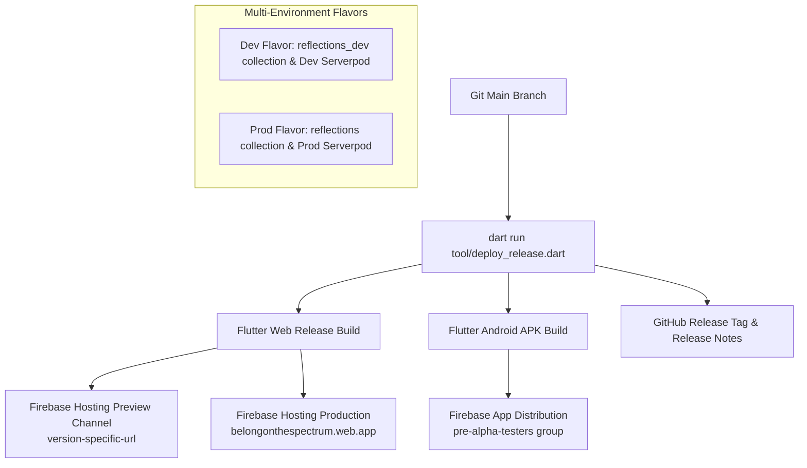

# 🚀 Belong on the Spectrum — Release & Deployment Guide (`DEPLOYMENT.md`)

*File: `DEPLOYMENT.md` (and `docs/wiki/deployment.md`)*  
*Maintained by: Belong on the Spectrum Engineering Team*  
*Target Platforms: Web PWA, Android Native (Google Play / App Distribution), Serverpod Backend*

---

## Soft-launch status (22 October 2026)

Checked against `origin/main` for the overlap week. This section does not record a new production deploy. The existing site remains [https://belongonthespectrum.web.app](https://belongonthespectrum.web.app).

- **Posts.** Serverpod is still the default post backend. Cloud Firestore is still the second copy. Appwrite has not replaced either. Appwrite is on `main` ([PR #412](https://github.com/neiljaywarner/refuge/pull/412), `fc71fd4`) and stays off unless both `APPWRITE_ENDPOINT` and `APPWRITE_PROJECT_ID` are set. [#384](https://github.com/neiljaywarner/refuge/issues/384) is not closed.
- **Android debug compile.** `android/app/build.gradle.kts` on `main` sets `jvmTarget` to `org.jetbrains.kotlin.gradle.dsl.JvmTarget.JVM_17`. That change is on `main` via [PR #413](https://github.com/neiljaywarner/refuge/pull/413). This note does not record a new debug build from the docs pass.
- **PostHog.** A smoke event was ingested. The app does not send product events unless `POSTHOG_KEY` or `POSTHOG_BELONG_PROJECT_TOKEN` is passed at build time. [Issue #410](https://github.com/neiljaywarner/refuge/issues/410) tracks that. Product conversion analytics are not live.
- **Feedback drawings.** Notes are saved in Firestore member_feedback with a clipboard handoff for organizers. The sheet does not say a note was filed on belong_feedback. The app does not embed an API token and does not create a GitHub issue by itself. Drawings stay with the note and are not presented as https://storage.belongonthespectrum.com uploads. [Issue #407](https://github.com/neiljaywarner/refuge/issues/407) is open.
- **Notifications.** The in-app bell exists. The launcher-dot MethodChannel (`com.belongonthespectrum.sanctuary/badge`) has no native handler. FCM permission requests set `badge: false`. [Issue #411](https://github.com/neiljaywarner/refuge/issues/411) is the test matrix and is not closed. Launcher badges and calm FCM are not fully verified on device.
- **Package name.** The Flutter package is still `refuge4serverpod`. Rename [Issue #233](https://github.com/neiljaywarner/refuge/issues/233) is not done.

---

## 📌 1. Deployment Architecture Overview

Belong on the Spectrum employs an unhurried, multi-environment continuous release pipeline designed to ship with confidence and zero downtime:



---

## 🏷️ 2. Multi-Environment Flavor Architecture

To ensure development, automated test suites, and CI/CD runs **never pollute production community reflections or notification streams**, the codebase strictly enforces flavor separation via `--dart-define=FLAVOR=...`:

| Flavor | Environment | Database Collection | Serverpod URL | Target Audience |
| :--- | :--- | :--- | :--- | :--- |
| **`dev`** | Development & CI | `reflections_dev` | `https://refuge4serverpod.api.serverpod.space/` (or local `http://10.0.2.2:8080/`) | Automated BDD tests, local emulators, continuous integration |
| **`stg`** | Staging | `reflections_stg` | Staging cluster | Pre-release rehearsal |
| **`prod`** | Production | `reflections` | `https://refuge4serverpod.api.serverpod.space/` | Real community members & churches |

### Running with Explicit Flavors
```bash
# Run in development mode (isolated dev collection)
flutter run -t lib/main_dev.dart --dart-define=FLAVOR=dev

# Run in production mode
flutter run -t lib/main_prod.dart --dart-define=FLAVOR=prod
```

---

## 🛠️ 3. One-Command Automated Release Pipeline

All release operations are consolidated into **`tool/deploy_release.dart`**. One command handles compilation, preview hosting generation, release note extraction, production deployment, and tester distribution:

```bash
# 1. Dry run: Verify release notes and command sequence without modifying anything
dart run tool/deploy_release.dart --version v0.8.0-alpha --dry-run

# 2. Preview deployment: Deploys a Firebase preview channel for internal audit
dart run tool/deploy_release.dart --version v0.8.0-alpha

# 3. Full production release: Ships Web PWA, Android APK, GitHub Release & App Distribution
dart run tool/deploy_release.dart --version v0.8.0-alpha \
  --prod \
  --github-release \
  --distribute-android \
  --highlights-file docs/release_highlights/v0.8.0-alpha.md
```

### Build identity

Every web and APK build this script compiles is stamped with three compile-time defines. The About Belong dialog reads them with `String.fromEnvironment` and shows the same values that were written into `build/web/version.json`.

| Define | Value | About dialog |
| :--- | :--- | :--- |
| `GIT_COMMIT_SHA` | Full 40-character hex from `git rev-parse HEAD` | Git commit, plus `https://github.com/neiljaywarner/refuge/commit/<sha>` |
| `BUILD_TIME_MS` | UTC Unix epoch milliseconds, captured once before `flutter build` | Build time, as ISO-8601 UTC and the same millisecond count |
| `RELEASE_TAG` | The `--version` flag (for example `v0.9.1`) | Release, when the define is non-empty |

`build/web/version.json` keeps its existing `version`, `build_number`, and `release_tag` fields and adds:

| Field | Example |
| :--- | :--- |
| `git_sha` | `0123456789abcdef0123456789abcdef01234567` |
| `build_time_ms` | `1792881722123` |
| `build_time_utc` | `2026-10-24T22:42:02.123Z` |

`--github-release` publishes those notes, so the GitHub tag's release body includes the SHA and the commit URL. The tag name stays the `--version` value.

`--skip-build` reuses artifacts already in `build/web` or `build/app`. It does not bake new defines into that binary and does not rewrite `version.json`.

A local `flutter run` that does not pass the defines shows Git commit `unknown`, build time `unknown`, and source `dev`. The app does not invent a SHA.

CI can pass the same three defines. On every push to `main`, [`.github/workflows/deploy.yml`](.github/workflows/deploy.yml) runs this script with `--prod`. Pull requests do not deploy. See [docs/wiki/CI-CD-FAQ.md](docs/wiki/CI-CD-FAQ.md).

```bash
flutter build web --release \
  --dart-define=GIT_COMMIT_SHA="$GIT_COMMIT_SHA" \
  --dart-define=BUILD_TIME_MS="$BUILD_TIME_MS" \
  --dart-define=RELEASE_TAG="$RELEASE_TAG"
```

---

## ⚙️ 4. CLI Flags & Options Reference

| Flag | Default | Description |
| :--- | :--- | :--- |
| `--version` | **Required** | Release tag / version string (e.g. `v0.8.0-alpha`) |
| `--channel` | `version` (dots→dashes) | Firebase Hosting preview channel name (e.g. `v0-8-0-alpha`) |
| `--prod` | `false` | Deploys directly to live production (`https://belongonthespectrum.web.app`) |
| `--github-release` | `false` | Automatically creates/updates the official GitHub Release with changelog |
| `--distribute-android` | `false` | Builds release APK and uploads to Firebase App Distribution |
| `--android-app-id` | Auto-detected | Firebase Android App ID (`$FIREBASE_ANDROID_APP_ID`) |
| `--groups` | `pre-alpha-testers` | Tester group aliases in Firebase Console |
| `--highlights-file` | `none` | Path to custom markdown highlights prepended to release notes |
| `--attach` | `none` | Repeatable file path(s) to attach to GitHub Release (e.g. screenshots/videos) |
| `--skip-build` | `false` | Skips the Flutter build and does not re-stamp dart-defines. Deploys existing artifacts in `build/web` or `build/app` |
| `--dry-run` | `false` | Previews release notes and actions without executing builds or deploys |

---

## 🧪 5. Pre-Deployment Verification Checklist

Before running a production deployment:

1. **Verify Static Analysis**:
   ```bash
   dart analyze .
   ```
2. **Run Full Test Suite**:
   ```bash
   flutter test
   ```
3. **Verify Serverpod Backend Status**:
   ```bash
   curl -I https://refuge4serverpod.api.serverpod.space/
   ```
4. **Inspect Firebase Hosting Preview Channel**:
   Navigate to the temporary preview channel URL output by `deploy_release.dart` (e.g. `https://belongonthespectrum--v0-8-0-alpha-xyz.web.app`) and verify navigation, sensory themes, and offline caching.

---

## ⏪ 6. Rollback & Incident Recovery

If an issue arises in production:

### Instant Web Rollback (Firebase Hosting)
```bash
# View recent deployment history
firebase hosting:channel:list

# Instant rollback via Firebase Console or rollback deploy
firebase hosting:clone belongonthespectrum:<PREVIOUS_VERSION_CHANNEL> belongonthespectrum:live
```

### Serverpod Reconnect Fallback
The client code is built with resilient dual-cloud fallback: if Serverpod is unreachable, the app automatically fails over to Cloud Firestore (`reflections` collection) and local in-memory storage, ensuring zero blackouts for active community members.

---

## 7. GitHub Actions

Two workflows live in `.github/workflows/`.

### Pull request CI (`.github/workflows/ci.yml`)

On every pull request and `workflow_dispatch`:

1. `dart format --output=none --set-exit-if-changed` on the files this pipeline owns. The rest of the tree is not format-clean yet ([#519](https://github.com/neiljaywarner/refuge/issues/519)). Page width stays at the SDK default until that sweep.
2. `dart analyze packages/belong_lints`, then `dart analyze` for the whole package. The job fails if `no_print_use_app_logger`, `prefer_use_text_editing_controller`, or pyramid_lint `dispose_controllers` appears. Older analyzer errors already on `main` do not fail this step. `dart analyze` is the command that loads these plugins.
3. `flutter test --coverage` on the compiling slice: build identity, text tokens, About, and the coverage tool. The whole `flutter test` tree does not compile until `home_screen.dart` matches the widgets it calls.
4. Line coverage floor of 40% on the lines that slice loads, via `dart run tool/check_line_coverage.dart --min 40`.

Flutter is pinned to 3.47.7. There is no spell check and no 100% coverage gate.

Local hooks match the fast part of that list. Install them with `dart run tool/install_git_hooks.dart`.

### Production deploy (`.github/workflows/deploy.yml`)

On every push to `main`, and on `workflow_dispatch`:

1. Checkout the full history so release notes can see tags.
2. Run `dart run tool/deploy_release.dart --version ci-<short-sha> --prod`.
3. The script builds web with `GIT_COMMIT_SHA`, `BUILD_TIME_MS`, and `RELEASE_TAG`, writes `build/web/version.json`, deploys a 14-day Hosting preview channel, then deploys production Hosting.

A manual run can choose a dry run (no Firebase), skip production, or also upload an APK to App Distribution. Automatic pushes do not create a GitHub Release and do not upload an APK.

### Secrets

Store these in GitHub repository secrets. Do not commit them.

| Secret | Required | Purpose |
| :--- | :--- | :--- |
| `FIREBASE_SERVICE_ACCOUNT` | One of this or `FIREBASE_TOKEN` | Service account JSON with Firebase Hosting admin on project `belongonthespectrum` |
| `FIREBASE_TOKEN` | One of this or `FIREBASE_SERVICE_ACCOUNT` | Firebase CI token, used when the service account secret is empty |
| `FIREBASE_ANDROID_APP_ID` | Only for App Distribution | Android app id. The script can try to detect one when this is unset |

Dry run from the Actions tab does not need the secrets.

### Dependabot

[`.github/dependabot.yml`](.github/dependabot.yml) opens weekly pull requests for the root pub package, `packages/belong_lints`, the Serverpod client and server packages, and GitHub Actions. Minor and patch updates are grouped. Nothing auto-merges. CI on the dependency PR must pass.

Troubleshooting: [docs/wiki/CI-CD-FAQ.md](docs/wiki/CI-CD-FAQ.md).

