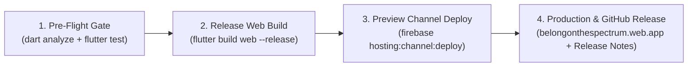

# 🚀 Deployment & Release Runbook (`DEPLOYMENT.md`)

> **Production Web & PWA URL**: [`https://belongonthespectrum.web.app`](https://belongonthespectrum.web.app)
> **Firebase Console**: [`https://console.firebase.google.com/project/belongonthespectrum/overview`](https://console.firebase.google.com/project/belongonthespectrum/overview)
> **Primary Automation CLI**: [`tool/deploy_release.dart`](tool/deploy_release.dart) & [`tool/refuge_cli.dart`](tool/refuge_cli.dart)
> **Related Docs**:
> * [`unattended_session_908pm.md`](https://github.com/neiljaywarner/refuge/blob/main/unattended_session_908pm.md)
> * [`neil_to_review_sunday_night.md`](https://github.com/neiljaywarner/refuge/blob/main/neil_to_review_sunday_night.md)
> * [`ADR-0006: Dev vs. Prod Flavor Strategy`](docs/adr/0006-firebase-flavors-dev-prod.md)
> * [`ADR-0009: Serverpod, Appwrite & Firebase Hybrid Architecture`](docs/adr/0009-piece-by-piece-vs-one-shot-appwrite-firebase-hybrid.md)
> * [GitHub Issue #56 (Minimum Viable Deployment Process)](https://github.com/neiljaywarner/refuge/issues/56)
> * [GitHub Issue #57 (GitHub Actions CI/CD Auto-Deploy)](https://github.com/neiljaywarner/refuge/issues/57)
> * [GitHub Issue #58 (Multi-Channel Release Notes & App Distribution)](https://github.com/neiljaywarner/refuge/issues/58)
> * [GitHub Issue #59 (`week1` Neurodivergent Audio MP3 Release Notes)](https://github.com/neiljaywarner/refuge/issues/59)

---

## 1. Philosophy: Calm, Verifiable, Zero-Surprise Releases

Every release of **Belong on the Spectrum** follows a 4-step deterministic pipeline implemented in pure Dart ([`tool/deploy_release.dart`](tool/deploy_release.dart)):



1. **Pre-Flight Quality Gate**: Zero analyzer errors and 100% passing unit + BDD widget tests (`patrolWidgetTest`).
2. **Structured Human + Neurodivergent-Friendly Release Notes**: Every deployment auto-generates clear bulleted release notes (`build/RELEASE_NOTES_<version>.md`) summarizing *What's New for Community Members*, *What's New for Organizers*, and *Engineering/PR Links* (plus prepares the script for **Issue #59: 60-Second Audio MP3 Release Notes**).
3. **Firebase Hosting Preview Channel First**: Deploys to an isolated preview URL (e.g. `https://belongonthespectrum--v0-8-0-alpha-<hash>.web.app`) expiring in 14 days so organizers can preview before or alongside production.
4. **Live Production Web/PWA Deploy (`https://belongonthespectrum.web.app`) + GitHub Release**: Pushes to the default `belongonthespectrum` site and publishes the tagged GitHub Release (`gh release create`).

---

## 2. One-Command Pure-Dart Deployment (`tool/deploy_release.dart`)

We prefer **pure Dart** over fragile bash scripts so it runs identically on macOS Apple Silicon and Linux CI runners:

### Standard release (web prod + preview + GitHub Release)
```bash
dart run tool/deploy_release.dart --version v0.7.0 --prod --github-release
```

### Full release incl. Android APK → App Distribution (`pre-alpha-testers`)
```bash
dart run tool/deploy_release.dart --version v0.8.0-alpha --prod --github-release \
  --distribute-android \
  --highlights-file docs/release_highlights/v0.8.0-alpha.md
```
Firebase emails every tester in the group the same notes, including the web preview link, so testers get **Android + Web in one email**. The Android app id is auto-detected (`firebase apps:list ANDROID`) or passed with `--android-app-id` / `FIREBASE_ANDROID_APP_ID`. Tester emails live only in the Firebase console, never in this repo.

### Dry run (print notes, deploy nothing)
```bash
dart run tool/deploy_release.dart --version v0.7.0 --dry-run
```

### How release notes are built
1. Optional hand-written **Highlights** (`--highlights-file`): plain language, for members.
2. **Changes**: merged commit titles since the previous tag (`git describe --tags HEAD^`), so notes only list what actually shipped.
3. Fixed "How to try it" and "Feedback" sections.

### Release discipline checklist
- [ ] `main` is green: `analyze_files` + `run_tests` (Dart MCP) pass.
- [ ] Every merged PR got a CodeRabbit review (`dart run tool/refuge_cli.dart review-status <N>`).
- [ ] `dart run tool/refuge_cli.dart privacy-scan` is clean on new files.
- [ ] Dry run reviewed; highlights mention only shipped features.
- [ ] After deploy: open the prod URL and the preview URL; tap Feedback & Vote once.

### Troubleshooting
| Symptom | Fix |
| :--- | :--- |
| `JAVA_HOME is set to an invalid directory` | `flutter config --jdk-dir "/Applications/Android Studio.app/Contents/jbr/Contents/Home"` |
| `LicenceNotAcceptedException` / `sdkmanager not found` | Install **Android SDK Command-line Tools** in Android Studio → SDK Tools, then `flutter doctor --android-licenses` (maintainer must accept) |
| `firebase`/`gh` 401 inside an AI sandbox | Re-run that command outside the sandbox (keychain access) |
| `Unable to add channel domain to Firebase Auth` | Harmless until Firebase Auth is enabled; ignore |
| `No Firebase Android app found` | `firebase apps:list ANDROID --project belongonthespectrum`, then pass `--android-app-id` |

---

## 3. Firebase MCP Server & CLI Coexistence

- **Firebase MCP Server (`firebase mcp`)**: Configured in `~/.gemini/config/mcp_config.json` with `--dir` set to the absolute path of the repo root (`refuge_cli configure-mcp` fills this in from the current directory). Agents should prefer Firebase MCP tools for inspecting project configuration, Remote Config keys, Hosting sites, and Analytics/Crashlytics state.
- **Firebase CLI (`/opt/homebrew/bin/firebase`)**: Invoked by `tool/deploy_release.dart` for uploading compiled `build/web` static bundles to `belongonthespectrum.web.app` and preview channels.

---

## 4. Roadmap of Deployment Improvements (Tracked in GitHub Issues)

| Issue | Milestone | Summary |
| :---: | :---: | :--- |
| **[#56](https://github.com/neiljaywarner/refuge/issues/56)** | `v0.5.5` / `v0.6.0` | **Minimum Viable Deployment Process**: `tool/deploy_release.dart` + `DEPLOYMENT.md` + auto-generated release notes for `belongonthespectrum.web.app` & preview channels. |
| **[#57](https://github.com/neiljaywarner/refuge/issues/57)** | `v0.8.0-alpha` | **GitHub Actions CI/CD Auto-Deployment**: Automatically deploy every PR to a Firebase Hosting Preview Channel and comment the live URL on the PR; auto-deploy `main` tags to `belongonthespectrum.web.app`. |
| **[#58](https://github.com/neiljaywarner/refuge/issues/58)** | `v0.9.0-rc` | **Multi-Channel Release Pipeline & Rollback Gate**: Unify Web PWA, Android APK/AAB (Firebase App Distribution), and iOS IPA/TestFlight release notes with 1-command atomic rollback. |
| **[#59](https://github.com/neiljaywarner/refuge/issues/59)** | `v1.0.0` (`week1` label) | **Neurodivergent-Friendly Audio MP3 Release Notes**: Generate a warm, calm 60-second `.mp3` spoken audio summary for every release so community members can listen instead of reading changelog walls of text. |
