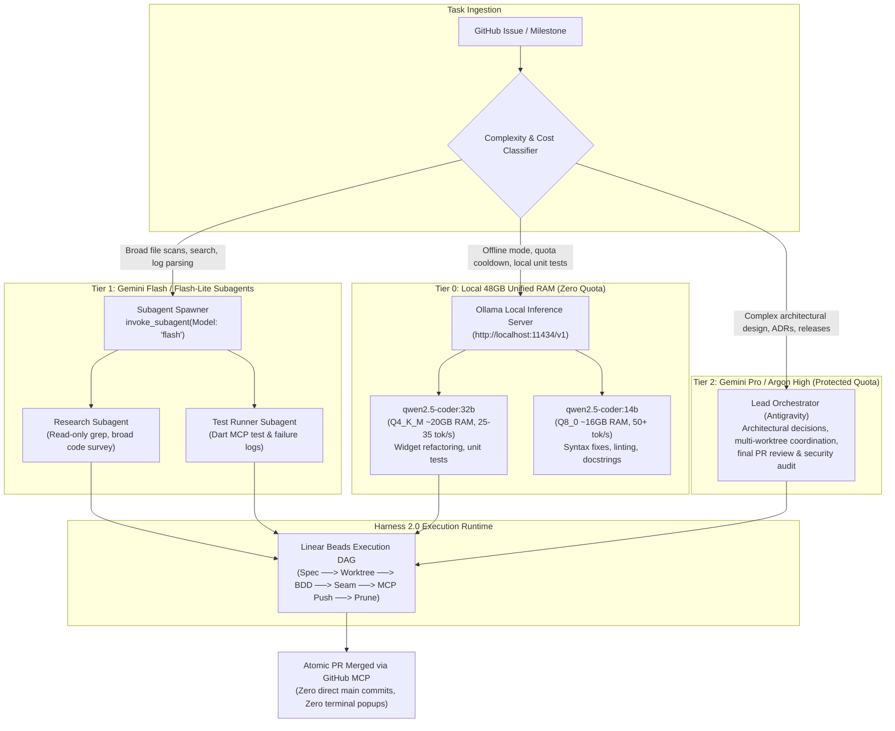
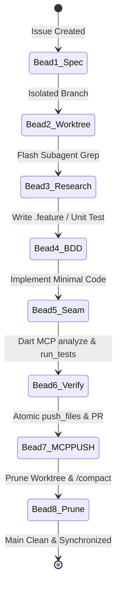

# 📿 Agent Harness 2.0: Orchestrator Topology & Multi-Model Quota Preservation

> **Canonical System Specification**: Agent execution architecture, subagent orchestration patterns, token quota preservation, and local 48GB Apple Silicon fallback routines for **Belong on the Spectrum** and **Refuge**.  
> **Companion Wiki Document**: [`docs/wiki/Agent-Harness-and-Token-Orchestration.md`](wiki/Agent-Harness-and-Token-Orchestration)  
> **Tracking Issue**: [Issue #114](https://github.com/neiljaywarner/refuge/issues/114)  
> **Target Machine**: Apple Silicon Mac (48 GB Unified Memory)  
> **Target Models**: Gemini Pro / Argon High (Tier 2), Gemini Flash / Flash-Lite (Tier 1), Ollama Qwen 2.5 Coder 32B/14B (Tier 0)

---

## 1. Executive Summary & Problem Formulation

During intensive autonomous engineering sessions, reliance on a single monolithic, top-tier model (**Gemini Pro** / **Argon High**) for every operation—including broad directory grepping, full-file inspections, mechanical lint fixes, git worktree orchestration, and status dashboard syncs—leads to severe quota depletion across two distinct throttles:
1. **5-Hour Rolling Burst Window**: Throttles request frequency when input token volume spikes over a continuous 300-minute interval.
2. **7-Day Weekly Cap**: Hard ceiling that shuts down high-tier reasoning for the remainder of the week if burned prematurely on routine tasks.

### The Solution: Agent Harness 2.0
**Agent Harness 2.0** decouples high-level architectural orchestration from mechanical execution. By combining:
- A **Hierarchical Orchestrator-Subagent Topology**
- An externalized **"Beads" Execution State DAG**
- A **3-Tier Model Routing Hierarchy** (Local 48GB Mac → Gemini Flash → Gemini Pro)
- **Zero-Approval GitHub & Dart MCP Protocols**

We preserve **80–90% of Gemini Pro quota** for genuine domain modeling, security seams, and release cutover decisions, ensuring continuous development even if cloud quotas are exhausted.

---

## 2. Visual Knowledge Graph: Multi-Model Routing & Quota Defense



---

## 3. The 3-Tier Model Allocation Matrix

| Tier | Model / Engine | Hardware / Cost | Primary Responsibilities | Token Cost Ratio |
| :--- | :--- | :--- | :--- | :---: |
| **Tier 0** | **Ollama `qwen2.5-coder:32b` & `14b`** | Local Apple Silicon (48GB RAM, Metal GPU) | • Offline fallback when quota exhausted<br>• Local unit tests & mechanical linting<br>• Zero-cost exploratory scratch coding | **0% API Cost** (100% Free / Infinite) |
| **Tier 1** | **Gemini Flash / Flash-Lite** | Cloud Subagent via `invoke_subagent` | • Broad codebase grepping and file discovery<br>• Reading test output and parsing stack traces<br>• Mechanical documentation formatting | **~5%–10%** of Pro token consumption |
| **Tier 2** | **Gemini Pro / Argon High** | Cloud Lead Orchestrator | • Architecture Decision Records (ADRs)<br>• Multi-worktree cross-cutting refactoring<br>• Core security rules & release validation | **100%** (Reserved for high-leverage tasks) |

---

## 4. 📿 The "Beads" Sequential Execution State DAG

Agent conversation context windows expand quadratically in cost as session turns accumulate. If an agent carries 50 turns of file diffs and tool logs in memory, every new request costs 100k+ input tokens.

**Harness 2.0** uses an externalized, state-preserving **Chain of Beads**. Each bead represents an atomic state transition persisted to disk or GitHub:



### Bead Definitions & Discipline

1. **Bead 1: Specification (`issue_read`)**:
   - Issue description contains explicit acceptance criteria and file boundaries. No unbounded brainstorming inside the main loop.
2. **Bead 2: Worktree Isolation (`git worktree add`)**:
   - Never develop on `main`. Create worktree at `/Users/neil/belongonthespectrum/.worktrees/issue-<NUM>-<slug>`.
3. **Bead 3: Targeted Subagent Research (`invoke_subagent`)**:
   - Delegate broad search to a `flash` subagent. The subagent returns a concise 5-line summary rather than cluttering parent context with 500 lines of grep.
4. **Bead 4: Behavioral Specification (BDD / TDD)**:
   - Write human-readable Gherkin `.feature` or unit test first.
5. **Bead 5: Seam Implementation**:
   - Edit only files within the ticket seam.
6. **Bead 6: Verification via MCP Tools**:
   - `analyze_files` and `run_tests` executed directly via Dart MCP server.
7. **Bead 7: Zero-Approval GitHub MCP Push & PR**:
   - Push commit via `push_files`. Open PR referencing `Closes #<NUM>`. Squash-merge via `merge_pull_request`.
8. **Bead 8: Prune & Reset (`/compact`)**:
   - Delete worktree, update `status.md`, and recommend `/compact` so the next ticket begins with near-zero input token overhead.

---

## 5. Local 48GB Apple Silicon Fallback (Tier 0 Setup)

With **48 GB of Unified Memory**, an Apple Silicon Mac can run state-of-the-art open-weights coding models locally using Metal GPU acceleration without swapping.

### Recommended Ollama Configuration (`~/.ollama/`)

```bash
# 1. Install & launch Ollama
brew install ollama
ollama serve

# 2. Pull optimal Qwen 2.5 Coder models for 48GB RAM
# Primary architectural workhorse (~20 GB unified memory footprint):
ollama pull qwen2.5-coder:32b

# High-speed utility model for lints & single-file edits (~9 GB footprint):
ollama pull qwen2.5-coder:14b
```

### Resource Allocation on 48GB Apple Silicon

```
┌────────────────────────────────────────────────────────────────────────┐
│                   48 GB UNIFIED MEMORY ALLOCATION                      │
├────────────────────────────────────────────────────────────────────────┤
│ 1. macOS System & Display:                             ~6 GB           │
│ 2. Flutter Toolchain & Android Emulator:               ~8 GB           │
│ 3. Ollama Metal GPU Cache (qwen2.5-coder:32b Q4_K_M):  ~20 GB          │
│ 4. Available Headroom & Buffer:                        ~14 GB          │
└────────────────────────────────────────────────────────────────────────┘
```

When cloud quota cools down or is reserved for architecture, the local endpoint (`http://localhost:11434/v1`) processes unlimited requests with **zero token cost and zero network dependency**.

---

## 6. Ten Golden Quota Preservation Rules

1. **Never Dump Full Files**: Use `view_file` with precise `StartLine` and `EndLine` slices (max 50–100 lines) instead of full-file reads.
2. **Delegate Broad Grep to Flash Subagents**: When searching the repo for keywords, spawn an `invoke_subagent(Model: 'flash')` rather than executing wide terminal searches in the primary context.
3. **Execute Non-Interactive GitHub MCP Calls**: Always use `push_files`, `create_pull_request`, and `merge_pull_request`. Terminal `git push` hangs on credential prompts and wastes tokens in wait loops.
4. **Trigger `/compact` Every 2–3 Merged PRs**: Long transcripts carry expensive historical tokens into every subsequent call. Compact regularly.
5. **Persist State to Disk, Not Working Memory**: Master state belongs in `status.md`, `human_to_review_after_session.md`, and `docs/wiki/`. When restarting, the agent reads only the top summary lines.
6. **Run Pre-Checks via Dart MCP**: Always run `analyze_files` via Dart MCP to catch syntax errors before opening PRs, preventing failed CI cycles.
7. **Use Strict `1 Issue = 1 Worktree = 1 PR`**: Small, surgical PRs require 90% fewer tokens to generate, review, and merge than monolithic changes.
8. **Rotate Model Tiers During Sprints**: After 45 minutes of heavy Gemini Pro execution, rotate 1–2 tickets to Flash or local Ollama to allow the 5-hour rolling window to reset.
9. **Zero-PII Scanning via Local Regex**: Run `tool/refuge_cli.dart privacy-scan` locally to prevent accidental credentials or personal identifiers from reaching Git.
10. **Separate Non-Technical and Technical Documentation**: Prevent non-technical contributors and automated scrapers from loading heavy architectural specifications unnecessarily.
