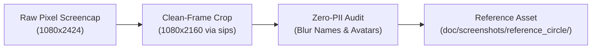

# 🧭 Careful Maestro Driving & Discovery Guide: Circle App on Pixel 9a

**Target App:** `so.circle.circle` (*Circle - Communities*, CircleCo Inc.)  
**Target Hardware:** Google Pixel 9a (`56091JEBF14039` or `58221JEBF20835`)  
**Tracking Issue:** [Issue #255](https://github.com/neiljaywarner/refuge/issues/255)  
**Flow Specification:** `.maestro/circle_app_discovery_careful.yaml`

---

## 1. Safety Guardrails & Zero-Destruction Guarantee

Driving a live commercial app with an active logged-in user account requires strict defensive controls:

1. **`clearState: false`**: Never clear app cache, local storage, or keychain state. The maintainer's authenticated community session must remain intact.
2. **Strictly Read-Only Traversal**: Under no circumstances should any Maestro tap simulate post creation, draft saving, comment publishing, channel joining/leaving, account deletion, or logging out.
3. **Safe Return Guarantee**: Every navigation sequence ends with explicit `back` commands to return the app safely to the root feed before closing.
4. **Live Human Oversight**: Always open the Maestro Viewer (`http://127.0.0.1:9999/`) prior to execution so the live viewport hierarchy is visible to the engineer.

---

## 2. Pre-Flight Verification Checklist

Before launching the Maestro discovery flow:

- [ ] **Step 1: Check Physical Pixel Connectivity**
  ```json
  call_mcp_tool(
    ServerName: "maestro",
    ToolName: "list_devices",
    Arguments: {}
  )
  ```
  Verify device `56091JEBF14039` or `58221JEBF20835` reports `"connected": true`.

- [ ] **Step 2: Verify Circle Installation**
  Verify package `so.circle.circle` is present on the device.

- [ ] **Step 3: Open Maestro Viewer**
  ```json
  call_mcp_tool(
    ServerName: "maestro",
    ToolName: "open_maestro_viewer",
    Arguments: {}
  )
  ```
  Surfaces `http://127.0.0.1:9999/` for real-time visual monitoring.

---

## 3. Execution Procedure

### Method A: Direct Maestro MCP Invocation (Zero Terminal Prompts)
```json
call_mcp_tool(
  ServerName: "maestro",
  ToolName: "run",
  Arguments: {
    "device_id": "56091JEBF14039",
    "files": [".maestro/circle_app_discovery_careful.yaml"]
  }
}
```

### Method B: Standalone Pre-Approved Script
```bash
/Users/neil/belongonthespectrum/refuge/tool/run_maestro_verification.sh
```

---

## 4. Post-Execution Zero-PII Sanitization & Clean-Framing Protocol

Captured screenshots must be sanitized before being added to any git repository or documentation:



### 1. Clean-Framing (Stripping Status Bars & Navigation Pills)
Physical Pixel captures contain battery percentage, WiFi/cellular signal, clock time, and Android navigation pills.
Using `sips` (standard macOS graphics utility, zero network):
```bash
sips -c 2160 1080 /tmp/raw_screenshot.png --out doc/screenshots/reference_circle/01_circle_clean.png
```

### 2. PII Redaction Audit
Examine the cropped screenshot to ensure:
- [ ] No member full names are visible.
- [ ] No personal avatar photos or selfies are legible.
- [ ] No private Slack/Circle community URLs or access invite codes are shown.
- [ ] No personal push notifications or system toast messages are visible.
