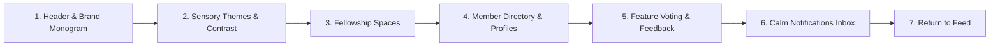

# 🎭 Marionette Live Demo Driver & Feature Showcase Guide

## Overview
The Marionette Live Demo Driver (`tool/marionette_demo.dart` and `tool/marionette_demo.sh`) provides an automated and interactive command-line experience for driving **Belong on the Spectrum** live on connected hardware (Google Pixel 9a, Pixel 8), Android emulators (`emulator-5554`), and Chrome browsers.

It was created under **Issue #380** to provide developers, testers, and stakeholders with an instant, repeatable way to experience the full calm-tech feature suite without manual tapping.

---

## 🚀 Quick Start

### 1. Launch Belong on Your Target Device
```bash
# On physical Google Pixel:
flutter run -d 56091JEBF14039

# On Android Emulator:
flutter run -d emulator-5554

# On Chrome Browser:
flutter run -d chrome
```

### 2. Run the Feature Showcase
In a second terminal window:
```bash
# Auto-detects device, grants permissions, and runs the tour:
dart run tool/marionette_demo.dart

# Or use the convenience bash wrapper:
tool/marionette_demo.sh
```

---

## 🎛️ Command-Line Options & Flags

| Flag | Short | Default | Description |
| :--- | :---: | :---: | :--- |
| `--help` | `-h` | - | Displays banner, usage instructions, and examples |
| `--device` | `-d` | `auto` | Target device ID (`56091JEBF14039`, `58221JEBF20835`, `emulator-5554`, `chrome`) |
| `--uri` | `-u` | `auto` | Explicit VM Service WebSocket URI (e.g. `ws://127.0.0.1:56283/token=/ws`) |
| `--speed` | `-s` | `normal` | Pacing between steps: `slow` (3.0s), `normal` (1.5s), or `fast` (0.5s) |
| `--interactive` | `-i` | `false` | Pauses between each feature milestone with an `[Enter]` prompt |
| `--capture` | `-c` | `false` | Captures high-resolution ADB screenshots into `/tmp/` at each milestone |
| `--no-grant-permissions` | - | `false` | Skips automatic `android.permission.POST_NOTIFICATIONS` ADB grant |
| `--dual` | - | `false` | Runs multi-device synchronized flow (e.g., Pixel 1 + Pixel 2 or Pixel + Chrome) |

---

## 🎬 7 Core Feature Milestones

The showcase script exercises Belong's signature calm-tech features:



1. **Header & Brand Monogram**:
   - Inspects the warm cream Belong infinity mark (`♾️`), Psalm 139 scripture anchor, and resilient connection indicator.
2. **Sensory Themes & Contrast**:
   - Toggles High Contrast mode (ultra-high contrast black and yellow palette) to reduce sensory overwhelm, validates responsiveness, and returns to Sage theme.
3. **Fellowship Spaces Directory**:
   - Switches tabs from Feed to Spaces to display organized rooms (Prayer Requests, Actually Autistic Events, Sensory Spaces).
4. **Member Profiles & Monograms**:
   - Opens Member Directory, highlighting member cards, comfort badges (e.g., *Literal communication appreciated*, *Sensory Sensitive*), and computed initials.
5. **Feature Voting & Feedback**:
   - Displays community feature upvoting and neurodivergent feedback submission sheet.
6. **Calm Notifications Inbox**:
   - Demonstrates unhurried notifications with filter chips (*Inbox*, *Mentions*, *Threads*, *Following*).
7. **Return to Feed**:
   - Returns seamlessly to the main sanctuary timeline.

---

## 👥 Multi-Device Scenarios

### Pixel + Android Emulator
```bash
# Drive Pixel 9a
dart run tool/marionette_demo.dart -d 56091JEBF14039 --capture

# Drive Emulator side-by-side
dart run tool/marionette_demo.dart -d emulator-5554 --speed fast
```

### Pixel + Chrome Desktop
```bash
dart run tool/marionette_demo.dart -d chrome
```

---

## 🛠️ Verification & Testing
The CLI tool is tested via Dart unit tests in `test/tool/cli_tools_test.dart` and real device verification via `adb`.
To verify help output directly:
```bash
dart run tool/marionette_demo.dart --help
```
