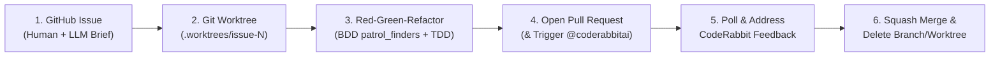

# 🎫 Ticket-Driven Development, Worktrees & CodeRabbit PR Lifecycle

*Canonical Engineering Process for **Belong on the Spectrum (`refuge`)***
*Last Updated: October 18, 2026 (`2026-10-18T20:00:00-05:00`)*

---

## 🎯 Why We Use Strict Ticket-Driven Development

This repository is designed both to **ship our production Circle.so replacement before October 31, 2026** and to serve as an **exemplary teaching codebase for Flutter apprentices, mentees, and AI pair-programmers** (Epic `#38`).

By enforcing **`1 GitHub Issue = 1 Git Worktree = 1 Atomic Pull Request`**, anyone inspecting our commit history, Pull Requests, or GitHub Issues can trace *why* every line of code was written.

---

## 🔄 The 6-Step Ticket Lifecycle



### Step 1: Dual-Audience GitHub Issue
Every ticket on [`https://github.com/neiljaywarner/refuge/issues`](https://github.com/neiljaywarner/refuge/issues) includes:
1. **Human & Mentoring Summary**: Plain-English explanation of user value, sensory/accessibility impact, and acceptance criteria.
2. **`🤖 LLM Execution Brief` Comment**: Recommended model tier (`Argon Low/Medium` vs `High`), exact worktree creation command, target files under CodeWithAndrea's `lib/src/features/<feature>/{domain,data,application,presentation}/` layers, and verification commands.

### Step 2: Isolated Git Worktree (Leveraging 48GB Apple Silicon RAM)
Instead of switching branches in a single working directory, we spin up isolated worktrees under `/Users/neil/belongonthespectrum/.worktrees/`:
```bash
git -C /Users/neil/belongonthespectrum/refuge worktree add \
  /Users/neil/belongonthespectrum/.worktrees/issue-18-circle-home-navigation \
  -b feat/#18-circle-home-navigation
```

### Step 3: Pragmatic TDD + BDD (`patrol_finders` & `bdd_widget_test`)
- **Pure Business Logic -> TDD**: Write a failing unit test first for domain logic (`CommunityBrandConfig`, `OrganizerRemoteConfigService`, `FeatureVotingNotifier`, CSV importers), make it pass, and refactor.
- **User Flows & UI -> BDD Widget Tests with `patrol_finders`**: Write readable Gherkin scenarios or `patrolWidgetTest` specs using intuitive `$` finders (`$(#nav_spaces).tap()`, `$('Geek Out!').waitUntilVisible()`).
- **Verify via Dart MCP (`Zero Sandbox Prompts`)**: Run `analyze_files` and `run_tests` before every commit.

### Step 4: Open Pull Request & Trigger CodeRabbit
Use `tool/refuge_cli.dart` (or `gh pr create`) to push the branch and open a PR against `main`, immediately commenting `@coderabbitai review`.

### Step 5: Poll & Address CodeRabbit Comments
During active development sessions, our automation (`dart run tool/refuge_cli.dart triage-prs`) polls open PRs for CodeRabbit review comments:
- **Blocking / Bug / Security Comments**: Fixed immediately in the worktree before merge.
- **Nitpicks / Follow-up Ideas**: Logged to our release-level CodeRabbit gate (Issue `#36`) if merging immediately is required to unblock a preview deployment.

### Step 6: Squash Merge & Delete Branch
Once tests and static analysis pass, merge the PR and delete the branch + worktree:
```bash
gh pr merge <PR_NUMBER> --repo neiljaywarner/refuge --squash --delete-branch
git -C /Users/neil/belongonthespectrum/refuge worktree remove /Users/neil/belongonthespectrum/.worktrees/issue-<NUM>-<slug>
```
