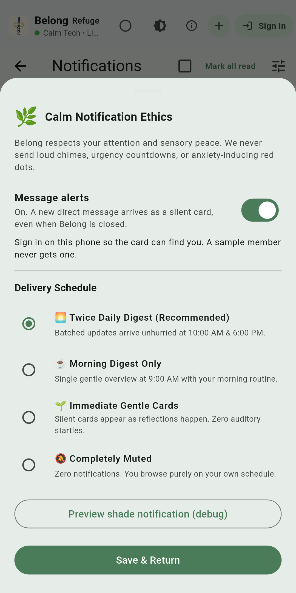

# Direct message alerts

> **Decision**: [ADR-0012](https://github.com/neiljaywarner/refuge/blob/main/docs/adr/0012-direct-message-alerts-are-opt-in.md)
> **Issue**: [#571](https://github.com/neiljaywarner/refuge/issues/571)
> **Product page**: [Gentle notifications](Notifications-Product-Guide)
> **Checked**: October 24, 2026, on Pixel Left and Pixel Right

A direct message can arrive as a normal notification, with sound. Nothing is sent until you turn **Message alerts** on. Immediate Gentle Cards is the quiet choice.

## What you do

1. Open **Notifications**.
2. Open **Calm Notification Preferences**.
3. Turn **Message alerts** on.
4. Sign in on that phone.

The switch starts off. Turning it on asks Android for permission once. After that, the phone remembers the choice, including the next time you open Belong.

The card has no chime and no red badge. The words say who wrote, then a short piece of the message.

If the phone is not signed in, the switch can still be on, but the card has nobody to find. The sheet says so: "Sign in on this phone so the card can find you."

Sample members (Marty, Caleb Stone, Sarah Chen) are practice names. A message to them stays on your phone. It does not push, and it does not email.

Completely Muted still sends nothing.

## What this does not do yet

The sending code is in the repo. It is not running in the cloud. The Firebase project has to move to the Blaze plan before that function can be deployed. Until then, turning the switch on saves your choice and, once you are signed in, saves a private token. It does not yet deliver a card to another phone.

Email when a message arrives is a later item, [#570](https://github.com/neiljaywarner/refuge/issues/570). That mail will say a message is waiting. It will not include the whole message.

## What the two phones showed

Both phones were signed out of the dev app. Maestro turned Message alerts on. A new launch of the app still showed the switch on. New Message opened, with the line "Sample members shown while the directory is offline."

The picture is the app only. The status bar and the gesture pill are cropped out. No community member is named.

## How the send is decided

The same rule lives in Dart and in the Cloud Function:

- Alerts are on.
- The schedule is not muted.
- The token is present and is not a test placeholder (`fcm_token_calm…`).

The token is stored at `users/{uid}/notification_settings/push`. The public profile document stays free of tokens and email addresses. Only that member can read or write the private document. The function reads it with the admin SDK.

A sample send and a send that never reached the database do not create a `direct_messages` document, so they cannot notify anyone.
