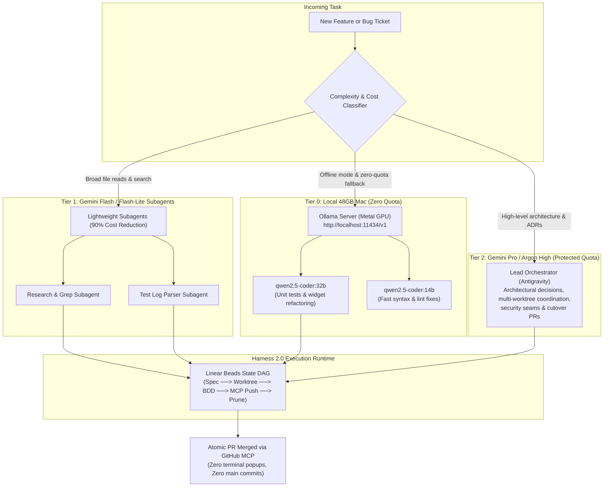
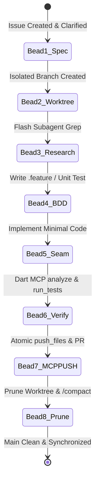

# 📿 Agent Harness 2.0 & Token Quota Preservation Guide

> **Audience**: Engineers, Students, Mentees, and Non-Technical Community Leaders  
> **Purpose**: How Belong on the Spectrum & Refuge maintain high development velocity, protect AI token quotas, and run unlimited offline coding on a 48GB Mac without recurring API costs.  
> **Canonical Repo Document**: [`docs/AGENT_HARNESS_AND_ORCHESTRATION.md`](https://github.com/neiljaywarner/refuge/blob/main/docs/AGENT_HARNESS_AND_ORCHESTRATION.md)  
> **Tracking Issue**: [Issue #114](https://github.com/neiljaywarner/refuge/issues/114)

---

## 1. Executive Summary (In Plain English)

Modern AI coding assistants are extraordinarily powerful, but they consume **tokens** (computational units of text) for every file they inspect, search, or edit.

If a project uses top-tier models (like **Gemini Pro**) for mundane tasks like searching directories or checking commas in spreadsheets, it quickly hits:
1. **5-Hour Rolling Burst Limits**: You are temporarily paused for a few hours.
2. **7-Day Weekly Caps**: Your advanced AI quota is shut down for the remainder of the week!

To protect our development momentum leading up to our **October 31st Circle.so cutover**, we designed **Agent Harness 2.0**:
- **Smart Delegation**: Routine tasks are handled by lightweight, ultra-fast AI models (**Gemini Flash**) or our local Mac GPU.
- **Reserved Power**: Gemini Pro is preserved strictly for complex architectural design and security reviews.
- **100% Free Offline Fallback**: Our **48 GB RAM Apple Silicon Mac** runs open-source models (**Qwen 2.5 Coder 32B**) completely locally, costing **$0 in API fees** with zero quota limits.

---

## 2. Visual Knowledge Graph: Multi-Model Routing



---

## 3. The 3-Tier Multi-Model Hierarchy

| Tier | Model / Engine | Cost / Quota | Best Suited For |
| :--- | :--- | :--- | :--- |
| **Tier 0 (Local)** | **Ollama `qwen2.5-coder:32b` & `14b`** | **$0 / Infinite** (Local 48GB Mac Unified RAM) | • Offline fallback during quota cooldown<br>• Local unit tests and linting<br>• Unbounded scratch explorations |
| **Tier 1 (Subagent)** | **Gemini Flash / Flash-Lite** | **~5%–10% of Pro Cost** (Fast & Cheap) | • Broad codebase grepping and file discovery<br>• Reading test output and parsing stack traces<br>• Mechanical documentation formatting |
| **Tier 2 (Orchestrator)** | **Gemini Pro / Argon High** | **Full Quota Allocation** (Protected & Reserved) | • Architecture Decision Records (ADRs)<br>• Multi-worktree cross-cutting refactoring<br>• Release cutover audits & final PR verification |

---

## 4. 📿 The "Beads" Sequential State DAG

Instead of keeping 50 turns of historical conversation in active memory (which multiplies token costs on every turn), **Harness 2.0** uses an externalized chain of **Execution Beads**:



### The 8 Execution Beads:
1. ⚪ **Bead 1 (Specification)**: Every task begins with a well-scoped GitHub Issue.
2. ⚪ **Bead 2 (Worktree)**: Created under `.worktrees/issue-<NUM>-<slug>`. Never commit directly to `main`.
3. ⚪ **Bead 3 (Subagent Research)**: A lightweight `flash` subagent scans the repo and reports back with a 5-line summary.
4. ⚪ **Bead 4 (BDD / TDD)**: Write behavior tests first (`test/features/*.feature.txt`).
5. ⚪ **Bead 5 (Minimal Seam)**: Write only the code necessary to fulfill the ticket.
6. ⚪ **Bead 6 (Dart MCP Verification)**: Run `analyze_files` and `run_tests` via Dart MCP.
7. ⚪ **Bead 7 (Zero-Approval GitHub MCP Push)**: Atomic push via `push_files`, PR created, and squash-merged.
8. ⚪ **Bead 8 (Prune & Compact)**: Delete worktree, update `status.md`, and run `/compact` to reset conversation tokens to zero.

---

## 5. Local 48GB Mac Setup (Offline Zero-Cost Coding)

Our development workstation features **48 GB of Apple Silicon Unified Memory**, allowing us to run high-performance local coding models with zero network dependency:

```bash
# 1. Install Ollama
brew install ollama
ollama serve

# 2. Download optimal models for 48GB RAM
ollama pull qwen2.5-coder:32b   # 32-Billion parameter code specialist (~20GB RAM)
ollama pull qwen2.5-coder:14b   # High-speed utility model (~9GB RAM)
```

The local API endpoint is available at `http://localhost:11434/v1` for any compatible tool or editor.

---

## 6. Ten Golden Quota Defense Rules

1. **Slice Files, Never Dump**: Use `view_file` with `StartLine` and `EndLine` (50–100 lines max) rather than loading entire files.
2. **Delegate Broad Search to Flash**: Spawn a `flash` subagent for codebase grepping to keep the main agent context slim.
3. **Use GitHub MCP Exclusively**: Never run interactive terminal `git push` which hangs on credentials.
4. **Run `/compact` Frequently**: Reset conversation memory every 2–3 completed PRs.
5. **Persist State to Disk**: Keep master dashboards in `status.md` and `human_to_review_after_session.md`.
6. **Pre-Check with Dart MCP**: Always run `analyze_files` before opening PRs to avoid wasted review cycles.
7. **Small Atomic PRs**: 1 Issue = 1 Worktree = 1 PR keeps token diffs under 5,000 tokens.
8. **Rotate Model Tiers**: After 45 minutes of heavy Gemini Pro execution, rotate 1–2 tickets to Flash or local Ollama.
9. **Zero-PII Scanning**: Run `tool/refuge_cli.dart privacy-scan` locally to protect privacy without LLM overhead.
10. **Clean Separation of Wiki**: Keep non-technical pages accessible to community organizers without loading heavy engineering specs.
