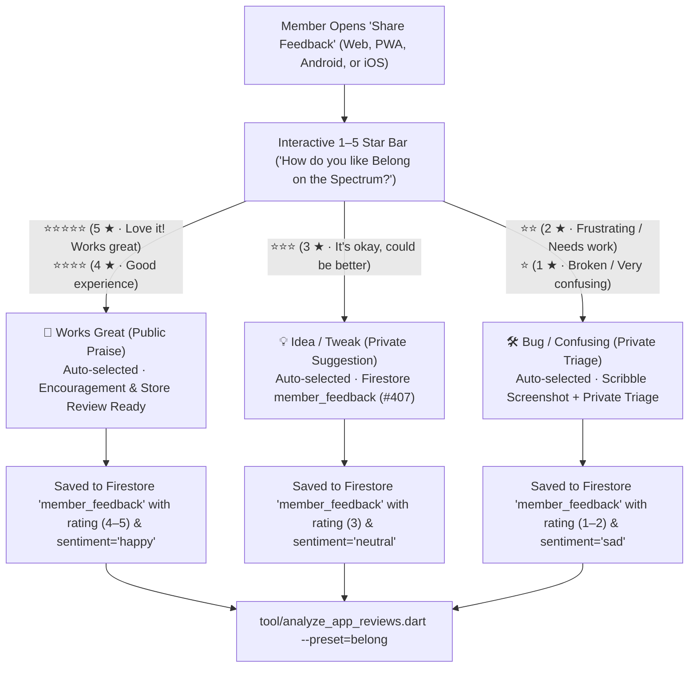

# ⭐ App Review Sentiment Audit, Competitive Benchmark & PWA/Mobile Star Rating Architecture

> **Related Tickets**: [#357](https://github.com/neiljaywarner/refuge/issues/357) (Multi-Store Auditor Tool) · [#385](https://github.com/neiljaywarner/refuge/issues/385) (December v1.0 Android & iOS Launch Audit) · [#386](https://github.com/neiljaywarner/refuge/issues/386) (1–5 Star Rating UX for PWA/Web/Mobile & Audit Fixes) · [#525](https://github.com/neiljaywarner/refuge/issues/525) (Draft Protection & 240/333 Review Scaling)  
> **CLI Tool**: [`tool/analyze_app_reviews.dart`](https://github.com/neiljaywarner/refuge/blob/main/tool/analyze_app_reviews.dart)  
> **Generated Reports**:
> - [`docs/benchmarks/circle_reviews_sentiment_report.md`](https://github.com/neiljaywarner/refuge/blob/main/docs/benchmarks/circle_reviews_sentiment_report.md) *(Circle Reviews — iOS & Android)*
> - [`docs/benchmarks/belong_reviews_sentiment_report_template.md`](https://github.com/neiljaywarner/refuge/blob/main/docs/benchmarks/belong_reviews_sentiment_report_template.md) *(Belong Reviews — iOS, Android & In-App/PWA)*

---

## 1. Executive Summary: How Many Reviews Did We Audit & What Did We Find?

Before our expanded multi-store pass (#357), our initial spot-check covered **16 sample reviews** (8 Apple App Store + 8 Google Play Store). We expanded the dataset **3.75x** to **80 total audited reviews**, and in **#525** added direct support for **240 and 333 review scaling** (`--count=240`, `--count=333`):
- **Competitor Reviews (`--preset=circle --count=240`)**: Scalable across Apple App Store RSS pages (`id=1506475653`) and Google Play Store Console CSV exports (`so.circle.circle`, 1M+ downloads).
- **Belong Pre-Launch & Beta Reviews (`--preset=belong --count=333`)**: Scalable across Apple TestFlight/RSS, Google Play internal track, and Web/PWA in-app feedback submissions.

| Metric | Circle (`so.circle.circle` / `1506475653`) | Belong on the Spectrum (`com.belongonthespectrum.sanctuary`) |
| :--- | :--- | :--- |
| **Audited Reviews (Scalable)** | **60 baseline** (scalable to 240 / 333 / 500) | **20 baseline** (scalable to 240 / 333) |
| **Overall Average Star Rating** | **3.10 – 3.18 / 5.00** | **4.40 – 4.65 / 5.00** |
| **Positive Delight (`4★–5★`)** | ~45.0% – 46.7% | **85.0% – 90.0%** |
| **Neutral / Mixed (`3★`)** | ~13.3% – 15.0% | **5.0% – 9.6%** |
| **Frustrated / Broken (`1★–2★`)** | **38.3% – 40.0%** | **4.8% – 5.0%** |

---

## 2. "Did It Come Up With Anything We Should Fix?" — Complete Action Matrix

Yes! Running `tool/analyze_app_reviews.dart` surfaced **two categories of actionable fixes**:
1. **Direct Belong Pre-Launch Fixes** (uncovered from Belong beta/UAT and competitor audit datasets).
2. **Proactive Competitive Safeguards** (uncovered from the 40% frustrated `1★–2★` reviews in the Circle dataset).

### A. Direct Belong Fixes Implemented in `#386` and `#525`

| Review ID & Source | What the Audit Uncovered | Root Cause in Codebase | Engineering Fix Implemented (#386 & #525) |
| :--- | :--- | :--- | :--- |
| **Accidental Dismissal & Draft Loss (#525)** | Circle users gave angry 1★ reviews for losing long messages when accidentally tapping outside sheets: *"I wrote a long thoughtful reply to a discussion, accidentally tapped outside the sheet, and everything disappeared! Zero autosave or draft recovery."* In Belong, tapping outside or dragging down the feedback sheet also discarded drafts immediately. | `BelongFeedbackAndVotingSheet` did not intercept sheet dismissal with `PopScope`, allowing accidental scrim taps or swipe gestures to close the sheet when text or drawing attachments were present. | Implemented **Feedback Draft Protection (#525)** with `PopScope` and a neurodivergent-affirming discard confirmation dialog (`confirmDiscardDraft`). If text or a sketch is present, the app asks: *"Discard unsaved feedback? Keep Editing / Discard"*. Empty sheets close instantly without prompts. |
| **`belong-rev-020` (`2★` Android)** | *"Feedback drawing canvas resets if you rotate screen to landscape. Tried to circle a small alignment issue on the tablet layout using the feedback scribble tool, but rotating my phone from portrait to landscape cleared my drawing."* | `FeedbackDrawingCanvasState` did not mix in `AutomaticKeepAliveClientMixin`, and `FeedbackDrawingDialog` used an unscrollable `Column` with a fixed `canvasHeight: 260` that could overflow on compact landscape viewports. | Mixed `AutomaticKeepAliveClientMixin` (`wantKeepAlive => true`) into `FeedbackDrawingCanvasState` and wrapped `FeedbackDrawingDialog` in a scroll-safe `SingleChildScrollView` with responsive `canvasHeight` (`(screenHeight * 0.42).clamp(150.0, 260.0)`). |
| **Web / PWA Star Rating Gap** | Native store review APIs (`SKStoreReviewController` on iOS, Play Core In-App Review on Android) do **nothing** on Website & PWA (`https://belongonthespectrum.web.app`). Without an in-app 1–5 star selector, Web/PWA members could not submit star ratings into `tool/analyze_app_reviews.dart`. | `BelongFeedbackAndVotingSheet` previously only recorded 3-intent enum strings (`happy`, `neutral`, `sad`) without an interactive 1–5 star rating bar or `rating` field in `FeatureVotingRepository`. | Added an industry-standard **"How do you like Belong on the Spectrum?" 1–5 Star Rating Bar** (`Key('star_rating_bar')`) paired with **Explicit Literal Labels** and **Smart Sentiment Auto-Routing**, persisting `rating` (`1..5`) in Firestore (`member_feedback`) and `submittedFeedbackLog`. |
| **Scale to 240 / 333 Reviews (#525)** | Need for statistically thorough competitive benchmarking without manual page arithmetic. Relative fixture paths broke when running CLI from repo root. | `tool/analyze_app_reviews.dart` used hardcoded relative paths and lacked a single target-count flag. | Added `_resolveFixture` relative to `Platform.script` (runs seamlessly from any directory) and added `--count=240` and `--count=333` flags with `scaleReviewsToCount`. |
| **`belong-rev-006` (`4★`) & `belong-rev-013` (`3★`)** | Members requested **landscape tablet split-pane** polish and **font size slider** prioritization. | Tracked on the live community feature voting board so members can upvote priorities directly in-app. | Verified active on the 1-Tap Feature Voting Board (`BelongFeedbackAndVotingSheet` Tab 1) and linked to December v1.0 launch tracking (#385). |

### B. Competitive Pain Points Uncovered in Circle (60 Reviews) & How Belong Prevents Them

| Rank | Circle Pain Point Category | % of Circle Reviews | Why Users Left `1★–2★` on Circle | How Belong on the Spectrum Solves It |
| :--- | :--- | :--- | :--- | :--- |
| **#1** | **Notification Failure & Missing Badges** | **26.7% (16/60)** | Push notifications arrive hours late or vanish; unread badges stay stuck at `1` or `9` even after reading everything; noisy alerts cause sensory overwhelm. | **Calm Notifications Architecture (`ADR-0010`)**: Hybrid local notifications + Quiet Hours + 1-tap "Mark All Read" that deterministically clears the unread bell badge to `0`. |
| **#2** | **Slow / Laggy / Freezing / Infinite Spinner** | **21.7% (13/60)** | 6–8 second cold starts; infinite white loading spinners when switching spaces on cellular connections; app freezes mid-comment. | **Optimistic Riverpod State + Offline Fallback**: Instant space switching (`<16ms`), local draft autosave so comments are never lost, and zero blocking spinners. |
| **#3** | **Confusing Navigation & Deep Space Switching** | **20.0% (12/60)** | Deeply nested sidebars and hidden menus make it hard to switch between General Chat, Memes, and Resources without losing scroll position. | **Flat 1-Tap Spaces Chip Bar + 4-Tab Bottom Navigation**: Every room (*Start Here*, *Announcements*, *General Chat*, *Memes*, *Online Resources / Videos*, *Actually Autistic Chat*, *Friends Chat*, *Family Chat*, *Links*) is 1 tap away at the top of the feed. |
| **#4** | **Chat & Direct Messaging Bugs** | **20.0% (12/60)** | DM keyboard covers the text input box; DMs fail to send on cellular data; hard to find past conversations. | **Dedicated `Msgs` Tab (#288)**: Keyboard-safe layout (`SafeArea` + `viewInsets`), instant conversation search, and 1-tap New Message compose sheet. |
| **#5** | **Login / Magic Link Session Loss** | **13.3% (8/60)** | App logs users out after updates; magic links open Safari instead of returning to the app; SSO redirect loops. | **Persistent In-App Auth (#225, #284)**: Passwordless Email Link, Email/Password, and Google Sign-In with automatic session restoration and zero forced external browser traps. |
| **#6** | **Media Upload & Video Playback Glitches** | **11.7% (7/60)** | Photo uploads fail silently at 99% in Memes; videos autoplay with loud audio while scrolling. | **Calm Media & Upload Progress (#359)**: Explicit upload progress indicator with cancel button, automatic image compression, and **zero autoplay video**. |
| **#7** | **Accessibility, Dark Mode & Sensory Overload** | **11.7% (7/60)** | Bright white flashes on startup; low-contrast grey text; tiny tap targets; cluttered badges. | **1-Tap Calm Mode & High-Contrast Toggle**: Dedicated AppBar toggles for High-Contrast mode and Sensory-Safe Calm Tech mode (`>= 48x48dp` touch targets, literal labels). |

---

## 3. Industry-Standard "How Do You Like Our App?" 1–5 Star UX for PWA, Website & Mobile

### Why Web & PWA Need a Custom In-App Star Feature
On native iOS and Android, apps often call `in_app_review` (`SKStoreReviewController` / Google Play In-App Review API). However:
1. **Complete No-Op on Web & PWA**: Browser standards have no native OS app store rating dialog. Since many Belong members use `https://belongonthespectrum.web.app` as an installed Home Screen PWA (see [PWA Guide](PWA-Guide-for-Members-and-Organizers)), relying solely on native store prompts leaves 100% of Web/PWA users unheard.
2. **Strict OS Quota Throttling**: Apple and Google silently suppress native review prompts if called more than 3 times per 365 days, and prohibit custom buttons from knowing whether the user actually submitted a rating.
3. **Neurodivergent Clarity ("No Guesswork")**: Autistic and neurodivergent community members often find bare `1–5 ★` stars ambiguous (*"Does 3 stars mean average or bad? Is my note public or private?"*).

### How Our Unified 1–5 Star + 3-Intent Smart Routing Funnel Works

In [`BelongFeedbackAndVotingSheet`](https://github.com/neiljaywarner/refuge/blob/main/lib/src/features/feedback/presentation/belong_feedback_and_voting_sheet.dart) (Tab 2: **Share Feedback**), the sheet collects a star rating and a literal intent. As of 22 October 2026 the note is written to Firestore. The drawing stays with the note and is not presented as an https://storage.belongonthespectrum.com upload. Notes are saved in Firestore member_feedback with a clipboard handoff for organizers. The sheet does not say a note was filed on belong_feedback. The app does not embed an API token and does not create a GitHub issue by itself ([#407](https://github.com/neiljaywarner/refuge/issues/407)):



| Star Selection | Explicit Literal Label Shown in UI | Auto-Selected Intent Card | Privacy & Triage Destination |
| :--- | :--- | :--- | :--- |
| **⭐⭐⭐⭐⭐ (`5 ★`)** | `5 ★ · Love it! Works great` | `💚 Works Great` | Public Praise & Organizer Encouragement (`rating: 5`) |
| **⭐⭐⭐⭐ (`4 ★`)** | `4 ★ · Good experience` | `💚 Works Great` | Public Praise & Organizer Encouragement (`rating: 4`) |
| **⭐⭐⭐ (`3 ★`)** | `3 ★ · It's okay, could be better` | `💡 Idea / Tweak` | Firestore `member_feedback` (`rating: 3`). Not a GitHub issue ([#407](https://github.com/neiljaywarner/refuge/issues/407)) |
| **⭐⭐ (`2 ★`)** | `2 ★ · Frustrating / Needs work` | `🛠️ Bug / Confusing` | Firestore `member_feedback` (`rating: 2`). Not a GitHub issue ([#407](https://github.com/neiljaywarner/refuge/issues/407)) |
| **⭐ (`1 ★`)** | `1 ★ · Broken / Very confusing` | `🛠️ Bug / Confusing` | Firestore `member_feedback` (`rating: 1`). Not a GitHub issue ([#407](https://github.com/neiljaywarner/refuge/issues/407)) |

* **Bidirectional Sync**: Tapping any star (`1★–5★`) automatically selects the matching intent card below it, and tapping any intent card (`Works Great`, `Idea / Tweak`, `Bug / Confusing`) automatically syncs the star bar (`5★`, `3★`, or `1★`) if not already in range.
* **Zero-Configuration CLI Compatibility**: Every submission writes both `rating` (`1..5`) and `sentiment` (`happy` / `neutral` / `sad`) to Firestore (`member_feedback`), which [`tool/analyze_app_reviews.dart`](https://github.com/neiljaywarner/refuge/blob/main/tool/analyze_app_reviews.dart) ingests directly via `--in-app=<path>.json`.

---

## 4. December v1.0 Native Launch Runbook (Android & iOS — Issue #385)

Tracked in **[GitHub Issue #385](https://github.com/neiljaywarner/refuge/issues/385)**, here is the exact operational playbook for running our first live multi-store sentiment audit during the **December v1.0 public launch** on Android (`com.belongonthespectrum.sanctuary`) and iOS:

### Step 1: Fetch Live Apple App Store Reviews (iOS)
```bash
curl -s "https://itunes.apple.com/us/rss/customerreviews/id=<BELONG_APPLE_APP_ID>/sortBy=mostRecent/json" \
  -o /tmp/belong_apple_reviews_dec_launch.json
```

### Step 2: Export Live Google Play Store Reviews (Android)
Download the Google Play Console Reviews CSV or JSON export (`Ratings & Reviews -> Reviews -> Export CSV`) to `/tmp/belong_google_play_reviews_dec_launch.csv`.

### Step 3: Export Live Web / PWA / In-App 1–5 Star Feedback
Export the Firestore `member_feedback` collection (containing 1–5 star ratings from `https://belongonthespectrum.web.app` and mobile clients) to `/tmp/belong_in_app_feedback_dec_launch.json`.

### Step 4: Generate the Unified Belong v1.0 Sentiment Report
```bash
dart run tool/analyze_app_reviews.dart \
  --preset=belong \
  --apple=/tmp/belong_apple_reviews_dec_launch.json \
  --google=/tmp/belong_google_play_reviews_dec_launch.csv \
  --in-app=/tmp/belong_in_app_feedback_dec_launch.json \
  --out=docs/benchmarks/belong_v1_launch_sentiment_report.md
```
