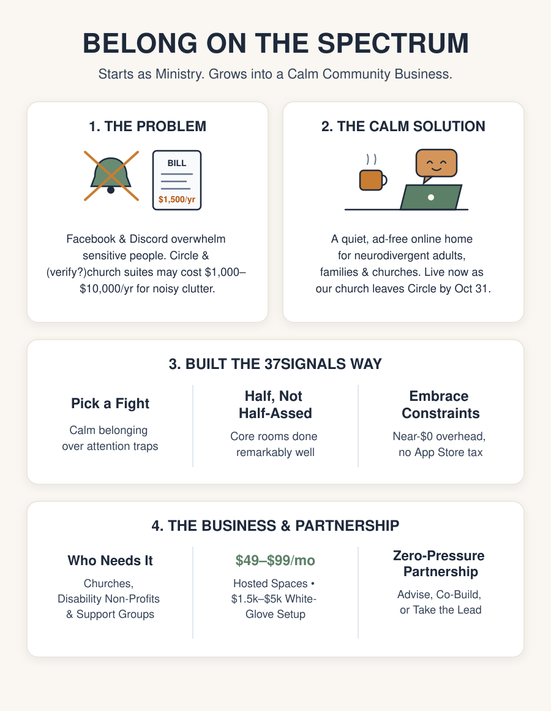

# 🤝 Business & Partnership Overview

> **A first-look executive summary and FAQ for prospective business partners, advisors, and collaborators approaching Belong on the Spectrum.**  
> **Product & Business Philosophy (37signals)**: [Pick a Fight](https://37signals.com/podcast/pick-a-fight/) · [Build Half a Product, Not a Half-Baked Product](https://37signals.com/podcast/build-half-a-product-not-a-half-assed-product/) · [Embrace Constraints](https://37signals.com/podcast/embrace-constraints/)

---

## 🕊️ Executive Summary: The 60-Second Story

If you have advised organizations, churches, or business owners for years, you have watched this play out over and over:

1. A community, church ministry, or support network wants a warm, private online home where members can connect during the week.
2. They turn to mainstream social media (**Facebook Groups**, **Discord**) or sign up for creator-focused community platforms (**Circle.so**, **Mighty Networks**) or expensive church app suites (**Subsplash**, **Pushpay**).
3. Within months, friction sets in: mainstream social platforms overwhelm members with ads, noise, and privacy worries, while Circle and legacy church suites charge **\$1,000 to \$10,000+ per year** for cluttered menus, course-selling upsells, and anxious notification badges that push sensitive people away.

**Why this matters as a business**:  
What begins as an authentic ministry solving a real \$1,500/year pain for Community #1 solves the exact same problem for thousands of churches, disability ministries, recovery groups, and non-profits. Because our baseline monthly operating cost is near **\$0/month**, we can offer other organizations their own calm, branded community space at a fraction of legacy prices—with healthy margins, zero outside investors, and genuine human impact.

---

## 🎯 How We Build & Compete: Three 37signals Principles

Rather than chasing startup hype or building bloated enterprise software, Belong follows three classic business principles from **[37signals](https://37signals.com)** (*REWORK* and *Getting Real*):

### 1. [Pick a Fight](https://37signals.com/podcast/pick-a-fight/)
Great small products stand clearly *against* what is broken in their industry so the right customers immediately recognize an ally:
* **Against Attention Traps & Sensory Overload**: No infinite-scroll algorithms, no red "unread" urgency badges, no autoplaying video or sound, and zero advertising.
* **Against the \$1,000+/Year Community Tax**: Small churches, ministries, and support groups shouldn't pay internet-marketer prices for course funnels and paywalls just to host warm weekday fellowship.
* **Against App Store Gatekeeping**: Members open a link on any phone or computer and can save Belong straight to their iPhone or Android home screen in seconds—no 30% store toll, no forgotten Apple IDs, and no waiting weeks for store reviewers.

### 2. [Build Half a Product, Not a Half-Baked Product](https://37signals.com/podcast/build-half-a-product-not-a-half-assed-product/)
Most community platforms cram in fifty half-baked features that confuse organizers and tire out members. We cut everything non-essential and focused on making the weekly essentials warm, clear, and dependable:
* **Familiar, Focused Rooms**: Dedicated spaces (*Start Here & Introduce Yourself*, *Announcements*, *General Chat*, *Memes*, *Online Resources*, *Actually Autistic Chat*, *Friends Chat*, *Family Chat*) plus a **Members Directory** and private **Saved for Later** bookmarks.
* **Gentle Conversations & Care Responses**: When someone shares, they can mark a post **Comfort Only** (company, not advice), and members respond with supportive words like **Praying** and **Support** rather than popularity contests.
* **Quiet, Opt-In Direct Messages**: Private one-on-one messages stay peaceful by default—members only receive phone alerts if and when they explicitly turn them on.
* **Personal Visual Comfort**: One-tap looks (**Clean Slate**, **Sage Botanical**, **Monastic Dark**, and **High Contrast**) and comfortable reading sizes so every member can settle their eyes.
* **Built-In Member Voice**: A **Vote & Feedback** button right inside the community lets members vote on upcoming ideas or circle something on screen whenever they spot a rough edge.

### 3. [Embrace Constraints](https://37signals.com/podcast/embrace-constraints/)
Tight limits on time, budget, and team size turned out to be superpowers:
* **A Real October 31 Cutoff**: Having a firm date to leave Circle forced practical focus—shipping what real people actually use every day, plus a smooth way to bring past introductions and posts over so rooms feel warm on day one.
* **Near-\$0 Baseline Overhead**: Keeping foundational running costs near zero eliminates financial burn pressure. Our home ministry can run sustainably forever, and paid customer plans become profitable almost immediately.
* **Small, Unhurried Footprint**: A focused product that works seamlessly across phones and computers stays easy for a tiny team to support without hiring an army.

---

## 💼 The Commercial Opportunity: Where Ministry Meets Sustainable Business

Just as Basecamp began inside a small consulting shop solving its own project-communication headache before becoming a thriving software business, Belong has a clear path from **one church community** to **many organizations**:

| Who Needs This | What Frustrates Them Today | What They Spend Today | What Belong Offers |
| :--- | :--- | :--- | :--- |
| **Churches & Faith Networks** *(care ministries, small groups, disability ministries, regional fellowships)* | Giving and bulletin apps handle Sunday announcements well, but feel cold or clunky for weekday fellowship and prayer. | \$2,400 – \$12,000 / year | A warm, church-branded weekday community at **\$49–\$99/month**—simple for pastors and lay leaders to run. |
| **Autism, Neurodiversity & Disability Non-Profits** | Facebook Groups and Discord trigger sensory fatigue, privacy fears, and heavy moderator burnout. | High volunteer burnout + noisy ad-driven tools | A quiet, respectful home designed from the ground up around sensory comfort and clear boundaries. |
| **Recovery, Grief & Caregiver Communities, Running clubs, whatever** *(Celebrate Recovery, GriefShare, parent & family circles)* | People hesitate to share vulnerable life updates on ad-tracked social media, while Circle/Mighty charge \$1,200–\$3,000/year. | \$1,200 – \$3,000 / year | Private, members-only rooms with gentle pacing, zero ads, and dignified privacy. |

### Four Straightforward Revenue Paths
1. **Hosted Community Plans (\$49–\$99/month per organization)**: Simple, predictable monthly pricing for churches, ministries, and non-profits wanting their own private, branded Belong community—roughly half the cost of Circle with very high margins.
2. **White-Glove Setup & Migration (\$1,500–\$5,000 one-time)**: Done-for-you onboarding for organizations moving off Circle, Facebook Groups, or Discord—setting up their spaces, bringing past posts over, and orienting their leaders. *(A natural fit for consulting and client-service strengths.)*
3. **Regional & Network Partnerships**: Group plans for church families, dioceses, or national non-profit chapters that want shared resources alongside local community rooms.
4. **Faith, Disability & Accessibility Grants**: Foundations investing in mental health, disability inclusion, and congregation vitality actively fund calm, accessible community initiatives—helping under-resourced groups join while paying the business sustainably.

---

## 🤝 How Partnership Can Look (Zero Pressure, High Trust)

Friendship and mutual trust come first. There is no pitch deck pressure and no rigid script here:

* **Complete Freedom of Involvement**: You might want to bounce ideas around over coffee once in a while, advise on positioning and pricing, introduce organizations from your consulting network, co-build the commercial side, or not get involved at all—every single one of those answers is 100% welcome.
* **Room to Run With the Business**: If your years of running a business spot a clear commercial lane and you want to take the lead on sales, packaging, client onboarding, or steering the business side, the door is wide open.
* **Simple, Honest Founder Alignment**:
  1. **Protect the Calm Heart**: Keep Belong genuinely gentle, accessible, and honest for the people and churches who rely on it.
  2. **Shared Credit**: Recognition for originating the vision and founding community.
  3. **Fair Financial Participation**: Straightforward, reasonable revenue or ownership sharing that honors both the foundation already built and whoever carries the business growth forward.

---

## ❓ Frequently Asked Questions (FAQ)

### Q1: Is this a church ministry or a real business?
**A**: Both—and each makes the other stronger. Serving our own neurodivergent church community first keeps the product grounded in real human needs rather than guesswork. Our home community remains a free ministry gift, while other churches, non-profits, and support organizations pay a fair, sustainable price for their own hosted spaces and onboarding.

### Q2: Why wouldn't an organization just use Facebook Groups, Discord, or Circle?
**A**: Most try one of those first.
(manual note from neil, they don't "Feel" like their own thing and also it gers people "arguing" about which to use :) 
- **Facebook Groups** surround vulnerable personal sharing with ads, outrage feeds, and privacy distrust—many younger adults and privacy-conscious families refuse to use Facebook at all.
- **Discord** races like a noisy gamer chatroom with dozens of blinking channels that quickly overwhelm parents, older members, and sensory-sensitive adults.
- **Circle and Mighty Networks** are built for online influencers selling courses and coaching cohorts, charging **\$1,000 to \$2,500+ per year** for complexity most caring communities never want.
- **Belong** strips away the clutter and cost to do one thing remarkably well: **calm, trustworthy human belonging**.

### Q3: Why open on the web instead of starting in the Apple App Store and Google Play Store?
**A**: Speed, independence, and economics. With a single web link, members can open Belong immediately on any phone, tablet, or computer—and add it straight to their iPhone or Android home screen so it opens full-screen like any other app. That means **zero 15–30% Apple/Google commission**, **no forgotten app-store passwords** blocking non-technical members, and **instant updates** without waiting on store review bureaucracy. Store listings remain an easy option down the road whenever a specific customer group values them.

### Q4: What does it cost each month to keep the lights on right now?
**A**: Practically nothing—probably aroudn $25/month for quite awhile (and \$0/month at our current baseline usage). Because there is no heavy monthly server bill ticking in the background, we never have to rush bad decisions or squeeze our founding members for money. Operating costs only rise meaningfully alongside paying organizations.

### Q5: How do you solve the "empty room" problem when an existing group switches platforms?
**A**: circle.so ha an export we could consider using

### Q7: If I'm curious, what is the easiest first step?
**A**: Spend five unhurried minutes clicking around our prototype on your phone or laptop (ask me for the link or look around), skim our [Plan through October 31](Non-Technical-Roadmap-to-Oct-31), and share your candid business gut check—what resonates, what you would trim or sharpen, and whether any angle of advising or partnering sounds life-giving to you.

---

## 🔗 Quick Links & Reading

* 🌿 **Our Calm Design Approach**: [Calm Design and Sensory Comfort](Calm-Tech-and-Accessibility)
* 🎬 **Companion Video Prompts**: [Gemini Web & Google Vids Prompts](Business-Partner-Video-Prompts)
* 💡 **37signals Principles Referenced Above**:
  * [Pick a Fight — 37signals *REWORK* Podcast & Transcript](https://37signals.com/podcast/pick-a-fight/)
  * [Build Half a Product, Not a Half-Assed Product — 37signals *REWORK* Podcast & Transcript](https://37signals.com/podcast/build-half-a-product-not-a-half-assed-product/)
  * [Embrace Constraints — 37signals *REWORK* Podcast & Transcript](https://37signals.com/podcast/embrace-constraints/)
  * [*REWORK* & *Getting Real* — 37signals Books](https://37signals.com/books/)
