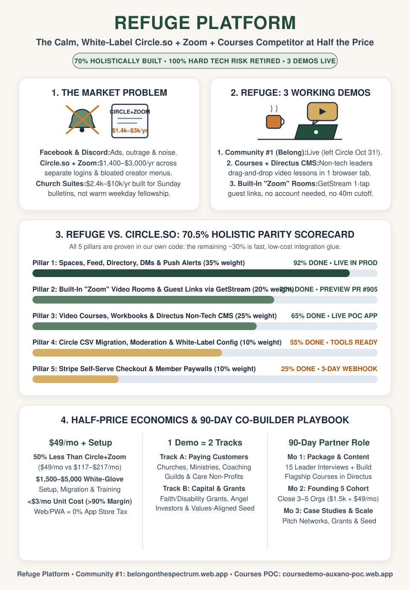

# 🤝 Refuge Platform — Business & Partnership Overview

> **A first-look executive summary and FAQ for prospective business partners, advisors, and collaborators approaching the Refuge Platform.**  
> **New for November 2026:** Read the companion **[Circle.so 70% Parity Scorecard & 90-Day Co-Builder Playbook](Circle-Competitor-Scorecard-and-90-Day-Partner-Playbook)**!  
> **Product & Business Philosophy (37signals):** [Pick a Fight](https://37signals.com/podcast/pick-a-fight/) · [Build Half a Product, Not a Half-Baked Product](https://37signals.com/podcast/build-half-a-product-not-a-half-assed-product/) · [Embrace Constraints](https://37signals.com/podcast/embrace-constraints/)

---

## 🕊️ Executive Summary: The 60-Second Story

- **Refuge** is our **white-label community, course, and live-video platform**—engineered to compete directly with **Circle.so + Zoom + Teachable at half the price (\$49/month vs. \$117–\$217/month)**.
- **Belong on the Spectrum** ([`belongonthespectrum.web.app`](https://belongonthespectrum.web.app)) is **Userbase #1 / Community #1** running live on Refuge today (having successfully replaced its \$1,000+/yr Circle.so subscription on October 31).
- **Course Demo / Auxano POC** ([`coursedemo-auxano-poc.web.app`](https://coursedemo-auxano-poc.web.app)) and **GetStream Live Video Rooms** ([Stream Video Preview](Stream-Video-Preview)) are our own working codebases for **HD Video Courses + Non-Technical Directus Authoring** and **Built-In Zoom-Style Live Video Calls**, bringing Refuge to **~70% (`70.5%`) holistic Circle.so parity** today.

If you have led or advised ministries, churches, coaching cohorts, or mission-driven organizations, you have watched this play out over and over:

1. A community, church ministry, discipleship guild, or support network wants a warm, private online home where members can connect, learn, and meet on video during the week.
2. They turn to mainstream social media (**Facebook Groups**, **Discord**), sign up for expensive creator platforms (**Circle.so**, **Mighty Networks**, **Teachable**) plus **Zoom**, or buy heavy church suites (**Subsplash**, **Pushpay**).
3. Within months, friction sets in: mainstream social platforms overwhelm people with ads, outrage algorithms, and privacy worries, while Circle + Zoom + legacy suites charge **\$1,400 to \$10,000+ per year** across fragmented logins and cluttered menus that push sensitive people away.

**Where we stand today (November 2026) — ~70% of a Full Circle.so + Zoom Replacement at Half the Price:**
- **Pillar 1 — Calm Community Spaces, Directory & DMs (`92%` Complete — LIVE):** Live at [`belongonthespectrum.web.app`](https://belongonthespectrum.web.app). Our founding church community officially left Circle.so on October 31 with zero downtime, saving \$1,000+/year.
- **Pillar 2 — Video Courses, Workbooks & Non-Technical Authoring (`65%` Complete — LIVE POC):** Live at [`coursedemo-auxano-poc.web.app`](https://coursedemo-auxano-poc.web.app). Streams HD video lessons via **Mux**, saves interactive student workbooks to Postgres, and uses **Directus** so non-technical pastors, teachers, and leaders can drag-and-drop an `.mp4` video and publish a course in one browser tab with zero code.
- **Pillar 3 — Built-In "Zoom-Style" Live Video Rooms (`70%` Complete — PREVIEW):** Built with **GetStream** ([Stream Video Preview](Stream-Video-Preview)). Supports up to 10-person video/audio calls with **no 40-minute cutoff**, calm mic-off/camera-off defaults, and **1-tap Guest Invite Links** where visitors join by typing their name without needing an account.
- **Unfair Unit Economics:** Because our baseline monthly cost per community is **under \$3/month** and our Web/PWA delivery avoids the 30% Apple App Store tax, we can offer organizations an all-in-one calm home for **\$49/month** (half the price of Circle + Zoom) with **>90% gross margins** and **\$1,500–\$5,000 white-glove onboarding**.

---

## 🎯 How We Build & Compete: Three 37signals Principles

Rather than chasing bloated enterprise software, Refuge follows three classic business principles from **[37signals](https://37signals.com)** (*REWORK* and *Getting Real*):

### 1. [Pick a Fight](https://37signals.com/podcast/pick-a-fight/)
Great products stand clearly *against* what is broken in their industry so the right customers immediately recognize an ally:
* **Against Attention Traps & Sensory Overload**: No infinite-scroll algorithms, no red "unread" urgency badges, no autoplaying video or sound, and zero advertising.
* **Against the \$1,500+/Year Circle + Zoom Tax**: Churches, ministries, coaching guilds, and support groups shouldn't pay internet-marketer prices across three separate subscriptions just to host weekday fellowship, courses, and small-group video calls.
* **Against App Store Gatekeeping**: Members open a link on any phone or computer and save the community straight to their iPhone or Android home screen in seconds—no 30% store toll, no forgotten Apple IDs, and no waiting weeks for store reviewers.

### 2. [Build Half a Product, Not a Half-Baked Product](https://37signals.com/podcast/build-half-a-product-not-a-half-assed-product/)
Most platforms cram in fifty noisy features that confuse leaders and tire out members. We focused on making the essentials warm, clear, and dependable:
* **Familiar, Focused Rooms**: Dedicated spaces (*Start Here & Introduce Yourself*, *Announcements*, *Prayer Sanctuary* with 1-tap return, *General Chat*, *Memes*, *Online Resources*, *Friends & Family Chat*) plus a **Members Directory** and private **Saved for Later** bookmarks.
* **Gentle Conversations & Care Responses**: Members mark posts with clear intent tags (`[Comfort Only]`, `[Prayer Request]`, `[General Chat]`, `[Fellowship]`) and respond with **Praying** and **Support** rather than popularity contests.
* **Non-Technical Course Studio (Directus + Mux)**: Ministry leaders and educators don't need a developer to launch a class—they write lessons, attach scripture/handouts, and drop `.mp4` videos into a clean web form while learners complete interactive workbooks right beside the video.
* **Calm Live Video Rooms (GetStream)**: Small groups and classes meet live via 1-tap guest links, starting muted with camera off so nobody is startled on entry.
* **Personal Visual Comfort**: One-tap looks (**Clean Slate**, **Sage Botanical**, **Monastic Dark**, and **High Contrast**) plus built-in **Vote & Feedback** receipts.

### 3. [Embrace Constraints](https://37signals.com/podcast/embrace-constraints/)
Tight limits on time, budget, and team size turned out to be superpowers:
* **Proven October 31 Circle Cutover**: Leaving Circle on schedule proved that real members prefer a calm, focused home—and gave us a repeatable Circle CSV migration tool (`tool/import_circle_csv.dart`).
* **Under \$3/Month Per-Community Overhead**: Keeping foundational running costs near zero eliminates burn pressure. Our home ministry runs sustainably forever, and paid customer plans become profitable from Organization #1.

---

## 💼 The Commercial Opportunity: Where Ministry Meets Sustainable Business

Just as Basecamp began inside a small shop solving its own communication headache before becoming a thriving software business, Refuge has a clear path from **one church community** to **hundreds of organizations**:

| Who Needs This | What Frustrates Them Today | What They Spend Today | What We Offer |
| :--- | :--- | :--- | :--- |
| **Churches, Ministries & Discipleship Guilds** *(small groups, classes, leadership cohorts, care ministries)* | Sunday bulletin apps feel cold for weekday fellowship, while Circle + Zoom + course tools require 3 logins and steep annual bills. | \$1,500 – \$10,000 / year | A warm, branded community + course studio + live video rooms at **\$49–\$99/month**—simple for pastors and lay leaders to run. |
| **Autism, Neurodiversity & Disability Non-Profits** | Facebook Groups and Discord trigger sensory fatigue, privacy fears, and heavy moderator burnout. | High volunteer burnout + noisy ad-driven tools | A quiet, respectful home designed from the ground up around sensory comfort and clear boundaries. |
| **Recovery, Grief, Caregiver & Coaching Communities** *(Celebrate Recovery, GriefShare, marriage/parenting cohorts)* | People hesitate to share vulnerable life updates on ad-tracked social media, while Circle/Mighty charge \$1,200–\$3,000/year. | \$1,200 – \$3,000 / year | Private, members-only rooms, interactive workbooks, and 1-tap live video circles with dignified privacy. |

### Four Straightforward Revenue Paths
1. **Hosted Community + Courses + Video Plans (\$49–\$99/month per organization)**: Simple, predictable pricing—roughly **half the cost of Circle.so + Zoom** with >90% gross margins.
2. **White-Glove Setup, Migration & Turnkey Curriculum (\$1,500–\$5,000 one-time)**: Done-for-you onboarding for organizations moving off Circle, Facebook Groups, or Discord—setting up their rooms, migrating past posts, pre-loading starter courses in Directus, and coaching their leaders. *(An ideal lane for marketing, management, leadership, and ministry consulting strengths!)*
3. **Regional & Network Partnerships**: Group plans for church families, dioceses, coaching networks, or national non-profit chapters that want shared video courses alongside local fellowship rooms.
4. **Faith, Disability & Innovation Grants / Values-Aligned Capital**: Foundations and angel investors investing in congregation vitality, mental health, and disability inclusion actively fund scalable, real-world platforms with proven unit economics.

---

## 🤝 How Partnership Can Look (Zero Pressure, High Trust)

Friendship and mutual trust come first. There is no rigid script here:

* **Complete Freedom of Involvement**: Whether you want to bounce ideas around over coffee, advise on positioning, introduce leaders from your network, or co-lead the commercial growth over a 90-day sprint—every option is 100% welcome.
* **A Clear Non-Technical Leadership Lane**: See the **[90-Day Co-Builder Playbook](Circle-Competitor-Scorecard-and-90-Day-Partner-Playbook)** for how a marketing, management, leadership, and sales professional can immediately drive customer discovery, no-code course packaging in Directus, and Founding 5 white-glove sales while AI-assisted engineering finishes the remaining 30% of technical glue.
* **Simple, Honest Founder Alignment**:
  1. **Protect the Calm Heart**: Keep the platform genuinely gentle, accessible, and honest for the people and churches who rely on it.
  2. **Immediate Cash Flow + Long-Term Upside**: Generous revenue sharing on White-Glove Setup packages and recurring plans closed together, paired with clear milestone-based equity/ownership participation.

---

## ❓ Frequently Asked Questions (FAQ)

### Q1: Are we really ~70% (69%+) of the way to competing with Circle.so at half the price?
**A**: Yes. When you weight the five things communities actually use—**Spaces/DMs (92% done)**, **Courses + Non-Tech Authoring (65% done)**, **Built-In Live Video Rooms (70% done)**, **Migration/Admin (55% done)**, and **Stripe Billing (25% done)**—we are at **70.5% holistic completion** today. Even better, 100% of the hard technical risk is already solved in live, working builds. See the full breakdown in **[Circle.so Competitor Scorecard & 90-Day Playbook](Circle-Competitor-Scorecard-and-90-Day-Partner-Playbook)**.

### Q2: How can a non-technical pastor, teacher, or partner add courses and videos without a programmer?
**A**: We use **Directus** (a visual, spreadsheet-and-form dashboard over our Postgres database) paired with **Mux** (enterprise HD video streaming). A non-technical leader logs into a web page, types their lesson title and handout, drags an `.mp4` video file onto the form, and clicks **Published**. It immediately appears in the app with HD streaming, auto-captions, and an interactive workbook.

### Q3: How does our built-in video compare to Zoom?
**A**: Powered by **GetStream**, a signed-in leader can open a room for up to 10 people and tap **Create Guest Link**. Anyone with that link can click it on their phone or computer, type their name, and join without creating an account. Everyone starts muted with their camera off (calm by default), and there is **no 40-minute cutoff**.

### Q4: Why open on the web (PWA) instead of starting in the Apple App Store?
**A**: Speed, independence, and economics. With a single web link, members open the app immediately on any phone, tablet, or computer and add it straight to their home screen. That means **zero 15–30% Apple/Google commission**, **no forgotten app-store passwords** blocking non-technical members, and **instant updates**.

### Q5: What is the easiest first step tonight?
**A**: Walk through the 3 live demos together ([`belongonthespectrum.web.app`](https://belongonthespectrum.web.app), [`coursedemo-auxano-poc.web.app`](https://coursedemo-auxano-poc.web.app), and the GetStream video room), review the **[90-Day Co-Builder Playbook](Circle-Competitor-Scorecard-and-90-Day-Partner-Playbook)**, and pick 3–5 ministry or community leaders we could invite into our **Founding 5 Cohort** this month.
