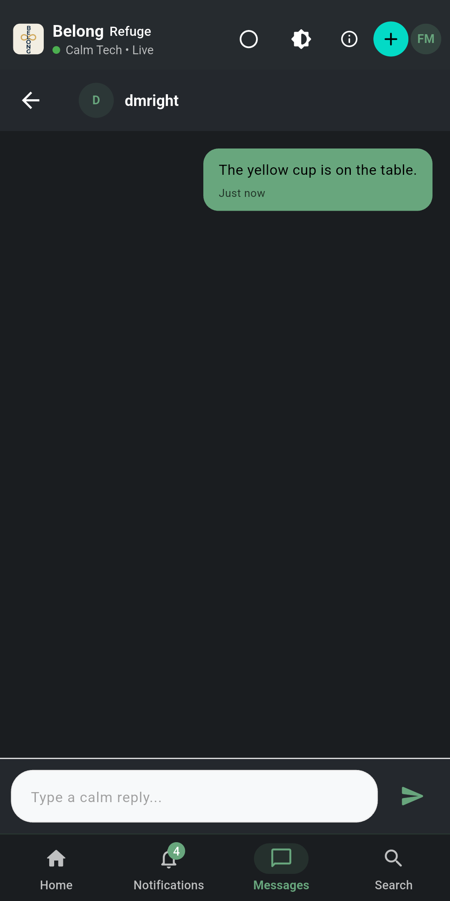
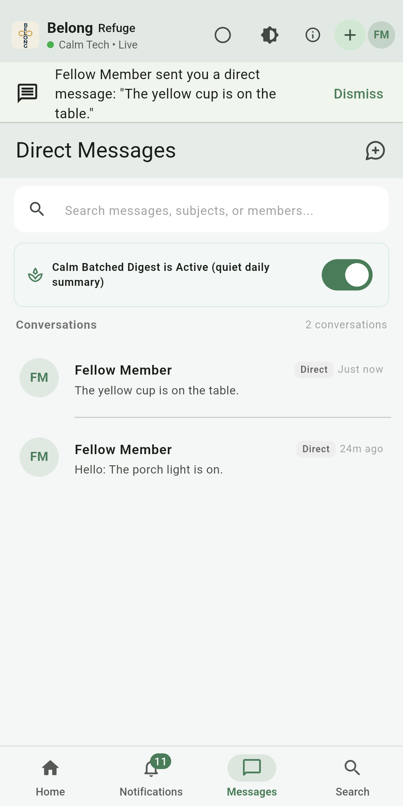

# Direct message push function

> **Code**: `appwrite/functions/dm-push`
> **Operator notes**: [README](https://github.com/neiljaywarner/refuge/blob/main/appwrite/functions/dm-push/README.md)
> **Decision**: [ADR-0012](ADR-0012-Direct-Message-Alerts)

Belong sends a direct-message notification from an Appwrite function, not from Firebase Cloud Functions. The Firebase project is on the Spark plan, which cannot build Cloud Functions. This function stays in the app repository because its send rule must match the Dart policy in the same change.

## Pieces

| Piece | Where |
| --- | --- |
| Entry | `src/main.js`. Checks the Firebase ID token with Google's public certificates. |
| Decision | `src/handle.js`. `register` saves the device. `send` notifies the other participants. |
| Rule | `src/decide.js`. Same on/off rule as the Dart file `direct_message_push_policy.dart`. |
| Tests | `npm test` in that directory. Twelve checks. No network. |

The function id is `dm-push`. The runtime is Node 22. The entrypoint is `src/main.js`.

## What it will not do

- It will not send when Message alerts are off or the schedule is Completely Muted.
- It will not send a placeholder token that starts with `fcm_token_calm`.
- It will not send to a sample member. Those sends never create a `direct_messages` document.
- It will not put the message text from the phone into the notification. It reads the stored document.
- It will not send when the FCM credential secret is missing. The response says the credential is not configured.
- It does not send email. That is [#570](https://github.com/neiljaywarner/refuge/issues/570).

## Secret

`FCM_SERVICE_ACCOUNT_JSON` is a secret variable on the function. It is the Firebase Admin SDK JSON for project `belongonthespectrum`. Do not commit it. Do not paste it into an issue, a pull request, or this wiki. Do not create a second key.

The row write uses `APPWRITE_FUNCTION_API_KEY`, which Appwrite creates for each run from the function scopes `rows.read` and `rows.write`. If that value is empty, the code falls back to an optional secret named `APPWRITE_API_KEY`. That name is not injected. If you create the fallback, its scopes are only `rows.read` and `rows.write`. Never write the value down.

## If register returns 401

The phone log is `dm-push register 500 {"error":"push failed"}`. The execution error is `could not store push device (401)`. The header `X-Appwrite-Key` was empty, so `push_devices` stayed empty and a later send skipped the recipient.

Check, in this order:

1. Function `dm-push` scopes include `rows.read` and `rows.write`.
2. `src/main.js` sends `APPWRITE_FUNCTION_API_KEY` as `X-Appwrite-Key`.
3. Redeploy this directory with entrypoint `src/main.js` and activate that deployment. Pack it without `node_modules`. On macOS set `COPYFILE_DISABLE=1` so the archive does not include AppleDouble files.
4. Run `register` again for a signed-in member. Success is HTTP 200 and `{"ok":true}`.

Report only `enabled`, `schedule`, and the token length. The token must be non-empty and must not start with `fcm_token_calm`. Do not copy the token, a Firebase uid, an address, a password, or either API key into the issue.

## What a member should see

1. Notifications, then Calm Notification Preferences, then **Message alerts** on.
2. Sign in on that phone. A practice name never gets a push.
3. The sender taps the person until a chip appears, then Send. The button shows a spinner, then **OK, it worked**.
4. If the recipient's app is open, a Material banner. Belong does not also post a system notification for that same moment.
5. If the app is closed or on the home screen, the system notification, with sound, on the Direct messages channel. Completely Muted sends nothing. Immediate Gentle Cards is the same notification without sound.

## Checked on two phones

October 25, 2026, dev app, two synthetic signed-in members. Message alerts was on. Each send was done in the app: New Message, the person selected, Send. The button read **OK, it worked** every time. No message was sent to a real community member. The pictures below are the app only. The status bar and the gesture pill are cropped off. A shade picture is not included, because that screen also shows other apps.

| Recipient | What the sender did | What the recipient showed |
| --- | --- | --- |
| App in front | Sent "The blue cup is on the table." | A Material banner with that sentence. The system shade did not gain that sentence. |
| App in the background, still running | Sent "The green cup is on the table." | The system shade text was: Fellow Member sent you a direct message: "The green cup is on the table." |
| App swiped away and not running | Sent "The yellow cup is on the table." | The same shade sentence for the yellow cup. Opening Belong then showed the banner and the conversation. |

[Short clip of that recipient screen](images/dm-receiver-banner.mp4)

Email for the same moment is still [#570](https://github.com/neiljaywarner/refuge/issues/570).
