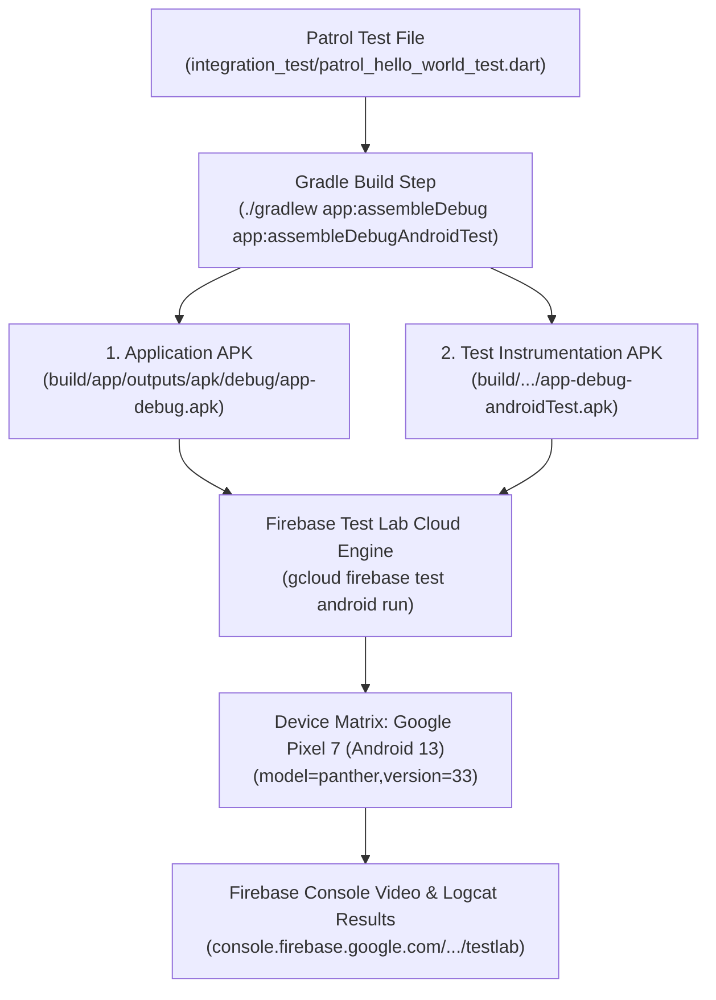

# 🧪 Firebase Test Lab & Patrol Integration Guide (`Firebase-Test-Lab-and-Patrol-Guide`)

> **Related Issue**: [Issue #136](https://github.com/neiljaywarner/refuge/issues/136)  
> **Related Runner**: [`tool/run_firebase_test_lab.dart`](https://github.com/neiljaywarner/refuge/blob/main/tool/run_firebase_test_lab.dart) & [`tool/run_firebase_test_lab.sh`](https://github.com/neiljaywarner/refuge/blob/main/tool/run_firebase_test_lab.sh)  
> **Test Target**: [`integration_test/patrol_hello_world_test.dart`](https://github.com/neiljaywarner/refuge/blob/main/integration_test/patrol_hello_world_test.dart)  
> **Firebase Console**: [`https://console.firebase.google.com/project/belongonthespectrum/testlab`](https://console.firebase.google.com/project/belongonthespectrum/testlab)

---

## 🧭 Why Run on Firebase Test Lab?

While local testing on the physical **Google Pixel 9a** and **Android Emulator (`emulator-5554`)** provides rapid inner-loop developer feedback, **Firebase Test Lab** provides:
1. **Diverse Device Matrix**: Automated testing across multiple Android API levels (Android 12, 13, 14, 15) and form factors (Pixel 7, Samsung Galaxy, tablets) without owning physical hardware.
2. **Video & Performance Recordings**: Every test execution automatically captures screen video, CPU/memory profiles, and logcat output in the Firebase Console.
3. **Release Packaging Gate**: Confirms that release/debug ProGuard rules, R8 shrinking, and Android Gradle dependencies compile cleanly.

---

## 🏗️ Architecture: How Patrol Runs on Firebase Test Lab

Unlike traditional Flutter driver tests that require a host computer tethered via ADB, **Patrol** compiles into standard native Android **Instrumentation APKs**:



1. **Application APK (`app-debug.apk`)**: The compiled Flutter application with all assets, icons, and Riverpod providers.
2. **Instrumentation APK (`app-debug-androidTest.apk`)**: Native Android test runner APK containing the JUnit / Patrol test runner that drives the application internally.

---

## 🚀 Running the Test Lab Pipeline

### 1. Dry Run (Inspect Configuration & Commands)
```bash
dart run tool/run_firebase_test_lab.dart --dry-run
```
Outputs the dev `flutter build apk` flags (`lib/main_dev.dart`, `FLAVOR=dev`, `ENABLE_SERVERPOD=false`), the Gradle instrumentation step, and the exact `gcloud` command.

### 2. Build Only (local gate, no upload)
```bash
dart run tool/run_firebase_test_lab.dart --build-only
```
Builds the APK pair and refuses to continue unless `aapt dump badging` reports `com.belongonthespectrum.refuge.dev` and label `Belong (Dev)`.

### 3. Full Cloud Test Execution
When run on a machine with `gcloud` authenticated (`gcloud auth login`):
```bash
dart run tool/run_firebase_test_lab.dart \
  --project belongonthespectrum \
  --target integration_test/patrol_hello_world_test.dart \
  --device model=panther,version=33,locale=en,orientation=portrait
```

Or using the bash wrapper:
```bash
./tool/run_firebase_test_lab.sh --dry-run
```

---

## 📱 Recommended Device Matrix

| Device Model | Model ID | Android Version | Form Factor | Tier |
| :--- | :---: | :---: | :---: | :---: |
| **Google Pixel 7 (Default)** | `panther` | Android 13 (API 33) | Physical Phone | Standard Cloud Matrix |
| **Google Pixel 6** | `oriole` | Android 12 (API 32) | Physical Phone | Backward Compatibility |
| **Pixel Fold** | `felix` | Android 14 (API 34) | Foldable Tablet | Responsive Layout |

---

## 💰 Quotas & Cost Discipline
* **Spark Plan (Free Tier)**: 5 virtual device test runs / day and 1 physical device test run / day at zero cost.
* **Blaze Plan**: Inexpensive per-device-minute billing (~$0.01–$0.05 per device minute).
* **Token & Cost Optimization**: Run fast sub-2-second Gherkin tests (`patrolWidgetTest`) locally on Mac, and reserve Firebase Test Lab for major milestone verification.
