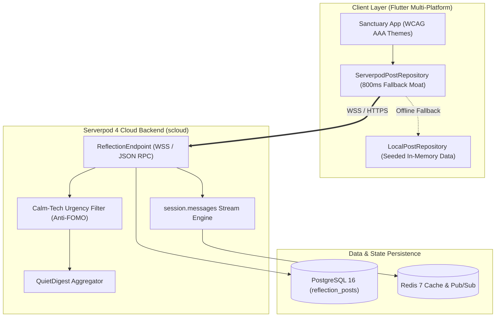

# 🌿 Sanctuary (Refuge): Calm-Tech Fellowship Platform
### *Official Documentation & Community Knowledge Base*

> **"I praise you because I am fearfully and wonderfully made; your works are wonderful, I know that full well."**  
> — *Psalm 139:14*

---

## 🕊️ Welcome to Sanctuary

**Sanctuary (Refuge)** is a custom, full-stack, calm-tech community platform created with **Flutter** and **Serverpod 4**. It was built specifically for **[Belong on the Spectrum](https://www.belongonthespectrum.com/)**, an initiative created by and for Autistic Disciples of Jesus, neurodivergent Christians, and their allies.

Mainstream community platforms (Circle, Mighty Networks, Slack, and Discord) charge small non-profits and faith communities **$89–$130/month ($1,000–$1,560/year)** and bombard users with dopamine gamification, red notification badges, and sensory overload. Sanctuary replaces this expensive, stressful model with **low-cost Serverpod 4 compute (<$5/month)** and an unshakeable calm-tech ethos.

---

## 🧭 Audience Portals

Please select the portal that best fits your role:

| Portal | Target Audience | Key Contents |
| :--- | :--- | :--- |
| **[🏆 Hackathon Judges Portal](Hackathon-Judges-Portal)** | Serverpod Hackathon Evaluators | Rubric breakdown (100%), live Serverpod Cloud endpoints, `.spy.yaml` protocols, PostgreSQL schema, 20/20 test results. |
| **[💼 Resume & Engineering Showcase](Resume-and-Engineering-Showcase)** | Hiring Managers, Recruiters & Technical Peers | Full-stack Dart architectural leadership, 96% cost reduction case study, dual-hardware mobile automation, technical portfolio overview. |
| **[🧩 Belong Community Guide](Belong-Community-Guide)** | Autistic Believers, Pastors, Caregivers & Allies | Community anchor, Psalm 139:14 mission, 5 fellowship spaces, special interest badging, autism & faith memes, 4 sensory modes. |
| **[🧪 QA & Beta Testing Guide](QA-and-Beta-Testing-Guide)** | QA Testers, UAT Evaluators & Early Beta Users | Web & Android APK installation, persona test matrices, offline fallback verification, bug report templates. |

---

## 🌐 Live Deployments & Verification

* 🌐 **Live Web Application**: [https://refuge4serverpodhackathon.web.app](https://refuge4serverpodhackathon.web.app)
* ☁️ **Serverpod Cloud API Endpoint**: [https://refuge4serverpod.api.serverpod.space/](https://refuge4serverpod.api.serverpod.space/)
* 🖥️ **Serverpod Cloud Web Landing**: [https://refuge4serverpod.serverpod.space/](https://refuge4serverpod.serverpod.space/)
* 📊 **Serverpod Insights**: [https://refuge4serverpod.insights.serverpod.space/](https://refuge4serverpod.insights.serverpod.space/)
* 📦 **GitHub Release v0.1.0 (APK & Demos)**: [v0.1.0 Release](https://github.com/neiljaywarner/refuge4serverpod/releases/tag/v0.1.0)
* 📱 **Dual Pixel 9a Cloud Demos**: [Pixel Left Demo](https://github.com/neiljaywarner/refuge4serverpod/releases/download/v0.1.0/sanctuary_pixel_left_scloud.mp4) • [Pixel Right Demo](https://github.com/neiljaywarner/refuge4serverpod/releases/download/v0.1.0/sanctuary_pixel_right_scloud.mp4)

---

## ⚡ Architectural Snapshot

---

## 📖 Additional Technical Pages
* **[Serverpod Architecture Deep Dive](Serverpod-Architecture-Deep-Dive)**: Complete review of SPI protocols, PostgreSQL indexing, and backend validation.
* **[Dual Pixel Cloud Demo](Dual-Pixel-Cloud-Demo)**: How we verified physical multi-device communication on T-Mobile LTE.
* **[Calm-Tech & Accessibility](Calm-Tech-and-Accessibility)**: Cognitive ease, color psychology, and WCAG AAA compliance.
