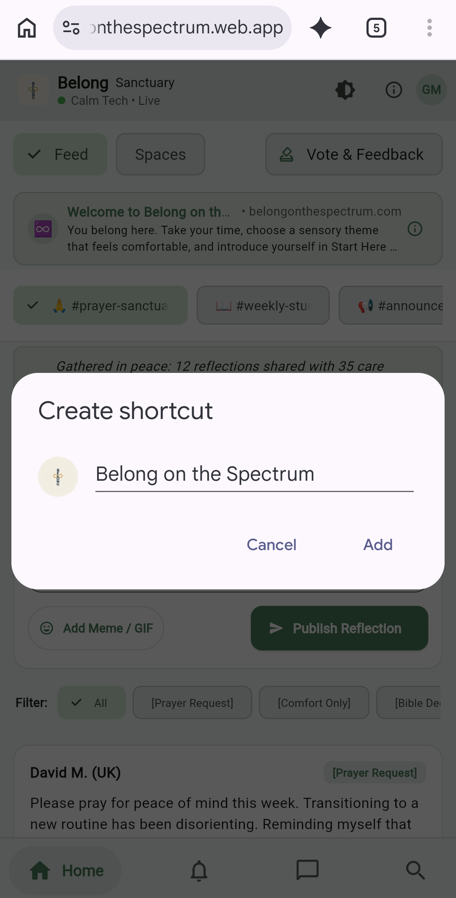
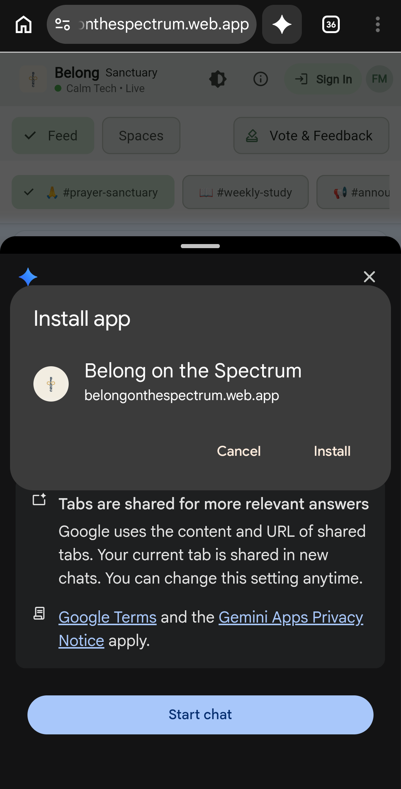

# How you can help

You do not need special skills. If you can open a link, look around, and say how it felt, you can help.

This week, **October 24–31**, Circle and Belong both stay open. Go at your own pace.

**Open Belong:** [belongonthespectrum.web.app](https://belongonthespectrum.web.app)

A longer schedule for leaders is on **[Plan through October 31](Non-Technical-Roadmap-to-Oct-31)**. The rooms are described on **[Our community spaces](Belong-Community-Guide)**.

---

## Start here (about 10 minutes, or just one part)

1. Open [belongonthespectrum.web.app](https://belongonthespectrum.web.app) on your phone or computer.
2. Look around. Tap **Spaces** and open a room you already know, such as **General Chat** or **Start Here**.
3. Tap **Vote & Feedback** (it sits near **Feed** and **Spaces**).
4. If you want, say hello in **Start Here & Introduce Yourself**.

Then use **[What to look for](#what-to-look-for)** below. You can do one section and stop. That is enough.

---

## A message you can paste into Circle

Copy everything in the box. It already includes the Belong link.

```markdown
👋 Hey Belong family!

Before October 31, we are gently moving from Circle into Belong on the Spectrum. Both places stay open through October 31. There is no rush.

Open Belong here:
https://belongonthespectrum.web.app

Our website:
https://www.belongonthespectrum.com/

Why this feels like home:
- It is calm on purpose: quiet colors, clear labels, and videos that do not start by themselves.
- The rooms you know are here: Start Here, Announcements, General Chat, Memes, Online Resources / Videos, Actually Autistic Chat, Friends Chat, and Family Chat.

Three easy ways to help (about 2 minutes):
1. Open the link above. Tap Vote & Feedback, then Vote on Features, and tap the thumb next to what matters to you.
2. In that same place, tap Share Feedback. Choose Works Great, Idea / Tweak, or Bug / Confusing, and tell us how it felt.
3. Say hello in Start Here so the rooms feel warm.

You can also put Belong on your iPhone or Android home screen. Steps for both are in the "How you can help" guide.

Reply here if you would like to welcome people this week.
```

---

## What to look for

Tell us what you noticed with **Share Feedback**. **Works Great** is for what already feels kind. **Idea / Tweak** is for a calmer or clearer change. **Bug / Confusing** is for anything that felt broken, unclear, or like too much.

You do not have to finish the list.

### A calm feel

- Do the colors feel easy to sit with?
- Does anything flash, pop up, or start playing sound or video on its own?
- Can you leave and come back without feeling behind?

### Words you can read

Tap the brightness icon at the top and try each look:

- **Clean** (Clean Slate)
- **Sage** (Sage Botanical)
- **Dark** (Monastic Dark)
- **Contrast** (High Contrast)

Look for words that disappear into the background, buttons that do not say what they do, and any look that feels harsh. There is also a one-tap jump between **Sage** and **High Contrast**.

### Voting and feedback

1. Tap **Vote & Feedback**.
2. The page that opens is titled **Belong Roadmap & Feedback**.
3. Tap **Vote on Features**. Tap the thumb next to an idea you care about. The number is how many people have chosen it. Tap again if you want to take the vote back.
4. Tap **Share Feedback**. Read the three choices before you pick one. Send a short note only if you want to.

Look for: Can you tell what each choice means before you tap it? Is the thumb easy to find? Did anything ask you to guess?

### Spaces that feel warm

Open **Spaces** and see whether you can find:

- **Start Here & Introduce Yourself**
- **Announcements**
- **General Chat**
- **Memes**
- **Online Resources / Videos**
- **Actually Autistic Chat**
- **Friends Chat**
- **Family Chat**

If a room you used on Circle is missing, or a name is confusing, that is useful to say. A short hello in **Start Here** helps the room feel lived in. You do not owe anyone a long introduction.

**Saved for Later** is for private bookmarks. **Members Section & Directory** is the member list. **DFW Church** opens the church website. **Actually Autistic Events** is not ready yet. If you see "coming soon," that is expected.

The bar at the bottom says **Home**, **Notifications**, **Messages**, and **Search**. Tap each one and make sure you can get back. If a number on **Notifications** feels stressful, please say so.

---

## Put Belong on your phone

Belong is not in the app stores yet. You can still keep it on your home screen, next to your other apps. It opens without the browser address bar. More of the "why" is on **[Why we are not in the app stores yet](Why-No-App-Store-App)**.

Use the phone's own browser for these steps. On iPhone, that is **Safari**. On Android, that is **Chrome**.

### iPhone and iPad (Safari)

Do this:

1. Open **Safari** (the compass). On iPhone, Chrome cannot add Belong to the Home Screen in the same way.
2. Go to [belongonthespectrum.web.app](https://belongonthespectrum.web.app).
3. Tap **Share**. It is a square with an arrow pointing up. On iPhone it is usually at the bottom. On iPad it may be at the top.
4. Scroll the list and tap **Add to Home Screen**.
5. The name should say **Belong on the Spectrum**. Tap **Add**.
6. Find the Belong icon on your Home Screen and tap it.

Look for: the icon is there, Belong opens without Safari's address bar, and you can still reach **Spaces**.

iPhone pictures are not in this guide yet. These are optional pictures to add later, not extra steps:

- Safari open to Belong, with the Share button visible
- The share list, with **Add to Home Screen** visible
- The Add screen, with the name **Belong on the Spectrum**
- The Belong icon on the Home Screen

### Android (Chrome)

1. Open **Chrome**.
2. Go to [belongonthespectrum.web.app](https://belongonthespectrum.web.app).
3. Tap the **three dots** at the top.
4. Tap **Install and create shortcut**. If your phone says **Add to Home screen** or **Install app** instead, tap that. They do the same job.
5. You will see one of the two prompts below. Either one is right.
   - If it says **Add to home screen**, check that the name is **Belong on the Spectrum**, then tap **Add**.
   - If it says **Install app**, tap **Install**.
6. Open Belong from your home screen or app list.

Look for: the icon is on your home screen, Belong opens without Chrome's address bar, and you can still reach **Spaces**.

One prompt you may see. Tap **Add**.



Another prompt you may see. Tap **Install**.



On a computer, open Belong in Chrome, Edge, or Safari. Look for an install icon in the address bar, or on a Mac choose **File**, then **Add to Dock**.

---

## If something feels off

Use **Bug / Confusing** or **Idea / Tweak** inside **Vote & Feedback**. Or message an organizer in Circle.

You can stop after one try. Thank you for helping the rooms feel like a place to land.

[Back to the welcome page](Home)
