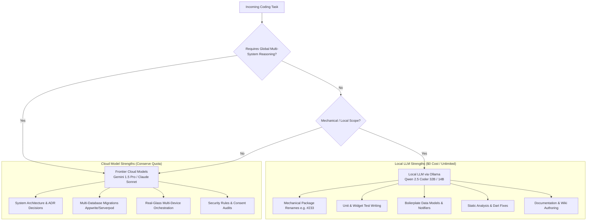

# 🤖 Local LLMs & Token Quota Preservation Strategy Guide

> **Target Audience**: Maintainers, AI Coding Agents, and Contributors  
> **Primary Hardware**: 48GB Unified Memory Apple Silicon (M-series Mac)  
> **Related Issues**: [#234](https://github.com/neiljaywarner/refuge/issues/234), [#233](https://github.com/neiljaywarner/refuge/issues/233), [#197](https://github.com/neiljaywarner/refuge/issues/197), [#92](https://github.com/neiljaywarner/refuge/issues/92)  
> **Master Dashboard**: [`status.md`](https://github.com/neiljaywarner/refuge/blob/main/status.md)

---

## 1. 🎯 Executive Summary & Purpose

Frontier cloud language models (e.g., Gemini 1.5 Pro, Claude 3.5 Sonnet, GPT-4o) possess remarkable architectural reasoning, but their API calls are constrained by **strict weekly token quotas and rate limits**. When exhausted or throttled, development velocity grinds to a halt unless an offline or zero-cost alternative is available.

With **48GB of unified memory on Apple Silicon**, we have approximately **36GB to 40GB of high-bandwidth VRAM** directly accessible to Apple's Metal GPU shaders. This enables running state-of-the-art open coding models (such as **Qwen 2.5 Coder 32B/14B** and **DeepSeek R1**) entirely locally:
- **Zero Cost**: $0.00 cloud API bills.
- **Zero Rate Limits**: Unlimited tokens day or night.
- **Zero Network Latency**: Blazing fast token generation completely offline.
- **Privacy & Zero-PII**: Sensitive data never leaves the local machine.

This guide outlines our **Task Delegation Taxonomy**, benchmarking data, setup commands, and integration patterns to ensure cloud tokens are preserved strictly for high-leverage architectural reasoning while mechanical work is offloaded to local models.

---

## 2. 💻 Hardware Sizing & Benchmarks (48GB Apple Silicon Unified RAM)

Apple Silicon's unified memory architecture allows CPU and GPU to share the same ultra-high-bandwidth memory bus without PCI express bottlenecks.

| Model Tier | Model Name | Quantization | VRAM Required | Token Generation Speed | Recommended Use Case |
|---|---|---|---|---|---|
| **Tier 1 (Workhorse)** | `qwen2.5-coder:32b` | `Q4_K_M` | ~20 GB | **25 – 35 tokens/sec** | Complex Dart/Flutter refactoring, BDD widget tests, Riverpod notifiers, full feature implementation. |
| **Tier 2 (High-Speed)** | `qwen2.5-coder:14b` | `Q8_0` | ~16 GB | **50 – 75 tokens/sec** | Rapid unit test iteration, mechanical package renames, lint fixes (`dart fix`), docstrings. |
| **Tier 3 (Lightweight)** | `qwen2.5-coder:7b` | `Q4_K_M` | ~5 GB | **90 – 120 tokens/sec** | Single-file edits, regex transformations, JSON mapping, commit message drafting. |
| **Tier 4 (Reasoning)** | `deepseek-r1:32b` or `14b` | `Q4_K_M` | ~20 GB | **20 – 30 tokens/sec** | Algorithmic optimization, complex test failure triage, logic verification. |

> [!TIP]
> On macOS with 48GB unified RAM, system services and dev tools (IDE, Android emulators, Chrome) consume ~8GB. Running a 32B `Q4_K_M` model (~20GB VRAM) leaves ~20GB free for Flutter compilation and real-device ADB/Maestro automation with zero paging or swapping!

---

## 3. ⚖️ Task Delegation Taxonomy: What to Run Locally vs. Cloud

To maximize development velocity and protect cloud quota, follow this strict task separation:



### 🟢 Ideal Tasks for Local LLMs (Ollama + Qwen 2.5 Coder)

1. **Mechanical Codebase-Wide Refactorings**:
   - **Case Study (Issue [#233](https://github.com/neiljaywarner/refuge/issues/233))**: Renaming package `refuge4serverpod` to `refuge`. Replacing `import 'package:refuge4serverpod/...'` across 100+ files and updating `pubspec.yaml` requires zero frontier reasoning—a local 14B or 32B model executes this deterministically without burning cloud credits.
2. **Unit & Widget Test Coverage (TDD)**:
   - Writing tests for repository adapters, Riverpod providers, and utility functions using `package:test` and `patrol_finders`.
3. **Data Model & JSON Boilerplate**:
   - Implementing `fromJson`, `toJson`, `copyWith`, and immutable model classes.
4. **Static Analysis & Lint Resolution**:
   - Applying `dart fix --apply` and cleaning unused imports or deprecated API warnings.
5. **Documentation & Changelogs**:
   - Authoring markdown wiki pages, documenting API headers with `///` docstrings, and drafting release notes.

### 🔴 Tasks Reserved for Frontier Cloud Models (Gemini Pro / Claude 3.5 Sonnet)

1. **Architectural Decisions (ADRs)**:
   - Designing multi-system synchronization between Appwrite document databases, Serverpod WebSockets, and Firebase edge triggers.
2. **Cross-Service Security Audit**:
   - Firestore security rules (`firestore.rules`), Appwrite permissions, and OAuth credential scopes.
3. **Complex Multi-Device Hardware Automation**:
   - Orchestrating dual-Pixel live flows over ADB/Maestro and resolving subtle timing/race conditions.

---

## 4. 🚀 Quickstart Setup Guide (macOS / Apple Silicon)

### Step 1: Install Ollama
Using Homebrew:
```bash
brew install ollama
brew services start ollama
```
Or download the native macOS app with menu-bar controls from [ollama.com](https://ollama.com/download).

### Step 2: Pull Target Models
```bash
# Workhorse 32B coding model (~20GB download):
ollama pull qwen2.5-coder:32b

# High-speed 14B model for fast iteration (~9GB download):
ollama pull qwen2.5-coder:14b
```

### Step 3: Test Local Inference
Verify Metal GPU acceleration by asking for a Dart snippet:
```bash
ollama run qwen2.5-coder:14b "Write a Riverpod Notifier in Dart for switching between Calm Teal and Lavender themes"
```

### Step 4: Configure OpenAI-Compatible Endpoint in Agent Tools
Ollama automatically provides an OpenAI-compatible HTTP API at:
```
http://localhost:11434/v1
```
You can point Antigravity, Cursor, Continue.dev, or Aider to this URL with:
- **Base URL**: `http://localhost:11434/v1`
- **Model**: `qwen2.5-coder:32b` or `qwen2.5-coder:14b`
- **API Key**: `ollama` (any non-empty string)

---

## 5. 📋 Execution Blueprint: Issue #233 Package Rename (`refuge4serverpod` $\rightarrow$ `refuge`)

This template is checked into Issue [#233](https://github.com/neiljaywarner/refuge/issues/233) for local LLM execution:

```bash
# 1. Checkout dedicated worktree
cd /Users/neil/belongonthespectrum/.worktrees/issue-233-rename-package-refuge4serverpod

# 2. Update pubspec.yaml name field
sed -i '' 's/^name: refuge4serverpod/name: refuge/' pubspec.yaml

# 3. Global import rename across Dart files
find lib test tool -name "*.dart" -exec sed -i '' 's/package:refuge4serverpod\//package:refuge\//g' {} +

# 4. Clean and regenerate dependencies
flutter clean && flutter pub get

# 5. Verification
dart analyze
flutter test
```

---

## 6. 🧪 Documented Live Test Accounts (Zero-PII)

During our end-to-end Firebase Auth live-glass testing on Google Pixel 9a (`58221JEBF20835`), the following test accounts were created and verified:

| Account Email | Initial Role / Profile | Verification State | Verification Tested | Purpose |
|---|---|---|---|---|
| `neilwarner+21oct1253am@gmail.com` | `Neil (Belong Founder)` | `emailVerified: false` | Resend verification email sent & verified | Live registration, profile edit, sign-out & sign-in e2e |
| `neilwarner@gmail.com` | Community Maintainer | Verified | Password reset link received & verified | Forgot Password live test |

> [!NOTE]
> All test accounts are managed under the official Firebase Project `belongonthespectrum` (Project Number `207506875171`). Future requirement for email verification enforcement is tracked in Issue [#236](https://github.com/neiljaywarner/refuge/issues/236).
