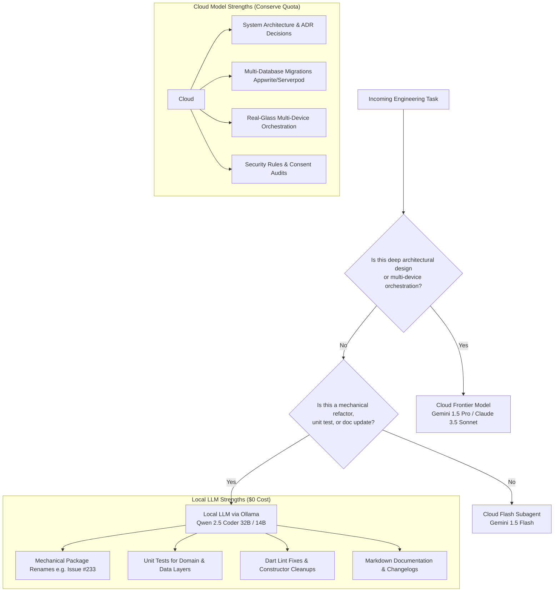

# 🤖 Local LLMs & Token Quota Preservation Strategy

> **Repository**: [`https://github.com/neiljaywarner/refuge`](https://github.com/neiljaywarner/refuge)  
> **Audience**: Engineers, Mentors, and Autonomous Coding Agents  
> **Hardware Context**: 48GB Unified RAM Apple Silicon Mac (`arm64`)  
> **Linked Skills**: [`token-quota-routing`](.agents/skills/token-quota-routing/SKILL.md)  
> **Linked Architecture**: [`docs/AGENT_HARNESS_AND_ORCHESTRATION.md`](../AGENT_HARNESS_AND_ORCHESTRATION.md)  
> **Status**: Production Operational Runbook

---

## 1. Executive Summary

Belong on the Spectrum is built using high-velocity agentic workflows. As the release approaches (**October 31, 2026**), preserving frontier cloud model quotas (e.g. Gemini 1.5 Pro / Claude 3.5 Sonnet 5-hour rolling limits and 7-day weekly caps) while maintaining rapid development momentum is paramount.

By leveraging **48GB of unified RAM on Apple Silicon**, we possess **~36GB of comfortably available VRAM** for local GPU inference via Metal shaders. This enables running state-of-the-art coding LLMs locally with **$0 API cost, zero rate limits, and zero cloud dependency**.

---

## 2. Hardware Capabilities & Local Model Benchmarks (48GB Mac)

On Apple Silicon (`M-series`), unified memory allows the GPU to access system RAM directly without PCIe transfer bottlenecks.

| Model | Quantization | Parameter Count | VRAM Footprint | Generation Speed (Metal) | Strengths / Capabilities |
| :--- | :---: | :---: | :---: | :---: | :--- |
| **`qwen2.5-coder:32b`** | Q4_K_M | 32.5 Billion | **~20 GB** | **25 – 35 tok/sec** | Flagship code model; Dart 3 pattern matching, complex Riverpod 2.x notifier refactors, full BDD scenario generation. |
| **`qwen2.5-coder:14b`** | Q8_0 / Q4_K_M | 14.7 Billion | **~9 GB** | **45 – 60 tok/sec** | Blazing-fast utility model; unit test authoring, mechanical renaming, lint resolution, regex patterns. |
| **`qwen2.5-coder:7b`** | Q8_0 | 7.6 Billion | **~5 GB** | **70 – 90 tok/sec** | Instant code generation; single-function edits, docstring generation, JSON schema definitions. |
| **`deepseek-coder-v2:16b`** | Q4_K_M | 15.7 Billion (MoE) | **~10 GB** | **40 – 55 tok/sec** | Multi-file reasoning, refactoring large Flutter presentation widgets. |

```
┌────────────────────────────────────────────────────────────────────────┐
│                      48 GB Unified System Memory                       │
├─────────────────────────┬─────────────────────────┬────────────────────┤
│   macOS & Dev Tools     │   Local LLM Inference   │ Free Buffer / Apps │
│   (Android Studio,      │   (qwen2.5-coder:32b)   │ (Chrome, Terminal, │
│    Pixel 9a Emulator)   │                         │  Slack, etc.)      │
│         ~12 GB          │         ~20 GB          │       ~16 GB       │
└─────────────────────────┴─────────────────────────┴────────────────────┘
```

---

## 3. The 3-Tier Task Delegation Taxonomy

To optimize both developer time and cloud token usage, all engineering tasks must be routed according to cognitive complexity:



### 🟢 Ideal Tasks for Local LLMs (Ollama + Qwen 2.5 Coder)

1. **Mechanical Codebase-Wide Refactorings**:
   - **Case Study (Issue [#233](https://github.com/neiljaywarner/refuge/issues/233))**: Renaming package `refuge4serverpod` to `refuge`. Replacing `import 'package:refuge4serverpod/...'` across 100+ files and updating `pubspec.yaml` requires zero frontier reasoning—a local 14B or 32B model executes this deterministically without burning cloud credits.
2. **Unit & Widget Test Coverage (TDD)**:
   - Writing tests for repository adapters, Riverpod providers, and utility functions using `package:test` and `patrol_finders`.
3. **Data Model & JSON Boilerplate**:
   - Implementing `fromJson`, `toJson`, `copyWith`, and immutable model classes.
4. **Static Analysis & Lint Resolution**:
   - Applying `dart fix --apply` and cleaning unused imports or deprecated API warnings.
5. **Documentation & Changelogs**:
   - Authoring markdown wiki pages, documenting API headers with `///` docstrings, and drafting release notes.

### 🔴 Tasks Reserved for Frontier Cloud Models (Gemini Pro / Claude 3.5 Sonnet)

1. **Architectural Decisions (ADRs)**:
   - Designing multi-system synchronization between Appwrite document databases, Serverpod WebSockets, and Firebase edge triggers.
2. **Cross-Service Security Audit**:
   - Firestore security rules (`firestore.rules`), Appwrite permissions, and OAuth credential scopes.
3. **Complex Multi-Device Hardware Automation**:
   - Orchestrating dual-Pixel live flows over ADB/Maestro and resolving subtle timing/race conditions.

---

## 4. 🚀 Quickstart Setup Guide (macOS / Apple Silicon)

> [!TIP]
> **Phase 1 Automation**: Run `./tool/setup_ollama.sh` to automatically install, launch, and verify Ollama.  
> Read the complete guide in [Local-LLMs-Phase-1-Getting-Started.md](Local-LLMs-Phase-1-Getting-Started.md) ([Issue #271](https://github.com/neiljaywarner/refuge/issues/271)).  
> Tracking Phase 2 (Advanced Routing Heuristics): [Issue #272](https://github.com/neiljaywarner/refuge/issues/272).

### Step 1: Install Ollama
Using the automated script:
```bash
./tool/setup_ollama.sh
```
Or manually via Homebrew:
```bash
brew install ollama
brew services start ollama
```
Or download the native macOS app with menu-bar controls from [ollama.com](https://ollama.com/download).

### Step 2: Pull the Coding Specialist Models
```bash
# Flagship model (32.5B params, ~20GB download/VRAM)
ollama pull qwen2.5-coder:32b

# High-speed utility model (14.7B params, ~9GB download/VRAM)
ollama pull qwen2.5-coder:14b
```

### Step 3: Run Interactive Test Query
Test the local inference directly from your terminal:
```bash
ollama run qwen2.5-coder:14b "Write a Riverpod Notifier in Dart for switching between Calm Teal and Lavender themes"
```

### Step 4: OpenAI-Compatible API Endpoint
Ollama automatically provides an OpenAI-compatible HTTP API at:
```text
http://localhost:11434/v1
```
- **Base URL**: `http://localhost:11434/v1`
- **Model Name**: `qwen2.5-coder:32b` or `qwen2.5-coder:14b`
- **API Key**: `ollama` (any non-empty string)

---

## 5. Integrating with Antigravity & Development Tools

### Option A: Local Coding Subagent Configuration
You can register a custom subagent in `.gemini/antigravity/` pointing to your local Ollama endpoint:

```json
{
  "name": "local-coder",
  "description": "Offline mechanical Dart coder running on Apple Silicon Metal GPU",
  "api_base": "http://localhost:11434/v1",
  "model": "qwen2.5-coder:32b",
  "temperature": 0.2
}
```

### Option B: Terminal CLI Quick Fixes
For quick mechanical tasks when quota is low, pipe code into Ollama directly:
```bash
cat lib/src/features/reflections/domain/reflection.dart | \
  ollama run qwen2.5-coder:14b "Add copyWith and equality operators using modern Dart 3"
```

---

## 6. Golden Rules for Token Preservation

1. **Never use Cloud Frontier models for mechanical edits** (regex search-and-replace, package renaming, import reorganization).
2. **Run `/compact` every 2–3 merged PRs** to prevent bloated chat contexts from compounding input token costs.
3. **Use Flash subagents for file reading and broad grep**, keeping the parent orchestrator context lean.
4. **When 5-hour cloud rolling limits approach 80%**, switch to **Local Ollama** or take a deliberate 15-minute maintainer walk/break (`take-a-break` skill) while the window replenishes.
