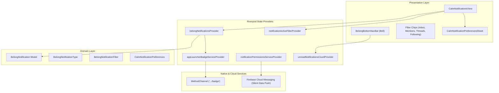

# 🔔 Notifications Technical Architecture

> **Belong on the Spectrum** (powered by Refuge)  
> **Source Directory**: `lib/src/features/notifications/`  
> **Related Architecture ADR**: [[ADR-0010-Notifications-Local-Awesome-vs-FCM]]  
> **Product Companion Guide**: [[Notifications-Product-Guide]]

> **Status (24 October 2026).** [ADR-0012](https://github.com/neiljaywarner/refuge/blob/main/docs/adr/0012-direct-message-alerts-are-opt-in.md) adds an opt-in direct-message push. The client saves the switch locally and, when a member is signed in, writes `users/{uid}/notification_settings/push`. The Appwrite function in `appwrite/functions/dm-push` is deployed and sends a normal Direct messages notification when the push credential is present. See [Direct message push function](Direct-Message-Push-Function). Calm email is a separate Cloud Function, `calmDirectMessageEmail`, because it has to read the private preference and the sign-in address when the document is created. Deploying it needs Blaze. See [Direct message email function](Direct-Message-Email-Function). The launcher-dot MethodChannel still has no native handler. [Issue #411](https://github.com/neiljaywarner/refuge/issues/411) stays open for the badge. FCM permission requests still set `badge: false`.

---

## 1. System Architecture

The notification subsystem in Belong on the Spectrum is built using **Feature-First Architecture** and **Riverpod** reactive state management. It bridges Flutter UI components with native Android and iOS operating system APIs via clean abstractions.



---

## 2. Riverpod State Providers

| Provider | Type | Responsibility |
| :--- | :--- | :--- |
| `belongNotificationsProvider` | `StateNotifierProvider<BelongNotificationsNotifier, List<BelongNotification>>` | Maintains list of notifications, marks items as read, triggers launcher badge updates. |
| `unreadNotificationsCountProvider` | `Provider<int>` | Computes unread notifications (`!isRead`). Drives bottom bar badge counter. |
| `notificationActiveFilterProvider` | `StateProvider<BelongNotificationFilter>` | Tracks active filter category (`inbox`, `mentions`, `threads`, `following`). |
| `filteredNotificationsProvider` | `Provider<List<BelongNotification>>` | Pure filtered subset for the active category. |
| `notificationPermissionsServiceProvider` | `StateNotifierProvider<NotificationPermissionsService, CalmNotificationPreferences>` | Manages FCM token registration, calm digest scheduling, and platform detection. |
| `appLauncherBadgeServiceProvider` | `Provider<AppLauncherBadgeService>` | Dispatches unread count to native launcher icon badge via MethodChannel. |

---

## 3. Data Structures & Formatting

### 3.1 `BelongNotification`
Represents an individual notification item:
- `id`: String ID.
- `authorName`: Author's full name.
- `authorInitials`: Smart 1-2 character initials generator. Strips parentheses and bracketed qualifications (e.g., `"Pastor Thomas (Melbourne)"` -> `"PT"`, `"Dr. Grace Hopper [Admin]"` -> `"DH"`).
- `type`: `mention`, `reply`, `like`, `following`.
- `postTitle`: Quoted reflection title.
- `timestamp`: DateTime timestamp.
- `isRead`: Boolean read flag.

### 3.2 Interaction Types & Avatars
Each notification type renders a distinct badge in the lower-right corner of the author's avatar:
- **`BelongNotificationType.like`**: Pink heart (`Icons.favorite`, `#E91E63`)
- **`BelongNotificationType.reply`**: Blue reply arrow (`Icons.reply_rounded`, `#2196F3`)
- **`BelongNotificationType.mention`**: Green `@` symbol (`Icons.alternate_email_rounded`, `#4CAF50`)
- **`BelongNotificationType.following`**: Purple person icon (`Icons.person_add_rounded`, `#9C27B0`)

---

## 4. Native Launcher Badge Synchronization

`AppLauncherBadgeService` dispatches unread counts through a standard Flutter `MethodChannel`:
```dart
static const MethodChannel _channel = MethodChannel(
  'com.belongonthespectrum.sanctuary/badge',
);

Future<bool> setBadgeCount(int count) async {
  if (kIsWeb) return false;
  return await _channel.invokeMethod<bool>('setBadgeCount', {'count': count});
}
```
When `count == 0` (e.g. after tapping *"Mark all read"*), the Dart service asks the channel to clear a count. There is no native handler, so the launcher icon dot does not change. The in-app unread count does clear.

---

## 5. Web Push, VAPID & `WEB_PUSH_VAPID_KEY` Architecture

### 5.1 What is VAPID? (High-Level Summary)
**VAPID** stands for **Voluntary Application Server Identification for Web Push**, codified as standard [IETF RFC 8292](https://datatracker.ietf.org/doc/html/rfc8292) and designed to work with the [W3C Push API](https://www.w3.org/TR/push-api/).

On mobile platforms (native Android or iOS), push notifications authenticate using proprietary OS vendor mechanisms (such as Google Play Services or Apple APNs authentication keys). On the open web, however, browsers (Chrome, Firefox, Safari, Edge) connect to different vendor-managed push services.

Without VAPID, web developers had to register separate developer accounts and API keys with every individual browser vendor. **VAPID eliminates this fragmentation**:
- It uses an **asymmetric elliptic curve keypair** (ECDSA over NIST curve P-256 / prime256v1).
- The **Public Key** (the `WEB_PUSH_VAPID_KEY`) is safe to ship to client browsers in frontend code.
- The **Private Key** stays protected on your application server or cloud functions.
- When your server sends a push message, it signs a JSON Web Token (JWT) using the private key. The browser vendor's push service (e.g. Mozilla Autopush, Google FCM Web Push Endpoint, Apple Push Service for Web) verifies the JWT signature against the public key associated with the client's subscription. This cryptographically proves the sender's identity and prevents unauthorized push spoofing without requiring vendor-specific API credentials.

### 5.2 Deep Technical Specifications & Standards
1. **Cryptographic Primitives ([RFC 8292 §2](https://datatracker.ietf.org/doc/html/rfc8292#section-2))**:
   - Algorithm: ECDSA using SHA-256 on the P-256 curve (`ES256`).
   - Public Key Encoding: Uncompressed point format (65 bytes starting with `0x04`), serialized as URL-safe Base64 without padding (typically 87 characters, starting with `B...`).
2. **Subscription Binding ([RFC 8292 §3](https://datatracker.ietf.org/doc/html/rfc8292#section-3))**:
   - In browser JavaScript: `pushManager.subscribe({ userVisibleOnly: true, applicationServerKey: vapidPublicKey })`.
   - In Flutter Web with Firebase Cloud Messaging:
     ```dart
     final fcmToken = await FirebaseMessaging.instance.getToken(
       vapidKey: String.fromEnvironment('WEB_PUSH_VAPID_KEY'),
     );
     ```
3. **Application Server Request Authentication**:
   - The backend includes an `Authorization: vapid t=<jwt>, k=<vapidPublicKey>` HTTP header when dispatching to the push service endpoint.
   - The signed JWT includes the `aud` claim (the origin of the push service), an `exp` expiration, and a `sub` claim (contact info, e.g. `mailto:support@belongonthespectrum.com`).

### 5.3 Belong on the Spectrum Implementation & Best Practices
- **Environment Injection**: The public key is injected at compile time via `--dart-define=WEB_PUSH_VAPID_KEY=<public_key>`.
- **Honest Fallback Behavior (`#811`)**:
  - If `WEB_PUSH_VAPID_KEY` is empty, unset, or a mock placeholder on Web, the client must **not** pass a dummy string to `getToken(vapidKey: ...)`, as modern browsers throw an `InvalidAccessError` or fail silently.
  - The app gracefully reports Web Push as unavailable on the web tab, surfaces a gentle prompt to install the PWA or use native notifications, and never crashes or records a false `enabled: true` in user preferences.
- **Authoritative References**:
  - [IETF RFC 8292: Voluntary Application Server Identification (VAPID) for Web Push](https://datatracker.ietf.org/doc/html/rfc8292)
  - [W3C Push API Specification](https://www.w3.org/TR/push-api/)
  - [Mozilla Developer Network (MDN): Sending VAPID identified WebPush Notifications](https://developer.mozilla.org/en-US/docs/Web/API/Push_API/Best_Practices#application_server_keys)
  - [Firebase Cloud Messaging Web Setup & VAPID Key Guide](https://firebase.google.com/docs/cloud-messaging/js/client#configure_web_credentials_with_fcm)

---

## 6. Verification & Test Suite

1. **Domain & Formatting Unit Tests**: `test/features/notifications/belong_notifications_test.dart`
2. **Preference & Schedule Unit Tests**: `test/features/notifications/notification_preferences_test.dart`
3. **Widget & BDD Tests**: Sub-2-second tests with `patrol_finders` verifying the bell, chips, mark-all-read checkbox, and contrast colors.
4. **Patrol Native Integration Tests**: Automated verification of Android Notification Shade via `$.native.openNotifications()`.
