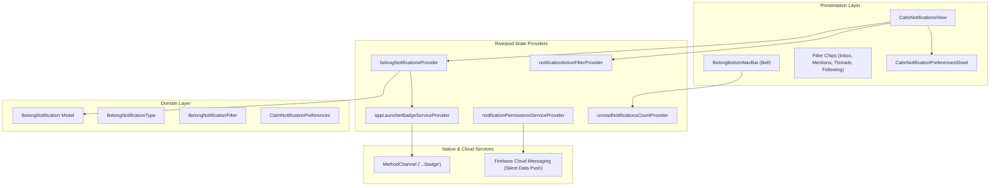

# 🔔 Notifications Technical Architecture

> **Belong on the Spectrum** (powered by Refuge)  
> **Source Directory**: `lib/src/features/notifications/`  
> **Related Architecture ADR**: [[ADR-0010-Notifications-Local-Awesome-vs-FCM]]  
> **Product Companion Guide**: [[Notifications-Product-Guide]]

> **Status (24 October 2026).** [ADR-0012](https://github.com/neiljaywarner/refuge/blob/main/docs/adr/0012-direct-message-alerts-are-opt-in.md) adds an opt-in direct-message push. The client saves the switch locally and, when a member is signed in, writes `users/{uid}/notification_settings/push`. `functions/index.js` would send a silent card on `direct_messages/{messageId}` create. That function is not deployed: Spark cannot enable Cloud Build. The launcher-dot MethodChannel still has no native handler. [Issue #411](https://github.com/neiljaywarner/refuge/issues/411) stays open for the badge. FCM permission requests still set `badge: false`.

---

## 1. System Architecture

The notification subsystem in Belong on the Spectrum is built using **Feature-First Architecture** and **Riverpod** reactive state management. It bridges Flutter UI components with native Android and iOS operating system APIs via clean abstractions.



---

## 2. Riverpod State Providers

| Provider | Type | Responsibility |
| :--- | :--- | :--- |
| `belongNotificationsProvider` | `StateNotifierProvider<BelongNotificationsNotifier, List<BelongNotification>>` | Maintains list of notifications, marks items as read, triggers launcher badge updates. |
| `unreadNotificationsCountProvider` | `Provider<int>` | Computes unread notifications (`!isRead`). Drives bottom bar badge counter. |
| `notificationActiveFilterProvider` | `StateProvider<BelongNotificationFilter>` | Tracks active filter category (`inbox`, `mentions`, `threads`, `following`). |
| `filteredNotificationsProvider` | `Provider<List<BelongNotification>>` | Pure filtered subset for the active category. |
| `notificationPermissionsServiceProvider` | `StateNotifierProvider<NotificationPermissionsService, CalmNotificationPreferences>` | Manages FCM token registration, calm digest scheduling, and platform detection. |
| `appLauncherBadgeServiceProvider` | `Provider<AppLauncherBadgeService>` | Dispatches unread count to native launcher icon badge via MethodChannel. |

---

## 3. Data Structures & Formatting

### 3.1 `BelongNotification`
Represents an individual notification item:
- `id`: String ID.
- `authorName`: Author's full name.
- `authorInitials`: Smart 1-2 character initials generator. Strips parentheses and bracketed qualifications (e.g., `"Pastor Thomas (Melbourne)"` -> `"PT"`, `"Dr. Grace Hopper [Admin]"` -> `"DH"`).
- `type`: `mention`, `reply`, `like`, `following`.
- `postTitle`: Quoted reflection title.
- `timestamp`: DateTime timestamp.
- `isRead`: Boolean read flag.

### 3.2 Interaction Types & Avatars
Each notification type renders a distinct badge in the lower-right corner of the author's avatar:
- **`BelongNotificationType.like`**: Pink heart (`Icons.favorite`, `#E91E63`)
- **`BelongNotificationType.reply`**: Blue reply arrow (`Icons.reply_rounded`, `#2196F3`)
- **`BelongNotificationType.mention`**: Green `@` symbol (`Icons.alternate_email_rounded`, `#4CAF50`)
- **`BelongNotificationType.following`**: Purple person icon (`Icons.person_add_rounded`, `#9C27B0`)

---

## 4. Native Launcher Badge Synchronization

`AppLauncherBadgeService` dispatches unread counts through a standard Flutter `MethodChannel`:
```dart
static const MethodChannel _channel = MethodChannel(
  'com.belongonthespectrum.sanctuary/badge',
);

Future<bool> setBadgeCount(int count) async {
  if (kIsWeb) return false;
  return await _channel.invokeMethod<bool>('setBadgeCount', {'count': count});
}
```
When `count == 0` (e.g. after tapping *"Mark all read"*), the Dart service asks the channel to clear a count. There is no native handler, so the launcher icon dot does not change. The in-app unread count does clear.

---

## 5. Verification & Test Suite

1. **Domain & Formatting Unit Tests**: `test/features/notifications/belong_notifications_test.dart`
2. **Preference & Schedule Unit Tests**: `test/features/notifications/notification_preferences_test.dart`
3. **Widget & BDD Tests**: Sub-2-second tests with `patrol_finders` verifying the bell, chips, mark-all-read checkbox, and contrast colors.
4. **Patrol Native Integration Tests**: Automated verification of Android Notification Shade via `$.native.openNotifications()`.
