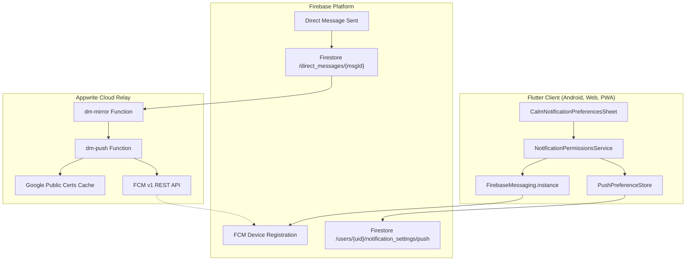

# Notifications Technical Architecture & Operational Guide (ADR-0010)

## Executive Summary
This document provides the authoritative architectural and operational specification for the Belong on the Spectrum notification engine, governing:
- **Calm Notification Ethics**: Batched delivery windows, anti-anxiety digests, zero sensory startles, and user schedule agency.
- **Unified Push Pipeline**: Integration between Firebase Cloud Messaging (FCM), Firebase Firestore, and the Appwrite Cloud Function relay (`dm-push`).
- **Web, PWA & Android Parity**: VAPID authentication, Service Worker lifecycles, and Android 13+ runtime permissions.
- **Automated Verification**: End-to-end BDD tests with Patrol finders and native integration suites.

---

## 1. Ethical Notification Principles & Mental Health Guarantees

In alignment with Belong on the Spectrum's core commitment to psychological safety for neurodivergent and autistic members, notifications follow strict design constraints:

1. **Zero Unsolicited Pushes**: The system never pushes notifications unless the member explicitly opts in.
2. **Predictable Schedules**: Notifications arrive in batched digests (`twiceDaily` at 10 AM / 6 PM or `morningOnly` at 9 AM) rather than real-time interruptions, unless `immediateGentle` is explicitly selected.
3. **Sensory-Safe Delivery**:
   - Audio alerts are disabled by default or routed to gentle, non-startling notification channels.
   - Vibrate patterns are non-jarring.
   - Zero urgent red badges or guilt-inducing streak alerts.
4. **Transparent Re-enablement**: If Android or iOS denies permission, the app never nags. A calm, unobtrusive banner in the Spaces directory surfaces only when the member navigates there.

---

## 2. Core Architecture & Component Flow



---

## 3. Data Models & Preference State

The client state is governed by `CalmNotificationPreferences`:

```dart
class CalmNotificationPreferences {
  final bool enabled;
  final CalmDigestSchedule schedule;
  final String? fcmToken;
  final bool isWebPwaInstalled;
  final bool isIosWebWithoutPwa;
  final bool isSystemPermissionDenied;
  final bool isWebPushUnavailable;
}
```

### 3.1 Schedules
- **`twiceDaily`** (Recommended): 10:00 AM & 6:00 PM local time.
- **`morningOnly`**: 9:00 AM morning check-in.
- **`immediateGentle`**: Immediate delivery on a quiet notification channel without alarm sounds.
- **`muted`**: Completely silenced.

---

## 4. Appwrite `dm-push` Function & Direct Message Pipeline

When a member sends a direct message:
1. Client writes message document to `direct_messages/{id}` in Firestore.
2. `dm-mirror` mirrors the message to Appwrite Community DB (`backup_direct_messages`).
3. `dm-push` inspects the recipient's push preferences in `users/{recipientId}/notification_settings/push`.
4. If enabled and eligible per schedule:
   - Evaluates recipient's registered `fcmToken`.
   - Uses `cert_cache.js` to verify caller Firebase ID token authenticity against Google's public x509 certs.
   - Authenticates against FCM v1 API and dispatches the payload:
     - Channel ID: `belong_calm_dms` (sound enabled for regular, silent for gentle).
     - Payload includes `threadId`, `senderName`, and sanitized message snippet.

---

## 5. Web Push & VAPID Integration Guide

### 5.1 What is VAPID?
**VAPID** (Voluntary Application Server Identification, RFC 8292) is a web standard that allows application servers to authenticate themselves to push services (such as Mozilla Autopush, Apple Web Push, or Google FCM) without requiring the push service to maintain pre-shared secret API keys for each backend.

### 5.2 How VAPID Works with Firebase & Web Browsers
1. **Key Generation**: A public/private ECDSA P-256 keypair is generated.
2. **Client Registration**:
   - The browser client passes the public key when subscribing:
     ```dart
     final token = await FirebaseMessaging.instance.getToken(
       vapidKey: String.fromEnvironment('WEB_PUSH_VAPID_KEY'),
     );
     ```
3. **Application Server Request Authentication**:
   - The backend includes an `Authorization: vapid t=<jwt>, k=<vapidPublicKey>` HTTP header when dispatching to the push service endpoint.
   - The signed JWT includes the `aud` claim (the origin of the push service), an `exp` expiration, and a `sub` claim (contact info, e.g. `mailto:support@belongonthespectrum.com`).

### 5.3 Belong on the Spectrum Implementation & Best Practices
- **Environment Injection**: The public key is injected at compile time via `--dart-define=WEB_PUSH_VAPID_KEY=<public_key>`.
- **Honest Fallback Behavior (`#811`, `#857`)**:
  - If `WEB_PUSH_VAPID_KEY` is empty, unset, or a mock placeholder on Web, the client must **not** pass a dummy string to `getToken(vapidKey: ...)`, as modern browsers throw an `InvalidAccessError` or fail silently.
  - Without a valid `WEB_PUSH_VAPID_KEY` on the web tab, the service records `enabled: false`, clears any stored `fcmToken`, and marks `isWebPushUnavailable: true`. The preferences sheet informs the member that Web push alerts are unavailable in this browser environment, without mislabeling it as an Android system denial or recording a false `enabled: true`.
- **Authoritative References**:
  - [IETF RFC 8292: Voluntary Application Server Identification (VAPID) for Web Push](https://datatracker.ietf.org/doc/html/rfc8292)
  - [W3C Push API Specification](https://www.w3.org/TR/push-api/)
  - [Mozilla Developer Network (MDN): Sending VAPID identified WebPush Notifications](https://developer.mozilla.org/en-US/docs/Web/API/Push_API/Best_Practices#application_server_keys)
  - [Firebase Cloud Messaging Web Setup & VAPID Key Guide](https://firebase.google.com/docs/cloud-messaging/js/client#configure_web_credentials_with_fcm)

---

## 6. Verification & Test Suite

1. **Domain & Formatting Unit Tests**: `test/features/notifications/belong_notifications_test.dart`
2. **Preference & Schedule Unit Tests**: `test/features/notifications/notification_preferences_test.dart`
3. **Widget & BDD Tests**: Sub-2-second tests with `patrol_finders` verifying the bell, chips, mark-all-read checkbox, and contrast colors.
4. **Patrol Native Integration Tests**: Automated verification of Android Notification Shade via `$.native.openNotifications()`.
