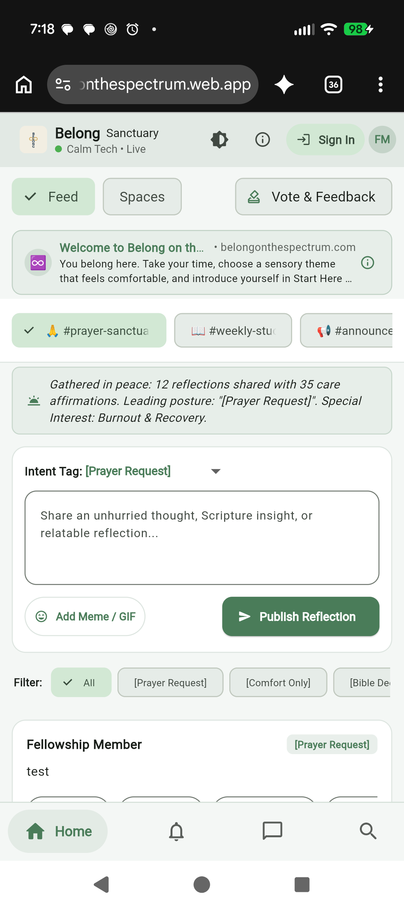
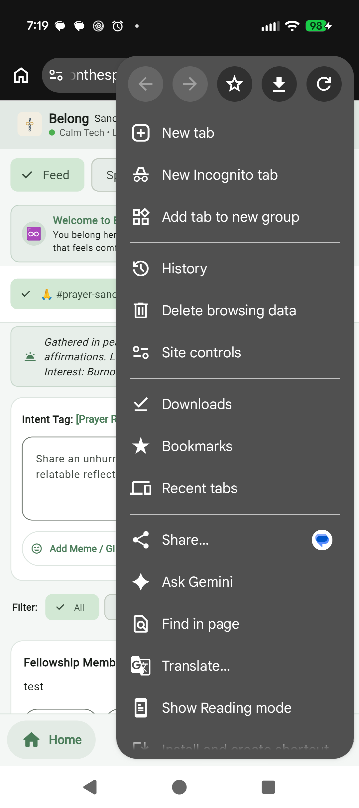
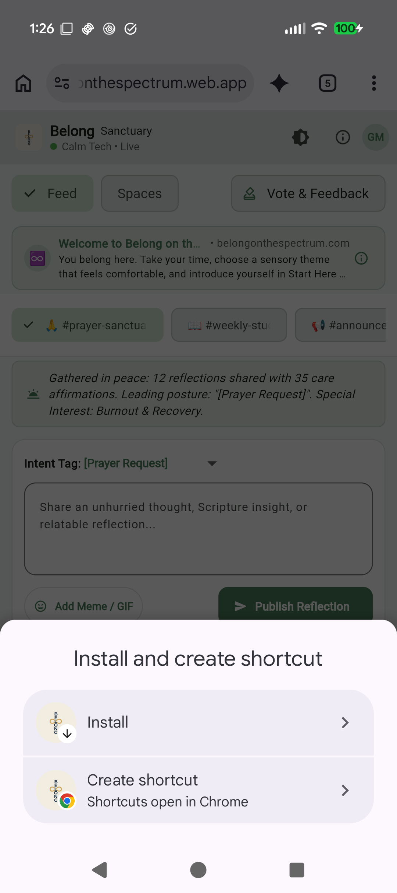
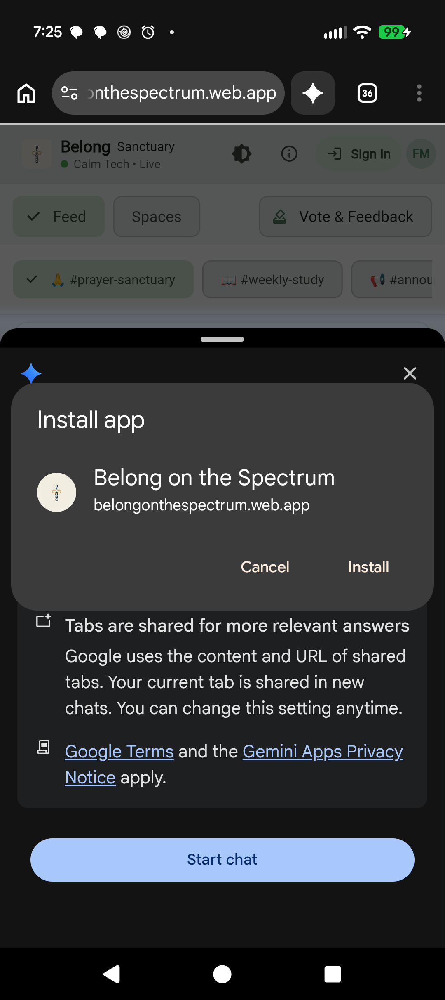
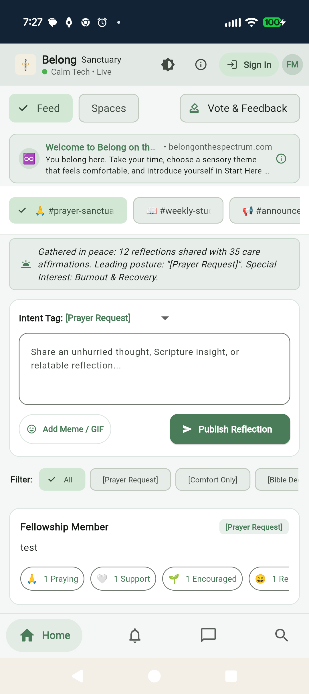

# 📱 Progressive Web App (PWA) Installation & Mobile Web Guide

> **iPhone steps, plus a short Android path:** **[Put Belong on your phone](How-You-Can-Help-Volunteer-Guide#put-belong-on-your-phone)**. The pictures below are Android only.

> **Welcome to Belong on the Spectrum!**
> This guide walks you step-by-step through installing the **Belong on the Spectrum** Progressive Web App (PWA) directly onto your phone, tablet, or computer — with **zero App Store wait, zero account passwords, and zero storage bloat**!

---

## 🎥 Video Walkthrough (Google Pixel 9a Real Glass)
We recorded a full live demonstration on physical glass (Android 15 / Google Chrome on a Google Pixel 9a) showing the complete 2-tap install experience:

- **Video Walkthrough File**: [`doc/videos/pwa_walkthrough_pixel9a.mp4`](../../doc/videos/pwa_walkthrough_pixel9a.mp4) (5.0 MB, 1080x2400 60fps)

---

## 📸 Step-by-Step Visual Walkthrough (Android Chrome)

### Step 1: Open Belong in Chrome
Visit `belongonthespectrum.web.app` in your mobile browser. The calm community feed, spaces, and sensory soundscapes are immediately active.

---

### Step 2: Open the Chrome Menu
Tap the **Three Dots Menu (`⋮`)** in the top-right corner of Chrome.

---

### Step 3: Select "Install and create shortcut"
In the menu, tap **"Install and create shortcut"** (or **"Install app"**).

---

### Step 4: Confirm Installation
Chrome displays the native install prompt showing the official **Belong on the Spectrum** title and gold infinity symbol (`∞`). Tap **"Install"**.

---

### Step 5: Installed Right to Your Home Screen
Android automatically provisions the WebAPK and places the **Belong** icon directly onto your device home screen and app drawer alongside your other apps. Once installed, tap the Belong icon to launch.

---

### Step 6: Standalone Full-Screen Experience
When you tap the Belong icon, it launches into a distraction-free, fullscreen sensory space without browser URL bars or navigation clutter!

---

## 🍎 How to Install on iPhone & iPad (Apple Safari)

1. Open **Safari** on your iPhone or iPad and navigate to `belongonthespectrum.web.app`.
2. Tap the **Share** button at the bottom of the Safari toolbar (the square with an arrow pointing up `⬆️`).
3. Scroll down the share sheet and tap **"Add to Home Screen"** (`➕`).
4. Tap **"Add"** in the top-right corner.
5. **Done!** The **Belong** icon sits right on your iOS home screen and launches with standalone fullscreen display, swipe-back gestures, and sensory soundscapes.

---

## 🌟 Why PWA is the Calmest Choice for Our Community

| Feature | Belong Web App (PWA) | Traditional App Store Download |
| :--- | :--- | :--- |
| **Download Size** | **< 5 MB** (instant cache) | 100–200 MB download |
| **Account Required** | **None** — no Apple ID or Google Play password needed | Requires linked credit card / store login |
| **Instant Updates** | **Immediate** — bug fixes and calm features arrive live | 2–14 day wait on App Store review queues |
| **Battery & Storage** | **Ultra-lightweight** — won't consume precious phone storage | Heavy background sync processes |
| **Privacy & Security** | **Sandboxed** by the browser — no background tracking | Requests extensive device permissions |

---

## 🎛️ In-App Integration
If you tap `Download the Android App` or `Download the iOS App` inside the Belong app navigation:
- A calm notice explains that the PWA is live today.
- A **"📱 How to Add to Home Screen (PWA Guide)"** button opens an instant modal with these exact steps.
- When Google Play and Apple TestFlight betas go live (**Milestone 1.0.0**), the links automatically point to the official store pages via Firebase Remote Config.