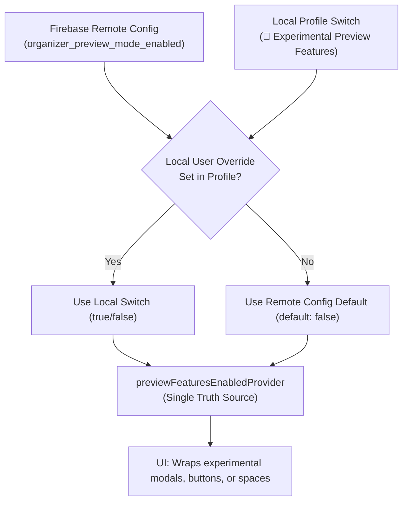

# 🧪 Preview Mode & Single Master Feature Flag (`Preview-Mode-and-Feature-Flags`)

> **Related Issue**: [Issue #135 (Single Master Preview Mode Flag)](https://github.com/neiljaywarner/refuge/issues/135)  
> **Architecture Reference**: [ADR-0006: Dev vs. Prod Flavors](UX-Evaluation-and-ADRs) & [Organizer-Remote-Config-Guide](Organizer-Remote-Config-Guide)

---

## 🧭 Purpose: Clean, Uncluttered Pre-Alpha Testing

During pre-alpha and beta testing leading up to the **October 31, 2026** Circle.so cutover, community testers need absolute confidence that the primary flows (Spaces, Reflections, Tone Filtering, DMs, Events, and Sensory Soundscapes) are stable and calm.

Instead of introducing dozens of scattered, confusing feature flags, Belong on the Spectrum uses a **Single Master "Preview Mode" Toggle** (`previewFeaturesEnabledProvider`):
* **Default State for Members**: `false` (experimental and unpolished components remain hidden).
* **Enabled for Testers & Organizers**: Can be turned on via Firebase Remote Config or toggled locally inside the Member Profile modal.

---

## 🎛️ How Preview Mode is Controlled



### 1. In-App User Switch (Member Profile)
1. Open the **Member Profile** dialog (top right avatar or directory).
2. Scroll to the **"🧪 Experimental Preview Features"** switch.
3. Toggle it on to reveal in-flight features, or off for pure core stability.

### 2. Organizer Remote Control (Firebase Console)
Organizers can globally enable or disable preview features without publishing a new app build:
* **Key**: `organizer_preview_mode_enabled`
* **Type**: Boolean (`true` or `false`)

---

## 💻 Developer & Testing Usage

In any Flutter widget:
```dart
final isPreview = ref.watch(previewFeaturesEnabledProvider);

if (isPreview) {
  // Render early experimental feature (e.g. Meme Gallery, API Explorer, etc.)
}
```

In unit or BDD widget tests:
```dart
testWidgets('renders experimental component only in preview mode', (tester) async {
  await tester.pumpWidget(
    ProviderScope(
      overrides: [
        previewFeaturesEnabledProvider.overrideWith((ref) => PreviewModeNotifier(true)),
      ],
      child: const SanctuaryApp(),
    ),
  );
  expect(find.byKey(const Key('experimental_widget')), findsOneWidget);
});
```
