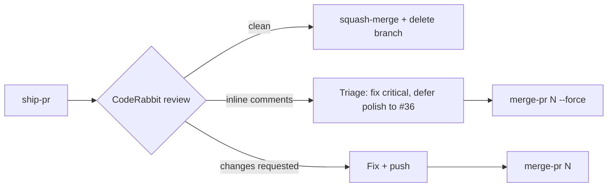

# 🛠️ Refuge CLI (`tool/refuge_cli.dart`)

A small pure-Dart command-line tool that automates the repetitive parts of our **Ticket-Driven Development** loop (`1 Issue = 1 Worktree = 1 PR → CodeRabbit → squash-merge`).

> Source: [`tool/refuge_cli.dart`](../../tool/refuge_cli.dart) · Deploys live in a separate tool: [`tool/deploy_release.dart`](../../tool/deploy_release.dart) (see [`DEPLOYMENT.md`](../../DEPLOYMENT.md)).

## Quick start

```bash
# from the repo root
dart run tool/refuge_cli.dart help
dart run tool/refuge_cli.dart help ship-pr
```

Requirements: `git`, and the GitHub CLI `gh` authenticated via `gh auth login`. To use a non-PATH `gh`, set `GH_BIN=/path/to/gh`.

## Everyday commands

| Command | What it does |
| :--- | :--- |
| `ship-pr <branch> "<title>" "<body>" [--timeout-min=15] [--no-merge]` | Pushes the branch, opens a PR, asks `@coderabbitai review`, **waits** for CodeRabbit, and squash-merges only if there are no requested changes and no inline comments. |
| `merge-pr <number> [--force]` | Merges a PR after you've triaged CodeRabbit comments. `--force` skips the inline-comment gate but still refuses `CHANGES_REQUESTED`. |
| `review-status <number>` | Prints CodeRabbit's verdict + every inline comment (`file:line  first line`). |
| `privacy-scan` | Fails (exit 5) if tracked files contain personal emails, `/Users/<name>/` paths, Google API keys, GitHub tokens, or private keys. **Run before every PR**, because this repo is public. |
| `sync-wiki` | Publishes `docs/wiki/*.md` to the GitHub wiki using a temp clone. |
| `configure-mcp` | Writes `$HOME/.gemini/config/mcp_config.json` for the dart, firebase, patrol, and marionette MCP servers. |
| `list-open` | Lists open issues. |

## Exit codes

| Code | Meaning | What to do |
| :---: | :--- | :--- |
| `0` | Success | Nothing |
| `2` | CodeRabbit requested changes | Fix in the worktree, push, run `merge-pr N` |
| `3` | CodeRabbit left inline comments | Fix critical ones; defer polish to **#36** with a link; then `merge-pr N --force` |
| `4` | Timed out waiting for CodeRabbit | Wait, then `merge-pr N` |
| `5` | `privacy-scan` found something | Remove it (see **#64**) |
| `64` | Usage error | Run `help <command>` |

## The CodeRabbit triage loop



## FAQ

**Why Dart instead of bash?** Students and mentees already know Dart from Flutter; it runs the same on macOS and Linux CI; and it's testable.

**`gh` says `HTTP 401` inside an AI agent sandbox.** The sandbox can't read the macOS keychain where `gh` stores its token. Re-run that one command outside the sandbox. It's not a repo problem.

**Can I re-run the seeding commands (`sync-issues`, `add-*`, `create-deploy-and-audio-issues`)?** No. They were one-time and will create duplicate issues.

**Where do tester emails live?** Only in Firebase App Distribution (`pre-alpha-testers` group). Never in this repo.
