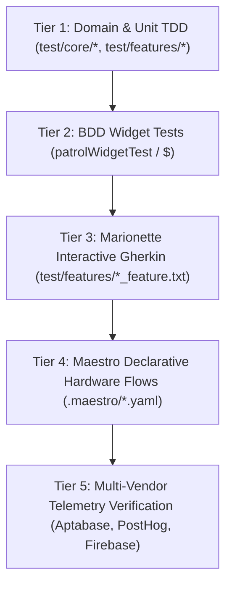

# Test Cases & Quality Assurance Matrix: Refuge

This document outlines the multi-tiered testing strategy, hardware verification matrix, and automated test catalog for the **Belong on the Spectrum (Refuge)** calm-tech digital community platform.

---

## 🎯 Testing Philosophy: Calm-Tech & Neurodivergent Accessibility

Traditional QA prioritizes rapid clicks, stressful alert popups, and aggressive re-engagement loops. Refuge enforces a **neurodivergent-first test policy**:
1. **Zero Red-Dot Urgency**: Notifications must arrive unhurriedly without anxiety-inducing badge counters or sudden sounds.
2. **High-Contrast & Sensory Comfort**: Every UI screen must be verified under multiple sensory themes (Sage, Clay, Ocean, High Contrast).
3. **Real Hardware Verification**: Every UI milestone is driven and screenshotted on real Google Pixel hardware (`56091JEBF14039` and `58221JEBF20835`) using Maestro and Patrol.

---

## 📱 Hardware & Automation Device Matrix

| Target Name | Type | Identifier | Primary Driver | Verification Scope |
| :--- | :--- | :--- | :--- | :--- |
| **Pixel Hardware 1** | Physical Device | `56091JEBF14039` | Maestro MCP / Patrol | User A Flows: Feed, Reflections, DMs |
| **Pixel Hardware 2** | Physical Device | `58221JEBF20835` | Maestro MCP / Patrol | User B Flows: Push notifications, Multi-user sync |
| **Medium Phone** | Android Emulator | `emulator-5554` | Patrol / Maestro | Nightly regression matrix |
| **Web Browser** | Chromium / Chrome | `chromium` | Patrol / Web Driver | PWA responsive layout & web push |

---

## 🏗️ 5-Tier Testing Architecture



---

## 📋 Comprehensive Test Case Catalog

### 1. Direct Messages & Private Fellowship (`TC-DM`)

| Test ID | Title | Level | Automations & Specifications | Expected Outcome |
| :--- | :--- | :--- | :--- | :--- |
| `TC-DM-01` | Conversations List Discovery | BDD / Hardware | `direct_messages_and_events_test.dart`<br>`.maestro/direct_messages_flow.yaml` | Navigating to `Msgs` displays 3 conversations (`Marty & Community Team`, `Sensory Game Night Group`, `Silent Co-Presence Fellowship`). |
| `TC-DM-02` | Calm Batched Digest Switch | BDD / Unit | `direct_messages_and_events_test.dart` | Toggling switch changes state between "Active (quiet daily summary)" and "Disabled (realtime alerts)". |
| `TC-DM-03` | Open Thread & Send Calm Reply | BDD / Hardware | `direct_messages_and_notifications_feature.txt`<br>`.maestro/direct_messages_flow.yaml` | Tapping conversation opens thread, soft keyboard input `"Thank you Marty! Glad to be here."` dispatches, clears input, and renders message bubble. |
| `TC-DM-04` | Real Hardware Pixel Verification | Hardware | Maestro MCP `run` & `take_screenshot` | 8-command flow executes with `success: true` on Pixel 9a (`56091JEBF14039`). |

### 2. Calm Notifications (`TC-NOTIF`)

| Test ID | Title | Level | Automations & Specifications | Expected Outcome |
| :--- | :--- | :--- | :--- | :--- |
| `TC-NOTIF-01` | Gentle Updates Rendering | BDD Widget | `direct_messages_and_events_test.dart` | Displays gentle reminder banner and unread cards for Events, Reflections, and Digest. |
| `TC-NOTIF-02` | FCM Push Reception | Integration | `test/features/auth/firebase_auth_repository_test.dart` | Remote push payloads arrive without jarring audio alerts. |

### 3. Sensory Events & Fellowship Calendar (`TC-EVENTS`)

| Test ID | Title | Level | Automations & Specifications | Expected Outcome |
| :--- | :--- | :--- | :--- | :--- |
| `TC-EVENTS-01` | Sensory Indicator Badges | BDD Widget | `direct_messages_and_events_test.dart` | Displays "Quiet Room Available", "Soft warm lamps", and "Low ambient sound". |
| `TC-EVENTS-02` | 1-Tap Quiet RSVP | BDD Widget | `direct_messages_and_events_test.dart` | Tapping RSVP increments attendee count and confirms status without modal friction. |

### 4. Telemetry & Observability (`TC-TELEMETRY`)

| Test ID | Title | Level | Automations & Specifications | Expected Outcome |
| :--- | :--- | :--- | :--- | :--- |
| `TC-TEL-01` | Zero-Secret Fallback Mode | Unit TDD | `community_analytics_service_test.dart` | In-memory event recording functions seamlessly when API keys are omitted. |
| `TC-TEL-02` | Aptabase REST Dispatch | Unit TDD | `community_analytics_service_test.dart` | Injects `App-Key` and serialized event payload to `https://us.aptabase.com/api/v0/event`. |
| `TC-TEL-03` | PostHog REST Capture | Unit TDD | `community_analytics_service_test.dart` | Injects `api_key` and enriched properties to `https://us.i.posthog.com/capture/`. |
| `TC-TEL-04` | Non-Blocking `unawaited` Resilience | Unit TDD | `community_analytics_service_test.dart` | HTTP exceptions and network drops are absorbed without throwing to UI. |

---

## 🛠️ Verification Commands

```bash
# 1. Run full unit and widget test suite
dart test

# 2. Run BDD patrol tests
flutter test test/features/direct_messages_and_events_test.dart

# 3. Run Maestro flow on connected Pixel
maestro test .maestro/direct_messages_flow.yaml --device 56091JEBF14039

# 4. View real-time device screen in Maestro Viewer
open http://127.0.0.1:9999/
```
