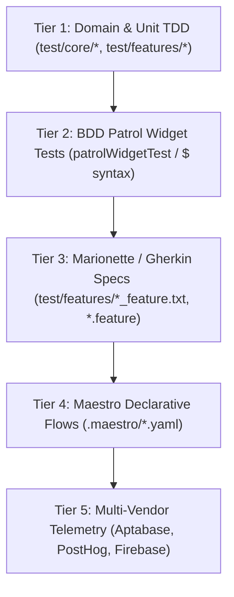

# Test Cases & Quality Assurance Matrix: Refuge & Circle Parity

This document outlines the multi-tiered testing strategy, hardware verification matrix, and automated test catalog for the **Belong on the Spectrum (Refuge)** calm-tech digital community platform, establishing verified feature parity with Circle.so (excluding courses) and strict calm push notification ethics.

---

## 🎯 Testing Philosophy: Calm-Tech & Neurodivergent Accessibility

Traditional QA prioritizes rapid clicks, stressful alert popups, and aggressive re-engagement loops. Refuge enforces a **neurodivergent-first test policy**:
1. **Zero Red-Dot Urgency & Zero Startup Prompts**: Push notifications must never prompt on initial app launch. Users must be presented with an explicit, calming ethical rationale before opting in.
2. **High-Contrast & Sensory Comfort**: Every UI screen must be verified under multiple sensory themes (Sage, Clay, Ocean, High Contrast).
3. **Triplicate Coverage (TDD + BDD + Maestro Hardware Driving)**: Every feature flow is verified across unit tests, fast `<2s` BDD widget tests (`patrol_finders`), and declarative hardware flows (`.maestro/*.yaml`) on physical Google Pixels (`56091JEBF14039`, `58221JEBF20835`) and emulators (`emulator-5554`).

---

## 📱 Hardware & Automation Device Matrix

| Target Name | Type | Identifier | Primary Driver | Verification Scope |
| :--- | :--- | :--- | :--- | :--- |
| **Pixel Hardware 1** | Physical Device | `56091JEBF14039` | Maestro MCP / Patrol | User A Flows: Feed, Reflections, DMs |
| **Pixel Hardware 2** | Physical Device | `58221JEBF20835` | Maestro MCP / Patrol | User B Flows: Push notifications, Multi-user sync |
| **Medium Phone** | Android Emulator | `emulator-5554` | Patrol / Maestro | Nightly regression matrix & release flows |
| **Pixel 9a Emulator** | Android Emulator | `emulator-5556` | Patrol / Maestro | Layout & sensory mode verification |
| **Web Browser** | Chromium / Chrome | `chromium` | Patrol / Web Driver | PWA responsive layout & web push |

---

## 🏗️ 5-Tier Testing Architecture



---

## 📋 Circle.so Feature Parity & Release Test Catalog

### 1. Circle Spaces & Community Structure (`TC-CIRCLE-SPACES`) — Linked to Epic #371
*Circle Parity Area: Spaces, Pinned Posts, Section Groups, Feed & Spaces Subnav*

| Test ID | Title | Level | Automations & Specifications | Expected Outcome |
| :--- | :--- | :--- | :--- | :--- |
| `TC-SPACE-01` | Sub-Navigation Switching | BDD Patrol | `circle_home_navigation_test.dart`<br>`circle_parity_release_readiness_bdd_test.dart` | Tapping `Spaces` chip switches from chronological Feed to Circle hierarchical spaces view in `<300ms`. |
| `TC-SPACE-02` | Section Hierarchy & Pinned Posts | BDD / Hardware | `circle_parity_release_flow.yaml`<br>`circle_parity_release_readiness_bdd_test.dart` | Renders `PINNED`, `WELCOME`, and `COMMUNITY` headers with space cards (General Chat, Start Here, Announcements). |
| `TC-SPACE-03` | Monogram Fallbacks & Space Icons | BDD Widget | `test/features/spaces_navigation_and_monogram_test.dart` | Every space displays high-contrast themed emoji or 2-letter monogram with zero missing asset errors. |

### 2. Member Directory, Search & Rich Autistic Profiles (`TC-MEMBERS`) — Linked to Epic #373
*Circle Parity Area: Member Directory, Search, Filters, Rich Profiles & Comfort Badges*

| Test ID | Title | Level | Automations & Specifications | Expected Outcome |
| :--- | :--- | :--- | :--- | :--- |
| `TC-MEM-01` | Member Directory Navigation | BDD Patrol | `belong_members_directory_view_test.dart`<br>`circle_parity_release_readiness_bdd_test.dart` | Tapping `Members Section & Directory` navigates to directory with search bar, filter chips (`All`, `ICOC Affiliated`, `Organizers`), and member cards. |
| `TC-MEM-02` | Filter Members by Church & Role | BDD Widget | `belong_members_directory_view_test.dart` | Selecting `Organizers` chip isolates organizer cards (e.g. `Marty (Organizer)`); selecting `ICOC Affiliated` filters church partners. |
| `TC-MEM-03` | Rich Autistic Profile Indicators | Unit / BDD | `member_profile_activity_counters_test.dart` | Displays neurodivergent comfort indicators (e.g., "Literal communication appreciated", "No small talk please", "Soundscapes & calm lighting"). |
| `TC-MEM-04` | Return to Spaces Cleanly | Hardware | `.maestro/circle_parity_release_flow.yaml` | Tapping on-screen `Back to Spaces` button smoothly pops back to Spaces hierarchy without minimizing app. |

### 3. Direct Messages & Private Fellowship Chat (`TC-DM`) — Linked to Epic #374
*Circle Parity Area: Direct Messages, Group Messages, Thread History, Search*

| Test ID | Title | Level | Automations & Specifications | Expected Outcome |
| :--- | :--- | :--- | :--- | :--- |
| `TC-DM-01` | Conversations List Discovery | BDD / Hardware | `direct_messages_and_events_test.dart`<br>`.maestro/direct_messages_flow.yaml` | Navigating to `Msgs` displays 3 conversations (`Marty & Community Team`, `Sensory Game Night Group`, `Silent Co-Presence Fellowship`). |
| `TC-DM-02` | Calm Batched Digest Switch | BDD / Unit | `direct_messages_and_events_test.dart` | Toggling switch changes state between "Active (quiet daily summary)" and "Disabled (realtime alerts)". |
| `TC-DM-03` | Open Thread & Send Calm Reply | BDD / Hardware | `direct_messages_and_events_test.dart`<br>`.maestro/direct_messages_flow.yaml` | Tapping conversation opens thread, keyboard input dispatches unhurried message bubble, clears composer, and logs telemetry. |
| `TC-DM-04` | Add Msg Modal & Autocomplete | BDD Widget | `direct_messages_and_events_test.dart` | Tapping `add_new_message_button` opens compose sheet with multi-member selector and direct recipient pills. |

### 4. Actually Autistic Events & Calm RSVPs (`TC-EVENTS`) — Linked to Epic #375
*Circle Parity Area: Community Events, Meetup Schedules, 1-Tap RSVP, Clear Expectations*

| Test ID | Title | Level | Automations & Specifications | Expected Outcome |
| :--- | :--- | :--- | :--- | :--- |
| `TC-EVT-01` | Sensory Indicator Badges | BDD Widget | `direct_messages_and_events_test.dart` | Displays explicit sensory criteria: "Quiet Room Available", "Soft warm lamps", "Low ambient sound", and zero strobe lighting. |
| `TC-EVT-02` | 1-Tap Quiet RSVP | BDD Widget | `direct_messages_and_events_test.dart` | Tapping RSVP increments attendee count and confirms status without modal anxiety or confirmation loops. |

### 5. Sensory Modes & Neurodivergent Accessibility (`TC-SENSORY`) — Linked to Epic #376
*Circle Parity Area: Calm UI, High Contrast, Soundscapes, Visual Rest*

| Test ID | Title | Level | Automations & Specifications | Expected Outcome |
| :--- | :--- | :--- | :--- | :--- |
| `TC-SEN-01` | Sensory Mode Menu Selection | BDD Widget | `sensory_theme_and_font_scaling_test.dart` | Switching themes between `Sage`, `Clay`, `Ocean`, and `High Contrast` updates color scheme across all screens. |
| `TC-SEN-02` | High Contrast WCAG AAA Verification | BDD / Visual | `sensory_theme_and_font_scaling_test.dart` | Pure black backgrounds (`#000000`) paired with high-contrast text and yellow borders (`#FFFF00`). |
| `TC-SEN-03` | Narrow Viewport Layout Protection | Widget | `lib/src/features/reflections/presentation/reflection_card.dart` | Title and author rows use `Flexible` with `maxLines: 1` eliminating narrow screen `RenderFlex overflow` regressions. |

### 6. Calm Push Notifications & FCM Opt-In Protocol (`TC-NOTIF`) — Linked to Epic #371 & #327
*Circle Parity Area: Notification Inbox, Mentions, Threads, Delivery Digests*

| Test ID | Title | Level | Automations & Specifications | Expected Outcome |
| :--- | :--- | :--- | :--- | :--- |
| `TC-NOT-01` | Zero-Startup OS Prompt Guarantee | BDD / Unit | `calm_fcm_notification_opt_in_feature.txt`<br>`circle_parity_release_readiness_bdd_test.dart` | App launches with zero permission dialogs; `NotificationPermissionsService` defaults to `enabled: false`. |
| `TC-NOT-02` | Calm Notification Ethics Primer | BDD / Hardware | `.maestro/circle_parity_release_flow.yaml`<br>`circle_parity_release_readiness_bdd_test.dart` | Opening Preferences displays explicit ethics explanation ("Belong respects your attention and sensory peace...") before requesting permissions. |
| `TC-NOT-03` | Delivery Schedules | BDD Widget | `test/features/notifications/notification_preferences_test.dart` | Supports `Twice Daily Digest` (10am & 6pm), `Morning Digest Only` (9am), `Immediate Gentle Cards`, and `Completely Muted`. |
| `TC-NOT-04` | Filter Chips (Inbox, Mentions, Threads, Following) | BDD Widget | `test/features/notifications/belong_notifications_test.dart` | Tapping filter chips filters notification list cleanly without page reloads. |
| `TC-NOT-05` | Direct message alerts stay off until asked | Unit | `direct_message_push_policy_test.dart`<br>`functions/decide.test.js` | Off, muted, and a `fcm_token_calm` placeholder do not send. A real token with alerts on does. |
| `TC-NOT-06` | Message alerts switch on a phone | Maestro | `.maestro/dm_alerts_toggle_once.yaml`<br>`.maestro/dm_alerts_on_check.yaml`<br>`.maestro/dm_alerts_opt_in.yaml` | The switch turns on, a relaunch keeps it on, and New Message still opens. Checked on Pixel Left and Pixel Right, October 24, 2026. The cloud send is not deployed. |

### 7. Roadmap & 1-Tap Feature Voting (`TC-ROADMAP`) — Linked to Epic #302
*Circle Parity Area: Public Product Roadmap, Upvoting, Member Feedback Loops*

| Test ID | Title | Level | Automations & Specifications | Expected Outcome |
| :--- | :--- | :--- | :--- | :--- |
| `TC-ROAD-01` | 1-Tap WIP Upvoting | BDD Patrol | `circle_home_navigation_test.dart`<br>`.maestro/feature_voting_flow.yaml` | Tapping vote icon on WIP feature increments vote tally instantly and updates state. |
| `TC-ROAD-02` | Literal 3-Intent Feedback Routing | Unit TDD | `circle_home_navigation_test.dart` | Happy feedback logs publicly; Neutral and Sad feedback route strictly to private pastoral triage. |

---

## 🛠️ Verification Execution Commands

```bash
# 1. Run all Circle Parity & Release Readiness BDD Patrol Tests (<5s execution)
flutter test test/features/circle_parity_release_readiness_bdd_test.dart

# 2. Run Comprehensive Core Feature Test Suite (26/26 tests green)
flutter test \
  test/features/circle_parity_release_readiness_bdd_test.dart \
  test/features/notifications/belong_notifications_test.dart \
  test/features/profile/belong_members_directory_view_test.dart \
  test/features/circle_home_navigation_test.dart \
  test/features/direct_messages_and_events_test.dart

# 3. Run Static Analysis across the entire project (0 errors)
dart analyze lib test

# 4. Run Declarative Maestro Circle Parity Flow on Hardware / Emulator
maestro test .maestro/circle_parity_release_flow.yaml --device emulator-5554

# 5. Launch Real-Time Screen Mirroring via Maestro Viewer
open http://127.0.0.1:9999/
```
