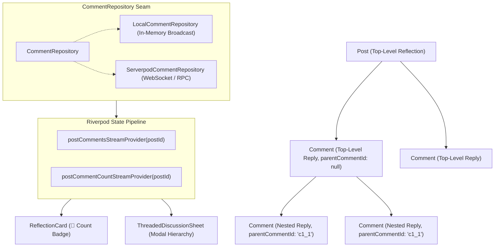

# 💬 Threaded Comments & Nested Discussion Architecture

> **Feature Ticket**: [#156](https://github.com/neiljaywarner/refuge/issues/156)  
> **Milestone**: `v0.9.0-rc` (Release Candidate & Circle.so Parity)  
> **Platform Status**: 🟢 Live in Native Android APK, Web PWA & BDD Test Suite (+138 Tests Passing)

---

## 🧭 Executive Summary & Neurodivergent Purpose

In traditional social media platforms, comment threads are optimized for engagement loops, conflict amplification, and rapid-fire replies. For autistic and neurodivergent adults, this design produces sensory overload, ambiguous tone misinterpretations, and social anxiety.

**Belong on the Spectrum** reimagines discussions with **Calm-Tech & Neurodivergent-First Discussion Architecture**:
1. **Explicit Emotional Intent & Tone Tags**: Comments and replies can optionally specify tone (e.g. `[Comfort Only]`, `[Relatable]`, `[Encouragement]`, `[Prayer]`), preventing cognitive exhaustion from guessing tone.
2. **Visual Hierarchy & Depth Limiting**: Nested replies are clearly indented with subtle connector lines (`↳`), capped to prevent infinite nesting rabbit holes.
3. **Unhurried Composition**: Built with Flutter Hooks (`useTextEditingController`, `useListenable`), auto-disposing controllers without memory leaks, and providing clear "Replying to @Author" indicators.
4. **Gentle Affirmations Over Upvote Popularity Contests**: Care reactions (`🙏 Praying`, `🤍 Support`, `🌱 Encouraged`, `😄 Relatable`) affirm the human contributor rather than ranking comments algorithmically.

---

## 🏛️ Architecture & Data Seam



---

## 📦 Domain Models

### `Comment` (`lib/src/features/reflections/domain/comment.dart`)
```dart
class Comment {
  final String id;
  final String postId;
  final String? parentCommentId; // null = top-level; populated = nested reply
  final String authorName;
  final String content;
  final String? toneTag; // e.g. '[Comfort Only]', '[Relatable]'
  final DateTime timestamp;
  final Map<String, int> reactions; // {'pray': 4, 'peace': 2, ...}

  bool get isNested => parentCommentId != null && parentCommentId!.isNotEmpty;
}
```

### `CommentRepository` (`lib/src/features/reflections/data/comment_repository.dart`)
```dart
abstract class CommentRepository {
  Future<List<Comment>> getComments({required String postId});
  Future<Comment> addComment(Comment comment);
  Future<void> addReaction({required String commentId, required String reactionType});
  Stream<List<Comment>> watchComments({required String postId});
  Future<int> getCommentCount({required String postId});
  Stream<int> watchCommentCount({required String postId});
}
```

---

## 📱 User Experience & Component Specifications

| Component | Key / Selector | Purpose |
| :--- | :--- | :--- |
| **Discussion Button** | `Key('discussion_button_${post.id}')` | Outlined action button on `ReflectionCard` showing live count badge (e.g. `💬 3 Replies` or `💬 Reply`). Tapping opens `ThreadedDiscussionSheet`. |
| **Discussion Sheet** | `Key('threaded_discussion_sheet_title')` | Modal sheet displaying original reflection snippet, threaded discussion list, and bottom pinned composer. |
| **Comment Tile** | `Key('comment_item_${comment.id}')` | Individual comment item with avatar, author name, tone chip, content, reaction counters, and reply action. Indented with `↳` if nested. |
| **Care Reactions** | `Key('comment_reaction_pray_${comment.id}')`<br>`Key('comment_reaction_peace_${comment.id}')`<br>`Key('comment_reaction_encouraged_${comment.id}')`<br>`Key('comment_reaction_relatable_${comment.id}')` | Qualitative affirmations that increment reactively in real time. |
| **Reply Target Action** | `Key('reply_button_${comment.id}')` | Focuses composer and activates `Replying to @Author` contextual banner with `Key('cancel_reply_target_button')`. |
| **Comment Input** | `Key('comment_input_field')` | Multi-line text field with unhurried placeholder. |
| **Tone Tag Chips** | `[Comfort Only]`, `[Relatable]`, `[Encouragement]`, `[Prayer]` | ChoiceChips tagging emotional intent. |
| **Submit Button** | `Key('submit_comment_button')` | Submits comment, broadcasts to stream, clears field, and resets reply target. |

---

## 🧪 Verification & Automated BDD Tests

- **Unit Suite**: `test/features/reflections/comment_repository_test.dart` (7 tests verifying model immutability, hierarchical tree sorting, reactions, and streams).
- **BDD Widget Suite**: `test/features/reflections/threaded_comments_widget_test.dart` (6 `patrolWidgetTest` scenarios verifying button badges, sheet presentation, nested indentation, care reactions, top-level replies, and nested target replies).
- **Full Suite**: 138/138 tests passing 100% green with 0 static analysis errors.
