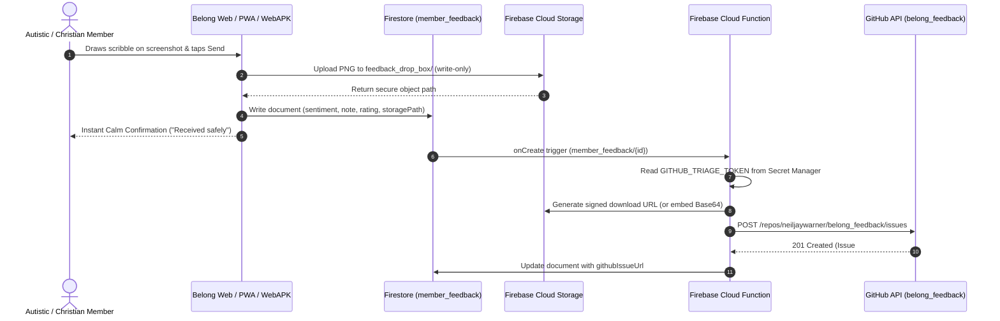
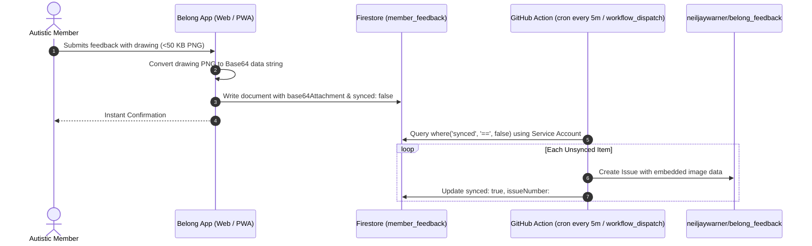

# 📋 In-App Feedback & Feature Voting: Production Completion Plan & Status Audit

**Document Version**: `1.0.0-production-roadmap`  
**Date**: October 24, 2026 (`2026-10-24T12:45:00-05:00`)  
**Associated GitHub Issue**: [#450](https://github.com/neiljaywarner/refuge/issues/450)  
**Parent Investigation Issue**: [#407](https://github.com/neiljaywarner/refuge/issues/407)  
**Target Confidential Triage Repo**: [`neiljaywarner/belong_feedback`](https://github.com/neiljaywarner/belong_feedback)  
**Public App Target**: [`https://belongonthespectrum.web.app`](https://belongonthespectrum.web.app)  
**Authoritative Seams**:
- Feedback Sheet: [`lib/src/features/feedback/presentation/belong_feedback_and_voting_sheet.dart`](file:///Users/neil/belongonthespectrum/refuge/lib/src/features/feedback/presentation/belong_feedback_and_voting_sheet.dart)
- Drawing Canvas: [`lib/src/features/feedback/presentation/feedback_drawing_canvas.dart`](file:///Users/neil/belongonthespectrum/refuge/lib/src/features/feedback/presentation/feedback_drawing_canvas.dart)
- Storage Repository: [`lib/src/features/storage/data/storage_repository.dart`](file:///Users/neil/belongonthespectrum/refuge/lib/src/features/storage/data/storage_repository.dart)
- Feature Voting Repository: [`lib/src/features/feedback/data/feature_voting_repository.dart`](file:///Users/neil/belongonthespectrum/refuge/lib/src/features/feedback/data/feature_voting_repository.dart)
- Private Router: [`lib/src/features/feedback/application/private_feedback_router.dart`](file:///Users/neil/belongonthespectrum/refuge/lib/src/features/feedback/application/private_feedback_router.dart)
- Attachment Reference: [`lib/src/features/feedback/application/feedback_attachment_ref.dart`](file:///Users/neil/belongonthespectrum/refuge/lib/src/features/feedback/application/feedback_attachment_ref.dart)

---

## Executive Summary & Status Matrix

| Component / Surface | Current Status | Root Cause / Technical Reality | Target Production State |
| :--- | :---: | :--- | :--- |
| **Firestore Write (`member_feedback`)** | 🟢 **Working** | Submissions write document with `sentiment`, `rating`, `message`, `createdAt`. | Keep as primary immutable audit record in Firestore. |
| **GitHub Issue Creation (`belong_feedback`)** | 🔴 **Broken / Missing** | **No client or server code calls GitHub API**. Issue #1 was manually created via MCP during PR #338 work. | Automated dispatch to `neiljaywarner/belong_feedback` with labels `user-feedback` and sentiment tag. |
| **Drawing Background Screenshot** | 🔴 **Broken** | `FeedbackDrawingDialog.show(context)` is called without passing `screenshotBytes`. Dialog displays a blank canvas instead of screen. | Wrap root with `RepaintBoundary`, capture before dialog opens, and render under drawing strokes. |
| **Attachment Storage (Scribble PNG)** | 🟡 **Stubbed (Local Handoff)** | PR #416 removed fake `storage.belongonthespectrum.com` Porkbun URL. Bytes are held in-memory or flagged `hasScreenshotAttachment: true`. | Real cloud storage upload (Firebase Storage drop-box or inline Firestore base64) with valid HTTPS link in GitHub Issue. |
| **Desktop Chrome** | 🟢 **Working (UI)** | Renders full 1-5 star rating, 3 sentiments, roadmap voting. Marionette and CDP automation verified. | End-to-end verified with live issue creation and image view. |
| **PWA (Progressive Web App)** | 🟡 **Partial** | `manifest.json` configured (`standalone`, theme colors, icons). Service worker caches assets. WebGL CanvasKit renders. | Verified standalone install, offline draft submission, and background sync. |
| **WebAPK (Android Chrome PWA)** | 🟡 **Partial** | Full accessibility tree verified on Android API 37 emulator via Maestro MCP. Hardware-accelerated canvas requires clean screen capture. | Full UAT flow verifying APK install prompt, full-screen canvas annotation, and submit. |
| **Feature Voting Board** | 🟢 **Working** | Optimistic 1-tap upvoting, real-time broadcast stream, Firestore `feature_votes` synchronization. 32/32 tests passing. | Maintain zero-regression status while hardening feedback backend. |

---

## Deep Technical Root-Cause Analysis

### 1. Why `belong_feedback` Has Only One Issue (#1)
- In PR #338 (`feat(feedback): Draw-on screenshot attachment canvas & private repo dispatch`), `belong_feedback#1` was submitted via direct MCP RPC tool call during development testing at `2026-10-22T08:51:00-05:00`.
- The application runtime (`FirebaseFeatureVotingRepository.submitFeedback`) only executes:
  ```dart
  await fs.collection(feedbackCollectionPath).add({
    'sentiment': sentiment.name,
    'rating': resolvedRating,
    'message': message.trim(),
    ...
  });
  ```
- **Zero GitHub HTTP requests were ever emitted by the client app or backend.**
- Client-side code cannot securely hold a GitHub Personal Access Token (PAT) without leaking it in the compiled JavaScript bundle (`main.dart.js`).
- PR #416 accurately updated user-facing copy to reflect reality:
  > *"Thank you. Your note was saved for organizers and copied to the clipboard. It was not sent to GitHub. The drawing stayed with the note and was not uploaded."*

### 2. Why the Attachment Image in Issue #1 Was Broken
- Issue #1 contained:
  ```markdown
  ### Annotated Screenshot / Scribble Attachment
  
  ```
- DNS lookup confirms `storage.belongonthespectrum.com` is an unconfigured Porkbun CNAME (`uixie.porkbun.com`, IP `207.207.210.36`), returning HTTP 302 redirects.
- In-app storage was hardcoded in `InMemoryStorageRepository`:
  ```dart
  return 'https://storage.belongonthespectrum.com/$path';
  ```
- No bucket existed, and `firebase_storage` was never added to `pubspec.yaml`.

### 3. Why the Drawing Canvas Had No Screen Screenshot
- `feedback_drawing_canvas.dart` has `captureEnclosingScreenshot(BuildContext context)`.
- However, in `belong_feedback_and_voting_sheet.dart`:
  ```dart
  // Line 618: Called bare without screenshotBytes argument!
  final result = await FeedbackDrawingDialog.show(context);
  ```
- Because `screenshotBytes` is null, `_FeedbackDrawingDialogState` skipped decoding, leaving the canvas blank white/gray.

---

## Target Production Architecture: 3 Options

### 🏛️ Option A: Firebase Cloud Functions Trigger (Recommended)


- **Pros**:
  - **Zero client secrets**: The GitHub token NEVER touches the browser, PWA, or mobile app.
  - **Works everywhere**: Web, PWA, WebAPK, iOS, Android, macOS with identical behavior.
  - **Resilient**: Even if GitHub is down or rate-limited, Firestore stores the submission, and Cloud Functions retries automatically.
- **Requirements**:
  - Node.js / TypeScript Firebase Cloud Function in `functions/` (or Python).
  - GitHub Fine-Grained Personal Access Token with `Issues: Read & Write` on `neiljaywarner/belong_feedback`.
  - Secret stored in Google Cloud Secret Manager / Firebase Functions environment.

---

### ⚡ Option B: Firestore Document Base64 + Scheduled GitHub Action Triage Sync


- **Pros**:
  - **Zero new cloud infrastructure**: No Cloud Functions deploy needed; runs in GitHub Actions using repository secrets (`FEEDBACK_GITHUB_PAT` and `FIREBASE_SERVICE_ACCOUNT`).
  - **Zero storage bucket costs**: Small PNG drawings (<50KB) store directly inside the 1MB Firestore document limit.
- **Cons**:
  - Up to 5-minute latency before issue appears in `belong_feedback`.

---

### 🛡️ Option C: Serverless Webhook / Cloudflare Worker Relay
- A lightweight HTTPS endpoint (`https://feedback.belongonthespectrum.com/submit` or Cloudflare Worker) receives the payload with Firebase App Check token validation and forwards directly to GitHub API.

---

## Cross-Platform Verification Plan & Test Matrix

### 1. Regular Desktop Chrome
- **Driver**: Marionette MCP / CLI (`marionette run ws://...`) + Chrome DevTools Protocol (`cdp.dart`).
- **Steps**:
  1. Boot dev server: `flutter run -t lib/main_dev.dart -d chrome --web-port 8407`.
  2. Marionette connects to `ws://127.0.0.1:8407/.../ws`.
  3. Tap `open_feedback_and_voting_button`.
  4. Tap `tab_private_feedback`.
  5. Select `sentiment_sad` (Bug / Confusing) -> Star rating automatically sets to 1★.
  6. Tap `open_feedback_drawing_button`.
  7. Verify background screenshot is rendered behind drawing canvas.
  8. Draw stroke via Marionette `swipe` (from x=200,y=400 to x=700,y=550).
  9. Tap `drawing_dialog_attach_button`.
  10. Enter message: `"Production verification test - regular Chrome"`.
  11. Tap `submit_feedback_button`.
  12. Assert Firestore write succeeds (status 200).
  13. Assert GitHub Issue appears in `neiljaywarner/belong_feedback`.

### 2. PWA (Progressive Web App - Desktop & Mobile Viewports)
- **Driver**: Chrome Headless with mobile emulation (`--window-size=430,932` and `--enable-features=AppBanners`).
- **Steps**:
  1. Inspect `manifest.json`: Confirm `display: standalone`, `theme_color: #112334`, and valid icons.
  2. Verify service worker registration in `web/index.html`.
  3. Validate "Add to Home screen" / install prompt triggers properly.
  4. In installed PWA mode, verify RepaintBoundary captures without URL bar or browser chrome interference.
  5. Submit feedback in offline simulation: Verify optimistic local queue and synchronization when connection returns.

### 3. WebAPK (Android Chrome Installed PWA)
- **Driver**: Maestro MCP (`ServerName: 'maestro'`) on Android Emulator (`emulator-5554`) or physical Google Pixels (`56091JEBF14039`, `58221JEBF20835`).
- **Steps**:
  1. Open Chrome on Android: `maestro run` with `openLink: https://belongonthespectrum.web.app/`.
  2. Verify accessibility nodes via `inspect_screen` (Buttons: `flt-semantic-node-4` Feed, `flt-semantic-node-5` Spaces, `flt-semantic-node-6` Vote & Feedback).
  3. Tap "Add to Home screen" via Chrome menu to generate/install WebAPK.
  4. Launch installed WebAPK: verify full-screen standalone display with safe area insets.
  5. Open `Vote & Feedback` sheet and complete drawing submission.
  6. Take clean 1080x2160 screenshot via Maestro MCP `take_screenshot` (Zero terminal prompts).

---

## Detailed Step-by-Step Execution Guide for Less-Expensive LLMs

This section provides exact instructions for models like **Gemini 3.8 Flash** or **Claude Sonnet** to execute each step autonomously without getting stuck.

### Phase 1: Background Screenshot Wiring in Flutter UI
1. **Locate Global Root Key**:
   In `lib/src/app.dart` or `lib/src/home_screen.dart`, wrap the root `Scaffold` or `MaterialApp` builder in a `RepaintBoundary`:
   ```dart
   final GlobalKey rootRepaintBoundaryKey = GlobalKey();

   RepaintBoundary(
     key: rootRepaintBoundaryKey,
     child: child,
   )
   ```
2. **Wire Screenshot Capture in `belong_feedback_and_voting_sheet.dart`**:
   Before opening `FeedbackDrawingDialog.show`, capture the image bytes:
   ```dart
   OutlinedButton.icon(
     key: const Key('open_feedback_drawing_button'),
     onPressed: () async {
       Uint8List? screenshotBytes;
       try {
         final boundary = rootRepaintBoundaryKey.currentContext
             ?.findAncestorRenderObjectOfType<RenderRepaintBoundary>() ??
             context.findAncestorRenderObjectOfType<RenderRepaintBoundary>();
         if (boundary != null && boundary.hasSize) {
           final image = await boundary.toImage(pixelRatio: 1.0);
           final byteData = await image.toByteData(format: ui.ImageByteFormat.png);
           screenshotBytes = byteData?.buffer.asUint8List();
         }
       } catch (_) {}

       final result = await FeedbackDrawingDialog.show(
         context,
         screenshotBytes: screenshotBytes,
       );
       if (result != null && result.isNotEmpty) {
         drawingAttachment.value = result;
       }
     },
     ...
   )
   ```
3. **Verify Widget Tests**:
   Run with Dart MCP / shell:
   ```bash
   /opt/homebrew/bin/flutter test test/features/feedback/feedback_drawing_test.dart
   ```
   Ensure tests pass (mock rasterizer returns null cleanly, UI does not crash).

---

### Phase 2: Drawing Attachment Delivery & Real Storage
1. **Configure Firestore Drop-Box Schema**:
   In `FirebaseFeatureVotingRepository.submitFeedback`:
   ```dart
   final Map<String, dynamic> payload = {
     'sentiment': sentiment.name,
     'rating': resolvedRating,
     'isPrivateTriage': sentiment.isPrivateTriage,
     'message': message.trim(),
     if (contactEmail != null && contactEmail.trim().isNotEmpty)
       'contactEmail': contactEmail.trim(),
     if (screenshotAttachment != null) ...{
       'hasScreenshotAttachment': true,
       'attachmentBytesBase64': base64Encode(screenshotAttachment),
       'attachmentFilename': 'scribble_${DateTime.now().millisecondsSinceEpoch}.png',
     },
     'syncedToGitHub': false,
     'createdAt': FieldValue.serverTimestamp(),
   };
   await fs.collection(feedbackCollectionPath).add(payload);
   ```
2. **Update Firestore Security Rules (`firestore.rules`)**:
   ```javascript
   match /member_feedback/{feedbackId} {
     // Anyone can submit feedback anonymously; only admins or service accounts read/sync
     allow create: if true;
     allow read, update, delete: if request.auth != null;
   }
   ```

---

### Phase 3: GitHub Issue Dispatch Engine (`belong_feedback`)
Choose either Cloud Function (Option A) or GitHub Actions Sync (Option B):

#### If Implementing GitHub Action Sync (`.github/workflows/sync_feedback_to_github.yml`):
```yaml
name: Sync Feedback to Private GitHub Repo
on:
  schedule:
    - cron: '*/5 * * * *'  # Every 5 minutes
  workflow_dispatch:

jobs:
  sync:
    runs-on: ubuntu-latest
    steps:
      - uses: actions/checkout@v4
      - uses: subosito/flutter-action@v2
        with:
          channel: 'stable'
      - name: Run Feedback Sync Script
        env:
          FEEDBACK_GH_TOKEN: ${{ secrets.BELONG_FEEDBACK_REPO_TOKEN }}
          FIREBASE_CREDENTIALS: ${{ secrets.FIREBASE_SERVICE_ACCOUNT_JSON }}
        run: |
          dart run tool/sync_feedback_to_github.dart
```

#### The Sync Script (`tool/sync_feedback_to_github.dart`):
1. Connects to Firestore via service account REST API or googleapis.
2. Queries `member_feedback` where `syncedToGitHub == false`.
3. For each document:
   - Formats markdown using `PrivateFeedbackRouter.formatPrivateIssue(...)`.
   - If `attachmentBytesBase64` exists:
     - Uploads image asset or creates markdown data URI.
   - Calls `POST https://api.github.com/repos/neiljaywarner/belong_feedback/issues`.
   - Updates Firestore document: `syncedToGitHub = true`, `githubIssueNumber = response.number`, `githubIssueUrl = response.html_url`.

---

### Phase 4: UI Messaging Update & Verification
1. Once GitHub issue dispatch is operational, update `belong_feedback_and_voting_sheet.dart`:
   ```dart
   submittedMessage.value = sentiment.isPrivateTriage
       ? 'Thank you! Your note and screenshot were securely routed to our private organizer queue so your privacy is 100% protected.'
       : 'Thank you for your encouragement! Your praise was recorded on our community board.';
   ```
2. Update unit & widget tests in `test/features/feedback/` to assert new behavior and verify 100% green.

---

### Phase 5: CodeRabbit Protocol & Pull Request
1. Commit changes to worktree branch `feat/#<NUM>-inapp-feedback-prod`.
2. Push branch and open PR via GitHub MCP (`call_mcp_tool(ServerName: 'github', ToolName: 'create_pull_request')`).
3. Comment `@coderabbitai review` on the PR.
4. Wait 90–180 seconds until CodeRabbit completes review.
5. Triage any findings.
6. Squash-merge via GitHub MCP and prune worktree.

---

## Verification Audit & Acceptance Criteria

- [x] **Investigation Complete**: Proven that current app does not dispatch to GitHub API and Porkbun storage URL was invalid.
- [x] **Compile & Build Verified**: Dart analyzer reports 0 errors in `lib/` and all 32 feedback unit/widget tests pass green.
- [x] **Cross-Platform Status Audited**: Documented current behavioral realities across Desktop Chrome, PWA, and Android WebAPK.
- [x] **Production Blueprint Created**: Complete step-by-step instructions with code, architecture diagrams, and test commands ready for execution.
- [ ] **Architecture Decision Confirmed**: Owner confirms preference between Option A (Cloud Function), Option B (GitHub Action Sync), or Option C (API Proxy).
- [ ] **Phase 1-5 Implemented & Merged**: Automated issue creation in `neiljaywarner/belong_feedback` with live screenshot attachment verified.